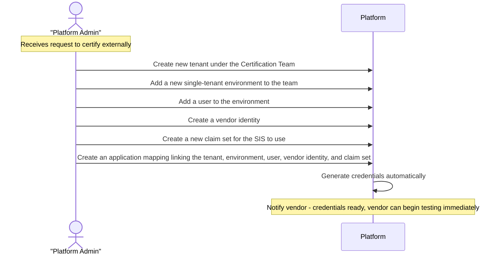
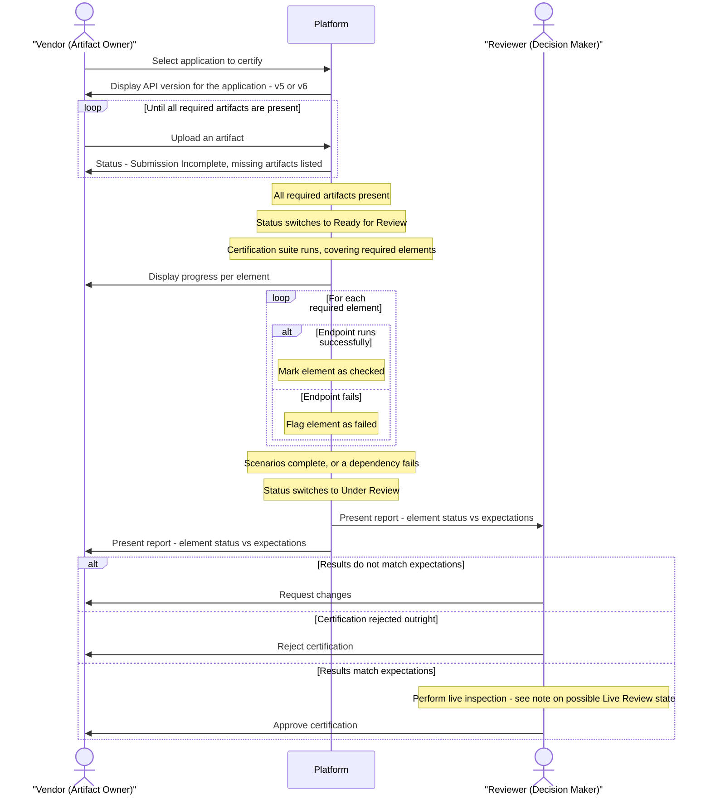
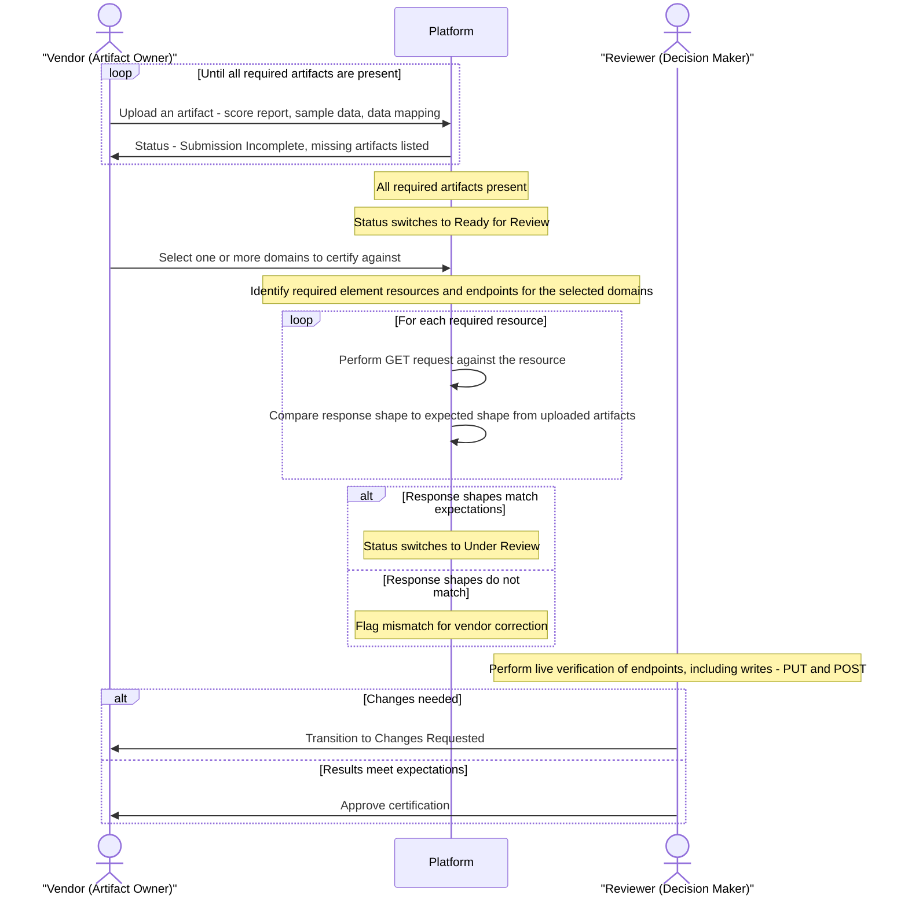
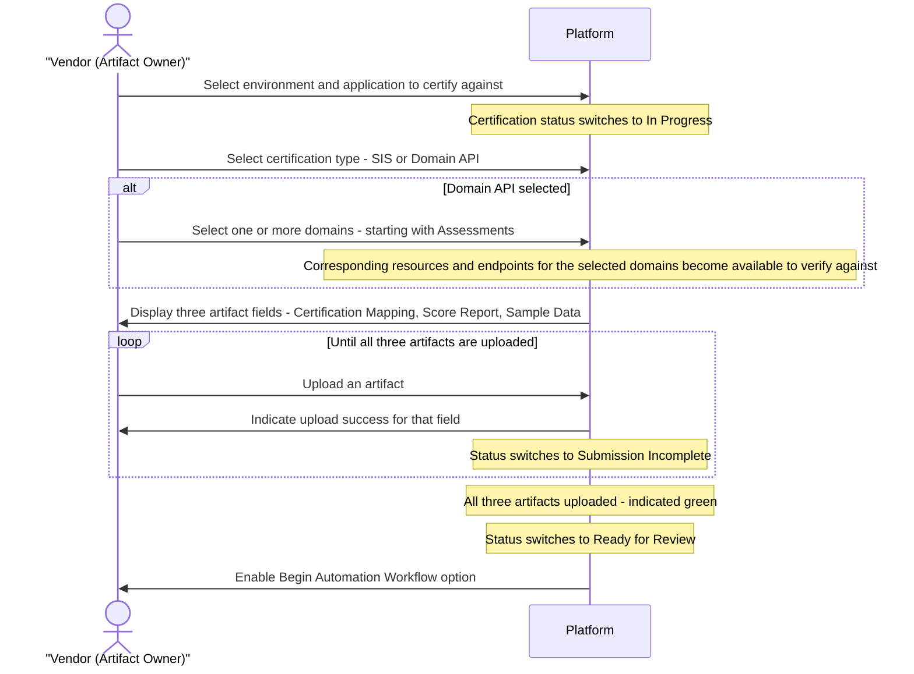
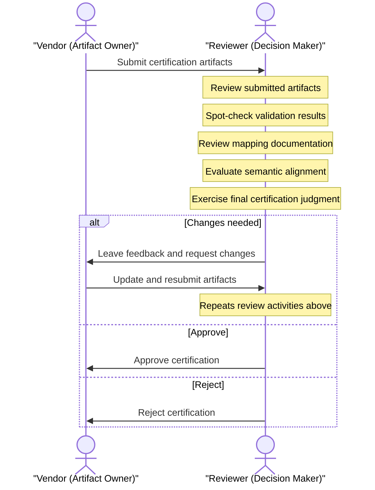
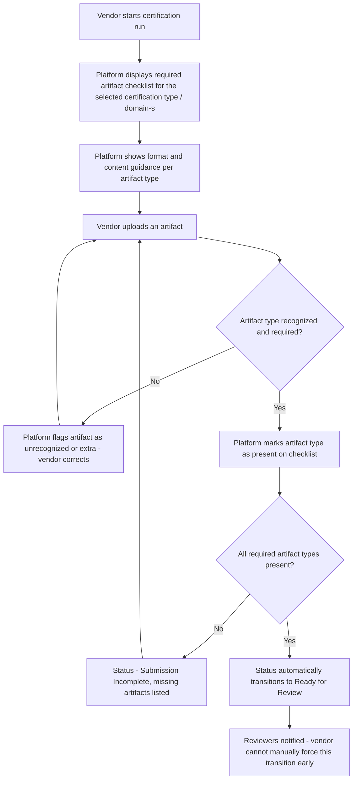
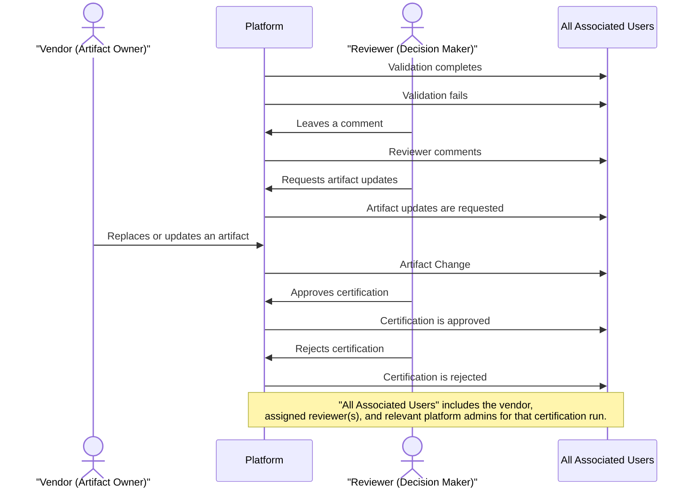

# Certification Automation Platform PRD

**Owner:** Robert H on behalf of Nathan G
**Status:** Draft — Revision 3 (restructured around first-round feedback)
**Last Updated:** August 10, 2026

> **Revision note:** Revision 2 incorporated feedback content additively, in place, inside the original PRD structure. Revision 3 restructures the document so the feedback's own logic drives the outline: Scope → **Confirmed Product Decisions** → **Certification Decision Ownership** → **Feature Requirements** (organized so each "Decision Requiring Documentation" is traceable to a specific feature) → **Workflow Assumptions** → **Nice to Have** → **Out of Scope**. No content from Revision 2 was dropped — supporting context (Personas, JTBD, NFRs, Architecture) is retained but now sits around this policy spine rather than alongside it as parallel structure.
>
> **Fidelity note:** Everything in §5 (Confirmed Product Decisions), §6 (Ownership Matrix), and the feedback-sourced bullet lists throughout §7/§10/§11/§12 is a direct transcription of the first-round feedback — treated as authoritative and not reworded for substance. A small number of places in §7.7, §7.8, and §12 extended the feedback's literal wording to make the PRD internally consistent (e.g., giving workflow states entry/exit criteria, since the feedback only named the labels). Those gaps were resolved on 2026-08-10 (workflow state diagram and gating logic, §7.7/§7.7.1; notification event consolidation, §7.8; renewal-workflow deferral, §12/§13) and are marked "confirmed 2026-08-10" inline, tracked in §15 (OQ8–OQ11) for traceability back to the original feedback.

---

# 1. Overview

The Ed-Fi Certification Automation Platform is a hosted platform designed to modernize and automate Ed-Fi certification workflows while replacing operational processes currently supported through the legacy Sandbox Admin experience.

The platform provides a unified experience for:

| Feature | Details |
| --- | --- |
| Vendor onboarding | |
| Certification environment provisioning | |
| Credential management | |
| SIS certification workflows | |
| Domain API certification workflows | |
| Validation and reporting | |
| Reviewer approval workflows | |

The platform builds upon the Admin App and Admin API foundation, extending administrative capabilities into certification lifecycle management.

**Governing principle:** The platform *implements* certification requirements; it does not *govern* them. See §5.1 for the confirmed decision behind this.

---

# 2. Purpose and Strategic Alignment

## Strategic Goals
| Objective | Description |
| --- | --- |
| Reduce certification onboarding time | |
| Reduce operational effort required by Ed-Fi staff | |
| Improve vendor certification experience | |
| Accelerate certification completion | |
| Improve consistency of certification validation | |
| Enable certification expansion into new domains and standards versions | |

## Administrative Tooling Alignment
| Tooling | Details |
| --- | --- |
| Admin App | |
| Admin API | |
| Credential Management | |
| Environment Provisioning | |
| Hosted Ed-Fi Infrastructure | |

Rather than operating as a standalone certification tool, certification becomes an extension of Ed-Fi administrative tooling.

## Market-Led Growth Alignment
| Benefit | Description |
| --- | --- |
| Reducing vendor integration costs | |
| Shortening implementation timelines | |
| Improving certification scalability | |
| Increasing partner satisfaction | |

---

# 3. Target Market

## Primary Audience

### Certified Vendors
Organizations seeking certification against Ed-Fi APIs.

### Vendor Engineering Teams
Engineers implementing and validating Ed-Fi integrations.

### Ed-Fi Certification Staff
| Responsibility | Details |
| --- | --- |
| Certification management | |
| Validation | |
| Review | |
| Approval | |

## Future Audiences
| Audience | Details |
| --- | --- |
| State Education Agencies (SEAs) | |
| Education Service Agencies (ESAs) | |
| Managed Service Providers (MSPs) | |
| Data Hub operators | |

---

# 4. Personas

## Vendor Certification Administrator
**Primary Motivations:** Register products; manage certification submissions; monitor certification progress.
**Success Looks Like:** Minimal waiting on Ed-Fi staff; clear certification status; self-service management.

## Vendor Integration Engineer
**Primary Motivations:** Validate Ed-Fi integrations; understand certification requirements; resolve certification issues quickly.
**Success Looks Like:** Immediate feedback; clear validation failures; guided certification workflow.

## Certification Reviewer
**Primary Motivations:** Validate submissions; ensure certification quality; reduce manual effort.
**Success Looks Like:** Standardized evidence; efficient review process; consistent certification decisions.

## Ed-Fi Platform Administrator
**Primary Motivations:** Provision environments; manage tenants; manage credentials; support certification infrastructure.
**Success Looks Like:** Automated provisioning; reduced operational overhead; repeatable deployment processes.

---

# 5. Confirmed Product Decisions

*(This section mirrors "Decisions Confirmed" from the first round of PRD feedback verbatim. It is the canonical policy layer — Sections 7 (Feature Requirements) and 10 (Workflow Assumptions) implement these decisions; they do not redefine them.)*

## 5.1 Certification Governance
- Published certification requirements are the authoritative source of truth.
- Certification requirements are owned by the Product Owner.
- The platform implements certification requirements but does not govern them.

*(Resolves PRD Open Question #3 — see §15.)*

## 5.2 Certification Model
- Certifications are granted to **products**, not vendors.
- A vendor may have multiple products.
- Only one active certification run may exist per product at a given time.
- SIS Certification and Domain Certification are distinct certification models.
- A SIS must complete SIS certification scenarios and does not qualify through domain certification.

## 5.3 Platform Responsibilities
The platform is responsible for:
- Environment provisioning
- Credential management
- Certification workflow execution
- Validation execution
- Artifact collection and storage
- Status tracking
- Reviewer workflow support
- Audit history

*(Implemented in §7, FT1–FT9.)*

## 5.4 Reviewer Responsibilities
The reviewer remains the certification decision-maker and is responsible for:
- Reviewing certification artifacts
- Spot-checking validation results
- Reviewing mapping documentation
- Evaluating semantic alignment
- Approving or rejecting certification submissions

*(Implemented in §7.6, FT6: Reviewer Workbench.)*

## 5.5 Artifact Ownership
- Certification artifacts are vendor-owned.
- Vendors create and upload mappings, reports, documentation, and sample data.
- The platform stores and presents artifacts.
- The platform does not generate certification artifacts.

*(See also §12 Out of Scope: Artifact Generation.)*

## 5.6 Domain Certification
- Vendors may certify one domain or multiple domains in a single submission.
- Validation results should show pass/fail status by domain, resource, and element.
- Certification remains at reviewer discretion based on submitted evidence.

*(Implemented in §7.3, FT3, and §7.5, FT5.)*

---

# 6. Certification Decision Ownership

*(This is the feedback's Ownership Matrix, transcribed as-given and positioned here — immediately after Confirmed Decisions §5.3–5.4 — because it is the single-glance summary of the platform/reviewer split that governs every feature below. This is the section to point to whenever scope discussions drift toward "should the platform decide this?")*

The platform is responsible for workflow orchestration, validation execution, evidence collection, and reporting. Reviewers remain responsible for certification judgment.

| Activity | Platform | Reviewer |
| --- | :---: | :---: |
| Provision environment | ✅ | |
| Manage credentials | ✅ | |
| Execute validation | ✅ | |
| Track certification workflow | ✅ | |
| Store artifacts | ✅ | |
| Report validation outcomes | ✅ | |
| Identify missing artifacts | ✅ | |
| Review artifacts | | ✅ |
| Spot-check validation results | | ✅ |
| Review mapping documentation | | ✅ |
| Evaluate semantic alignment | | ✅ |
| Determine if re-validation is needed | | ✅ |
| Approve/reject certification | | ✅ |

---

# 7. Feature Requirements (Must Have)

*(This section mirrors "Decisions Requiring Documentation" from feedback: each item in that list is called out below at the feature it belongs to, so the traceability from feedback → PRD is explicit rather than implied.)*

## 7.1 FT1: Automated Environment Provisioning

**Goal:** Automatically provision vendors, tenants, ODS instances, applications, and credentials.

**Conditions of Satisfaction:**
- Vendor can begin testing immediately
- Credentials are generated automatically
- Reviewer can assign environments

**Provisioning Flow:** Steps from external certification request through a testable vendor environment:

## 7.2 FT2: SIS Certification Workflow

**Goal:** Provide guided execution of SIS certification scenarios.

**Conditions of Satisfaction:**
- Workflow progression tracked
- Validation performed automatically
- Progress status visible
- A SIS must complete SIS certification scenarios; domain certification does not substitute (§5.2)

**SIS Certification Sequence:** Application selection through approval/rejection, spanning Vendor, Platform, and Reviewer:

**Note — possible "Live Review" state:** The description above calls for a reviewer "live inspection" step once automated results match expectations, before final approval. The diagram currently places this inside "Under Review" rather than as its own workflow state. Whether §7.7's state model needs a distinct **Live Review** state (between Under Review and Approved) — e.g., to give the reviewer a scheduling/tracking hook for a live session with the vendor, separate from asynchronous artifact review — is an open question; see §15 OQ12.

## 7.3 FT3: Domain API Certification Workflow

**Goal:** Enable certification against selected domains.

**Conditions of Satisfaction:**
- Required resources identified
- Required endpoints identified
- Certification requirements visible
- A single submission may cover one or multiple domains (§5.6)

**Open Questions:** Whether certification should be driven by domain resources, endpoint coverage, or sample data remains open (§15). §5.6 confirms the certification *decision* stays with the reviewer regardless of which technical signal drives validation — but not which signal(s) the validation engine should use.

**Domain API Certification Sequence:** Domain selection through automated GET-shape verification and live write verification:

The artifact upload loop is now explicit in the diagram, rather than assumed: a vendor must successfully add the required artifacts (score report, sample data, data mapping) and reach "Ready for Review" *before* domain selection begins — domain selection is not a substitute path around the artifact gate in §7.7.1. The GET-shape verification loop that follows domain selection is a distinct, later automated check against the resources/endpoints for the *selected domains*, not a re-check of artifact presence. The live PUT/POST verification step also raises the same question flagged in §15 OQ12 for §7.2: whether "live verification" of write endpoints should be its own workflow state distinct from "Under Review."

## 7.4 FT4: Certification Artifact Management

**Goal:** Provide management of product mappings, reports, sample data, and validation results, so reviewers can compare mappings, sample data, reports, and API responses using a common structure.

**Ownership and generation boundary** (§5.5): Certification artifacts are vendor-owned. The platform stores and presents but does not generate them.

**"Decision Requiring Documentation" — Artifact Updates During Review** (feedback verbatim):
- Vendors may replace artifacts during review.
- Reviewers are notified when artifacts change (§7.8, FT8: Notifications).
- Reviewers decide whether a change requires re-validation.
- Reviewers do not upload artifacts on behalf of vendors.

**Artifact Submission Sequence:** Environment/application selection through the Ready for Review gate:

This is the same three-artifact set (Certification Mapping, Score Report, Sample Data) referenced generically in §5.5/§7.7.1 — here shown as the specific fields the vendor sees on screen. The "Domain API selected" branch is the entry point into §7.3's domain-selection step; Assessments is called out as the first domain available, with other domains following the same resource/endpoint pattern.

## 7.5 FT5: Validation Engine

**Goal:** Validate endpoints, resources, data structures, required fields, and data types, such that results are actionable and understandable.

**"Decision Requiring Documentation" — Reporting granularity:** Per §5.6, Domain Certification validation results must show pass/fail status by **domain, resource, and element**, not only at the endpoint/resource level.

## 7.6 FT6: Reviewer Workbench

**Goal:** Support certification review workflows.

**"Decision Requiring Documentation" — Reviewer Approval Criteria** (implements §5.4 in full — feedback's "Reviewer Approval Criteria" list merged with the "Approving/rejecting" and "leave feedback" items from Reviewer Responsibilities; no wording changed): Reviewers can:
- Review submitted artifacts
- Spot-check validation results
- Review mapping documentation
- Evaluate semantic alignment
- Exercise final certification judgment
- Leave feedback
- Approve or reject certifications

**"Decision Requiring Documentation" — Reviewer Landing Page** (feedback verbatim): The reviewer homepage must prominently display, per certification run:
- Certification Type (SIS or Domain)
- Product Name
- Vendor Name
- Submission Date
- Validation Status
- Scenario Completion Status
- Artifact Checklist
- Missing Artifacts

**Review Activity Diagram:** Converts the Reviewer Approval Criteria above into discrete activities per actor, showing the loop back to the vendor when changes are requested rather than a straight-through approval path:

Every note in the Reviewer lane maps directly to a bullet in the Reviewer Approval Criteria list above, and the "Changes needed" branch is the only path that hands control back to the Vendor — consistent with §6's ownership split (reviewers judge, vendors act on that judgment).

## 7.7 FT7: Certification Status Tracking

**Goal:** Provide end-to-end certification visibility — current status, failed validations, pending actions, reviewer feedback.

**"Decision Requiring Documentation" — Workflow States** (state labels are feedback verbatim; entry/exit criteria below are **confirmed 2026-08-10** — the feedback named the states but did not define their gating logic, so this is where that logic was decided):

| State | Entry / Exit Criteria |
| --- | --- |
| In Progress | Vendor is actively working the certification scenarios/environment |
| Submission Incomplete | One or more required artifact types are missing |
| Ready for Review | All required artifact types are present (even if individually incomplete) — vendor cannot force this transition manually; see §7.7.1 |
| Under Review | Reviewer has begun evaluation |
| Changes Requested | Reviewer has requested artifact updates or clarification |
| Approved | Reviewer has approved the certification |
| Rejected | Reviewer has rejected the certification |

**Workflow State Diagram:**

```mermaid
stateDiagram-v2
    state "In Progress" as InProgress
    state "Submission Incomplete" as SubmissionIncomplete
    state "Ready for Review" as ReadyForReview
    state "Under Review" as UnderReview
    state "Changes Requested" as ChangesRequested
    state "Approved" as Approved
    state "Rejected" as Rejected

    [*] --> InProgress
    InProgress --> SubmissionIncomplete : vendor submits with required artifact type(s) missing
    InProgress --> ReadyForReview : all required artifact types present
    SubmissionIncomplete --> ReadyForReview : remaining required artifact type(s) added
    ReadyForReview --> UnderReview : reviewer begins evaluation
    UnderReview --> ChangesRequested : reviewer requests updates or clarification
    UnderReview --> Approved : reviewer approves
    UnderReview --> Rejected : reviewer rejects
    ChangesRequested --> UnderReview : vendor updates artifacts; reviewer resumes evaluation
    Approved --> [*]
    Rejected --> [*]
```

Note the diagram enforces that **both** paths into "Ready for Review" require all required artifact types to be present — there is no transition that lets a vendor enter review early.

## 7.7.1 Submission Readiness Flow (resolves OQ8)

A vendor cannot transition a product into "Ready for Review" until all required artifact types have been added. The path leading up to that gate is a guided flow that prepares the vendor to submit artifacts correctly, rather than a bare pass/fail check at the end:

## 7.8 FT8: Notifications

**Goal:** Notify all users associated with a certification run of status-relevant events.

**"Decision Requiring Documentation" — Notification Requirements** (**confirmed 2026-08-10**): Notify all associated users when:
- Validation completes
- Validation fails
- Reviewer comments
- Artifact updates are requested — reviewer requests changes/clarification from the vendor
- Certification is approved
- Certification is rejected
- **Artifact Change** — distinct from the above: fires when a vendor actually replaces/updates an artifact during review (§7.4/§10.2). "Artifact updates are requested" and "Artifact Change" are two separate events, not a single generalized one — the former is the reviewer asking, the latter is the vendor acting.

**Review-in-progress indicator:** While a submission is in the "Under Review" state, the platform should display a status indicator to the vendor (e.g., on their certification dashboard) showing review is underway. This does **not** need to be a separate notification event — it's a persistent status indicator, not a point-in-time alert.

**Notification Trigger Diagram:** The seven events above are independent triggers — from the Vendor, the Reviewer, or the platform's own validation execution — that all resolve through the platform to the same "notify associated users" action, rather than a fixed sequence of steps:

## 7.9 FT9: Audit History

**Goal:** Retain a complete, reviewable audit trail for every certification run.

**"Decision Requiring Documentation" — Audit History Requirements** (feedback verbatim, implements §5.3's "audit history" platform responsibility): Retain:
- Certification submission date
- Validation results
- Validation execution history
- Uploaded artifacts
- Artifact version history
- Reviewer comments
- Reviewer identity
- Reviewer decision date
- Approval/rejection history

---

# 8. Jobs To Be Done

*(Retained as supporting rationale for Section 7's features — each JTBD explains the "why" behind one or more FTs above.)*

## JTBD 1: Obtain Certification Environment → supports FT1
**When** a vendor begins certification, **I want** a certification environment provisioned automatically, **so that** I can immediately begin testing.
Signals: environment created automatically; credentials generated automatically; vendor access assigned automatically.
Notes: population state, ed-org/permissions needed, ODS/DMS version, single-tenant environment used.

## JTBD 2: Complete SIS Certification → supports FT2
**When** I am certifying my product, **I want** a guided certification workflow, **so that** I understand exactly what must be completed.
Signals: scenario status tracking; automated validation; certification progress visibility.

## JTBD 3: Complete Domain API Certification → supports FT3
**When** I select one or more domains to certify, **I want** the platform to identify required resources and endpoints, **so that** I understand my certification scope.
Signals: endpoint coverage identified; required resources identified; certification readiness visible.

## JTBD 4: Submit Certification Evidence → supports FT4, FT7
**When** I complete validation activities, **I want** to submit certification artifacts in a standardized format, **so that** reviewers can efficiently evaluate my certification.
Signals: consistent evidence structure; reduced back-and-forth; faster review cycles.
Artifacts to submit: mapping; sample data; score report (assessment) / sample report (domain). Vendors should be informed of the report so they can review/resubmit if necessary.

## JTBD 5: Review Certification Submission → supports FT6, FT9
**When** a vendor submits certification, **I want** a consistent set of artifacts and validation results, **so that** I can confidently approve or reject certification.
Signals: reduced manual investigation; standardized review process; faster certification decisions.

The expectation is to review a report similar to what the **Certification Agent** outputs (JTBD 4 could feed this system). *Confirmed terminology:* "Certification Agent" refers to a structured report-formatting/aggregation tool — not an AI recommendation or decision system. It compiles submitted evidence into a standard reviewer-facing report and does not evaluate, score, or recommend a certification outcome (kept consistent with §12 Out of Scope: AI-generated recommendations).

Vendors should also have visibility into what's been submitted and where they stand in the process, so they can be proactive and resubmit if necessary.

---

# 9. Scope

## SIS Certification
- **SIS v5:** Migration of SIS v4 certification scenarios to Data Standard v5.
- **SIS v6:** Next-generation SIS certification scenarios aligned with Data Standard v6.

## Domain API Certification
- **Domain API v5:** Certification of resources and endpoints within Data Standard v5 domains.
- **Domain API v6:** Certification of resources and endpoints within Data Standard v6 domains.

*(Certification model rules governing this scope — products vs. vendors, one active run per product, SIS/Domain non-substitutability — are defined once, in §5.2, rather than repeated here.)*

---

# 10. Workflow Assumptions

*(These mirror the feedback's "Workflow Assumptions" section verbatim. They are cross-cutting ground rules that recur across JTBD 4, JTBD 5, and FT4/FT7 above; they're stated once here rather than repeated at each occurrence.)*

## 10.1 Submission Model
- Vendors may submit incomplete certification packages.
- Missing artifacts should be clearly identified.
- Documentation must be present before review activities begin. **[Rev 3 interpretation — unconfirmed, see §15 OQ8]**: operationalized in §7.7 as "all required artifact types must be present, even if individually incomplete" before entering "Ready for Review" — but the feedback's Artifact Ownership section lists "documentation" as one specific artifact type among several (mappings, reports, sample data), so this gate may need to mean only the documentation artifact, not every artifact type collectively. Needs Nathan's confirmation.

## 10.2 Artifact Updates
- Vendors may replace artifacts during review.
- Reviewers are notified when artifacts change.
- Reviewers do not upload artifacts on behalf of vendors.

*(Full detail at §7.4, FT4.)*

## 10.3 Review Process
- Reviewers review artifacts.
- Reviewers spot-check validation results.
- Reviewers then approve or reject.

*(Full detail at §5.4 and §7.6, FT6.)*

---

# 11. Nice to Have

- **Mapping review automation** — would assist, not replace, reviewer judgment (per confirmed reviewer decision authority, §5.4/§6).
- **Semantic validation automation** — would assist, not replace, reviewer judgment. Relates to Open Question on semantic automation extent (§15).

---

# 12. Out of Scope

*(Feedback verbatim list; §15 OQ11 flags the one place Rev 3 added a characterization not stated by the feedback.)*

- **Artifact generation.** Vendors are solely responsible for creating certification artifacts. Neither the platform nor reviewers generate artifacts on a vendor's behalf (§5.5).
- **AI-generated recommendations.** The platform does not produce AI-generated certification recommendations. The "Certification Agent" in JTBD 5 is a non-AI report-formatting tool and is not affected by this boundary.
- **Certification confidence/risk scoring.** The platform does not produce a computed confidence or risk score for a submission.
- **Renewal workflows.** Out of scope for the current release, **deferred** (confirmed 2026-08-10) — not a permanent exclusion. Tracked separately under "Automated Re-Certification" in Future Enhancements (§13). Renewal is expected to closely resemble the original certification workflow, so the deferral is a sequencing decision rather than a signal that a materially different workflow needs to be designed later.
- **Certification governance/version management workflows.** Governance of certification requirements remains owned by the Product Owner outside the platform (§5.1); the platform implements but does not govern.

---

# 13. Future Enhancements

| Enhancement | Details |
| --- | --- |
| Certification Registry Integration | Automated publication of certification results. |
| Vendor Self-Service Registration | Allow vendors to create and manage certification accounts. |
| Automated Re-Certification | Support certification renewal workflows. Deferred, not excluded (§12) — expected to closely resemble the original certification workflow rather than requiring a distinct design. |
| Certification APIs | Provide Admin API endpoints for certification operations. |
| Deployable Certification Packages | Support deployment to Data Hubs, SEAs, ESAs, MSPs. |
| State-Specific Certification Programs | Enable state-level certification extensions. |

*(See also §11, Nice to Have, for mapping/semantic validation automation.)*

---

# 14. Non-Functional Requirements

## Security
| Requirement | Details |
| --- | --- |
| Secure credential generation | |
| Audit logging | See §7.9, FT9: Audit History, for the specific retained data set. |
| Role-based authorization | |
| Tenant isolation | |

## Scalability
| Requirement | Details |
| --- | --- |
| Support concurrent certification activities | |
| Support multiple active environments | |

## Extensibility
| Requirement | Details |
| --- | --- |
| Additional certification types | |
| Additional Data Standard versions | |
| Domain expansion | |

## Maintainability
| Requirement | Details |
| --- | --- |
| Scenario updates should not require code changes where possible | |
| Validation rules should be versioned | |

---

# 15. Open Questions

| ID | Question | Answers / Notes |
| --- | --- | --- |
| 1 | Should Domain API automation be driven by sample data? | Open. |
| 2 | Do Admin and Security databases require isolated environments? | Open. |
| 3 | What is the authoritative source of certification definitions? | **Resolved** — see §5.1. |
| 4 | Can certification definitions be generated from Data Standard metadata? | Open. |
| 5 | Should vendors self-register? | Open (see §13, Vendor Self-Service Registration). |
| 6 | How much semantic validation can be automated? | **Partially resolved** — baseline is manual reviewer evaluation (§5.4); automation is Nice to Have only (§11), assisting rather than replacing judgment. |
| 7 | What is the standard format for mappings, reports, and sample data? | Open. |
| 8 | Does "documentation must be present before review activities begin" (feedback, Submission Model) mean the specific "documentation" artifact type, or all required artifact types collectively? | **Resolved 2026-08-10** — means all required artifact types collectively; a vendor cannot enter "Ready for Review" until every required artifact type is present. See §7.7.1 flowchart. |
| 9 | What should the entry/exit criteria be for each workflow state (In Progress, Submission Incomplete, Ready for Review, Under Review, Changes Requested, Approved, Rejected)? | **Resolved 2026-08-10** — see state diagram in §7.7. |
| 10 | Should "artifact replaced/updated by vendor during review" be added as an explicit 7th event in the Notification Requirements list (§7.8), or is it already covered by the general Artifact Updates notification rule? | **Resolved 2026-08-10** — added as a distinct "Artifact Change" event, separate from "Artifact updates are requested" (§7.8): the requested-update event fires when the reviewer asks for changes; the Artifact Change event fires when the vendor actually makes a change. A persistent "review in progress" status indicator is also required but does not need its own notification event. |
| 11 | Is "Renewal workflows" out of scope permanently, or deferred to a future release (tracked as "Automated Re-Certification," §13)? | **Resolved 2026-08-10** — deferred, not excluded (§12/§13); expected to closely resemble the original certification workflow. |
| 12 | Should the workflow state model (§7.7) have a distinct "Live Review" state for the reviewer's live inspection/verification step (§7.2's live inspection, §7.3's live PUT/POST verification), separate from the general "Under Review" state? | Open — raised 2026-08-10 while diagramming §7.2's SIS certification sequence; recurs in §7.3's domain certification sequence. |

**Still open beyond this table:**
- FT3's sub-question on whether resources, endpoints, or sample data (or a combination) should drive Domain API certification requirements.
- Whether Vendor Self-Service Registration intersects with the vendor/product/certification-run model in §5.2.

---

# 16. Enterprise Architecture

## Core Components
- **Admin App** — administrative interface and provisioning workflows.
- **Admin API** — automation and platform integration.
- **Certification Platform** — coordinates certification workflows.
- **Validation Engine** — executes automated validations.
- **Artifact Store** — stores mappings, reports, sample data, validation results.
- **Hosted Certification Infrastructure** — certification-specific environments.

---

# 17. Success Metrics

## Operational Metrics
Reduction in certification provisioning time; reduction in reviewer effort; reduction in certification support requests.

## Vendor Metrics
Faster certification completion; improved vendor satisfaction; reduced certification remediation cycles.

## Platform Metrics
Increased certification throughput; reduced dependency on Sandbox Admin; increased automation coverage.

---

# Appendix A: Potential Architecture Decisions

1. Certification Artifact Model — must account for artifacts belonging to products (not vendors directly), with a vendor able to own multiple products, and only one active certification run per product (§5.2).
2. Scenario Definition Framework
3. Domain Metadata Management
4. Certification Registry Integration
5. Shared vs Isolated Environment Model
6. Admin App / Admin API Integration Boundaries

---

# Appendix B: Glossary

| Term | Description |
| --- | --- |
| Certification Run | A single certification attempt for a **product** (not a vendor). Only one active run per product at a given time (§5.2). |
| Certification Artifact | Mapping, report, sample data, or validation result submitted during certification. Vendor-owned (§5.5). |
| Domain Certification | Certification against one or more Ed-Fi domains; may cover a single domain or multiple domains in one submission. |
| SIS Certification | Certification against SIS workflows and scenarios. Distinct from Domain Certification — not substitutable (§5.2). |
| Validation Engine | Component responsible for executing automated certification checks. |
| Certification Agent | Structured report-formatting/aggregation tool referenced in JTBD 5. Not an AI recommendation or decision system. |
| MTSS / Interventions | |
