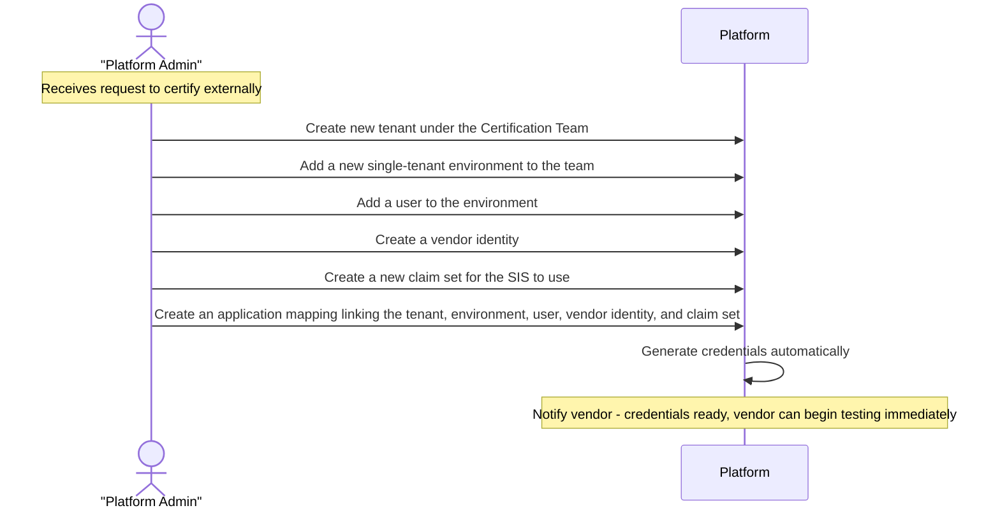
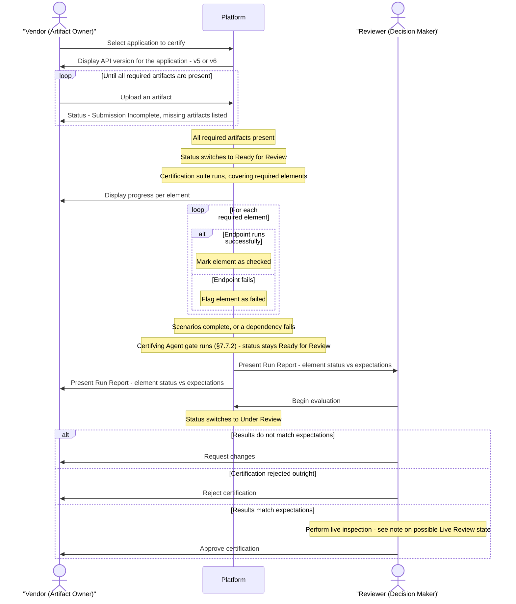
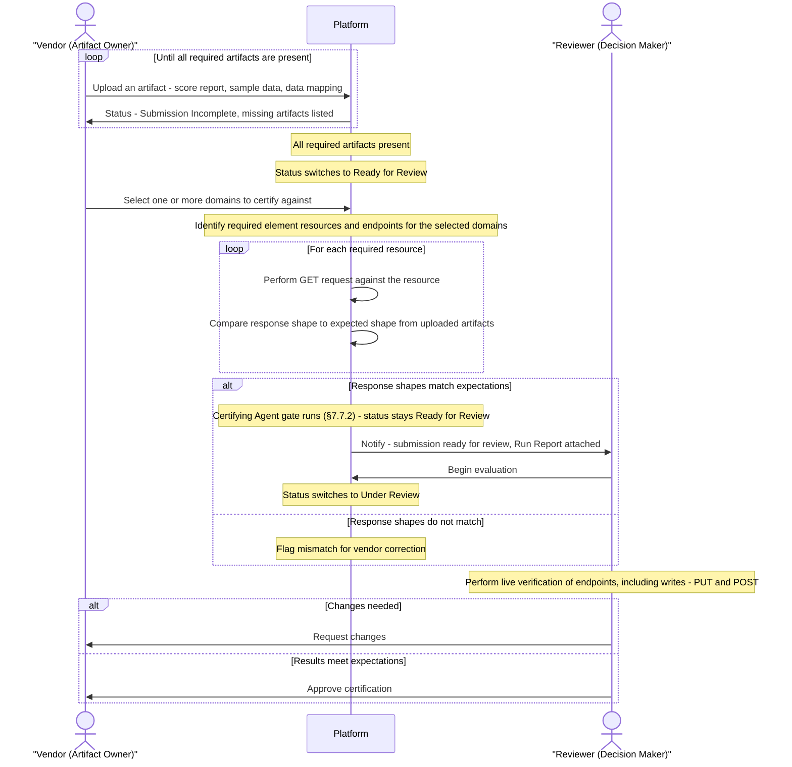
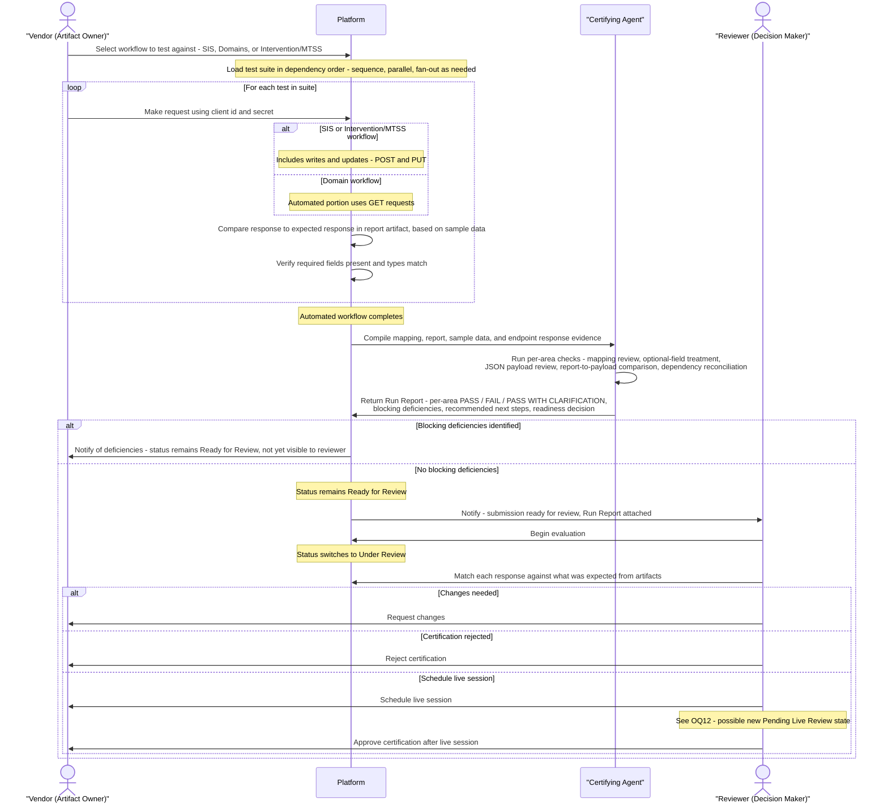
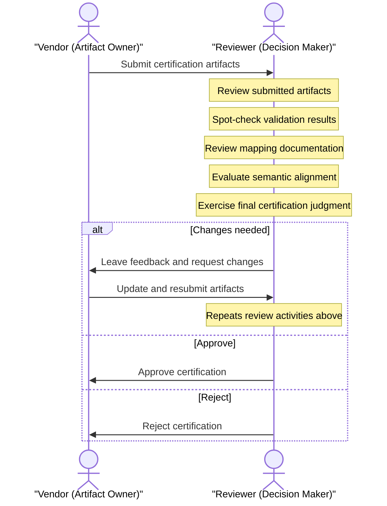
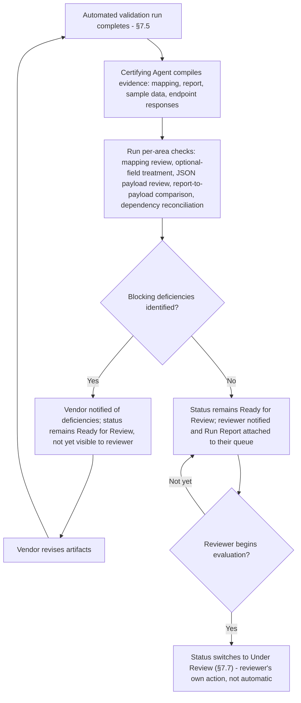
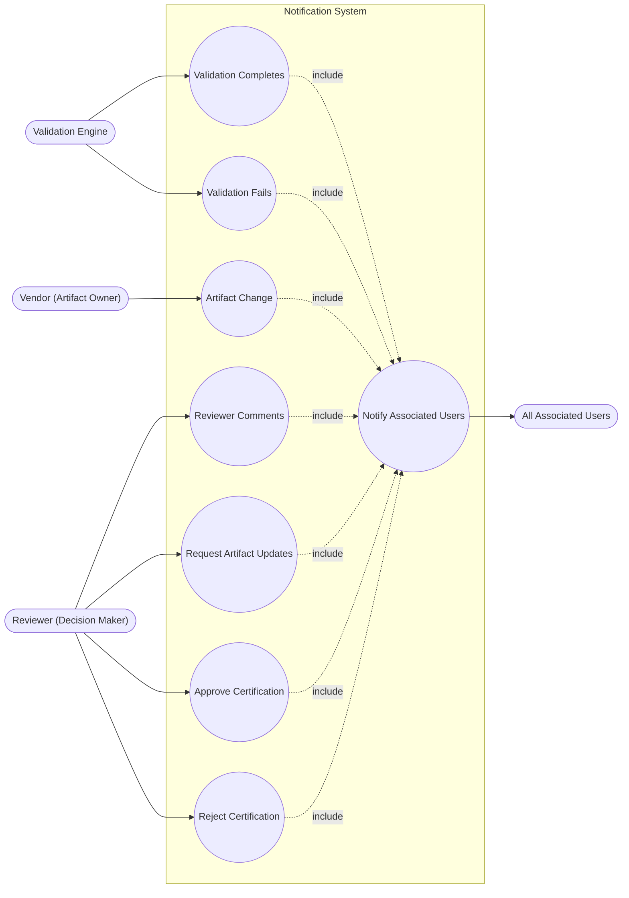
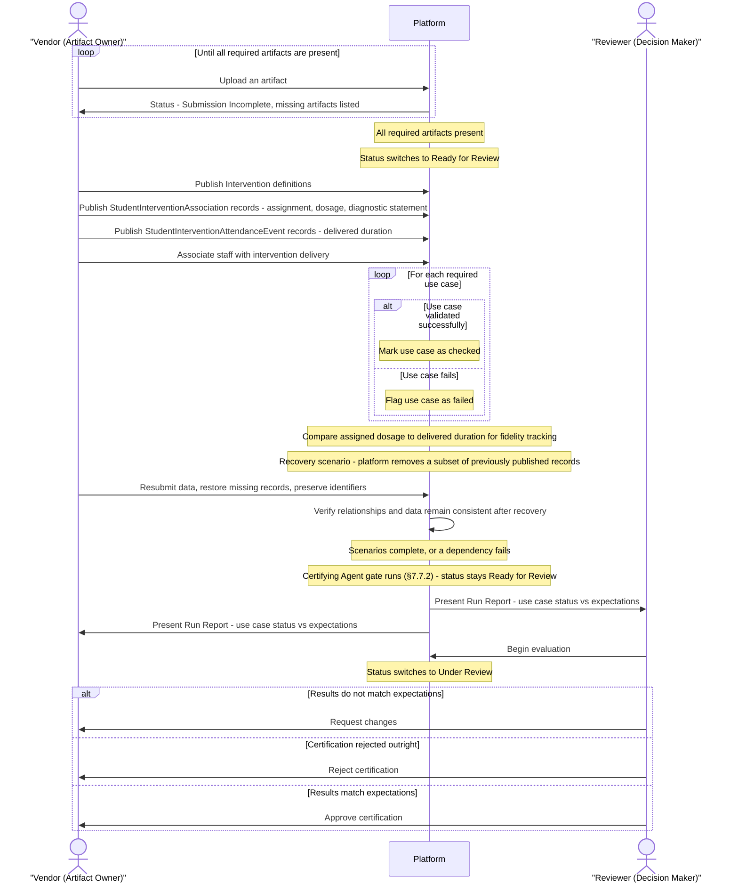
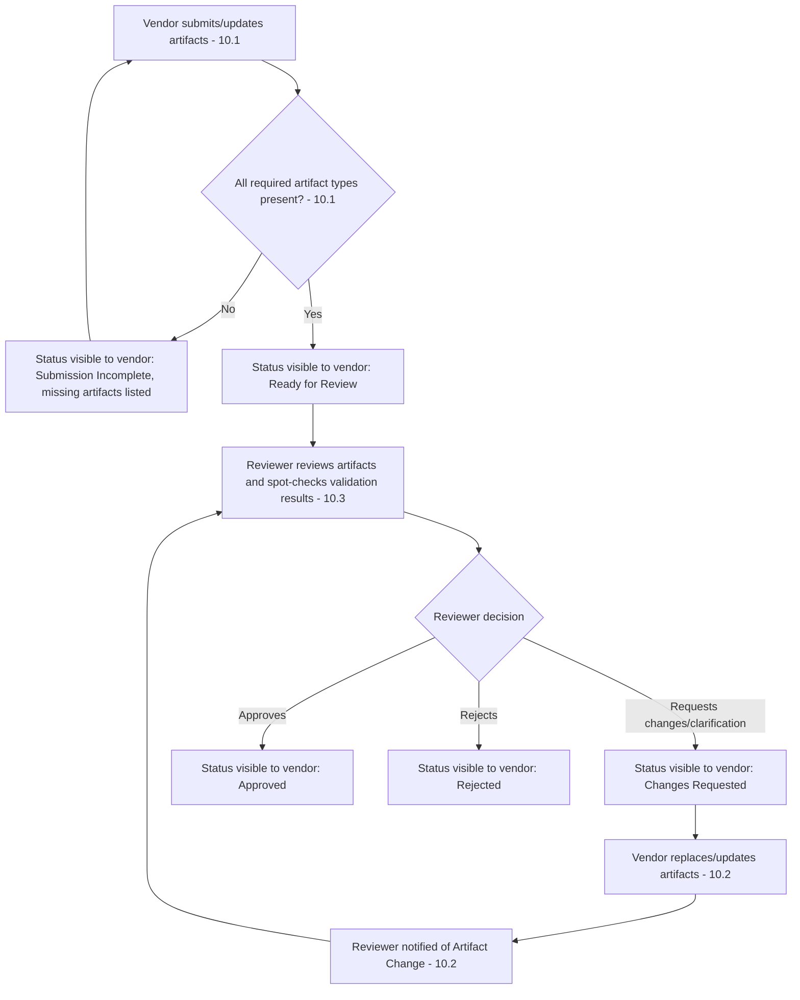

# Certification Automation Platform PRD

**Owner:** Robert H on behalf of Nathan G
**Status:** Draft — Revision 4
**Last Updated:** August 13, 2026

> **Revision note:** Revision 2 incorporated feedback content additively, in place, inside the original PRD structure. Revision 3 restructures the document so the feedback's own logic drives the outline: Scope → **Confirmed Product Decisions** → **Certification Decision Ownership** → **Feature Requirements** (organized so each "Decision Requiring Documentation" is traceable to a specific feature) → **Workflow Assumptions** → **Nice to Have** → **Out of Scope**. No content from Revision 2 was dropped — supporting context (Personas, JTBD, NFRs, Architecture) is retained but now sits around this policy spine rather than alongside it as parallel structure. Revision 4 (2026-08-13) adds three things without changing that spine: **Intervention/MTSS Certification** as a third certification model (§5.2, §7.10, §9); the **Certifying Agent** pre-review determination gate and Run Report structure, derived from a real agent output (§7.5, §7.7.2, §15 OQ13); and a terminology/consistency pass reconciling "Certification Agent" → "Certifying Agent," "deny" → "reject," and the Ready for Review → Under Review transition across all sequence diagrams. Revision 5 (2026-11-17) makes Assessments mapping **validated, not edited**: the vendor's filled Data Mapping Template workbook and per-assessment sample data are the source of truth, and the platform produces a **mapping validation report** (readiness checklist with fix locations, then the endpoints and expected responses) that gates the Assessments run (§5.7, §7.3, §7.4, §7.5, §7.6, §7.9, §15 OQ14). Decisions D32–D36 are proposed, not yet confirmed by the certification workgroup. Drafted with AI assistance; review before relying on it. Design: `docs/design/2026-11-17-mapping-validation-report-design.md`.
>
> **Fidelity note:** Everything in §5 (Confirmed Product Decisions), §6 (Ownership Matrix), and the feedback-sourced bullet lists throughout §7/§10/§11/§12 is a direct transcription of the first-round feedback — treated as authoritative and not reworded for substance. A small number of places in §7.7, §7.8, and §12 extended the feedback's literal wording to make the PRD internally consistent (e.g., giving workflow states entry/exit criteria, since the feedback only named the labels). Those gaps were resolved on 2026-08-10 (workflow state diagram and gating logic, §7.7/§7.7.1; notification event consolidation, §7.8; renewal-workflow deferral, §12/§13) and are marked "confirmed 2026-08-10" inline, tracked in §15 (OQ8–OQ11) for traceability back to the original feedback.

---

# 1. Overview

The Ed-Fi Certification Automation Platform is a hosted platform designed to modernize and automate Ed-Fi certification workflows while replacing operational processes currently supported through the legacy Sandbox Admin experience.

The platform provides a unified experience for:

| Feature | Details |
| --- | --- |
| Vendor onboarding | Automated tenant, environment, and vendor identity setup so a vendor can begin testing immediately upon a certification request (§7.1). |
| Certification environment provisioning | Automatic provisioning of tenants, single-tenant environments, and ODS instances per certification run (§7.1). |
| Credential management | Automatic generation of application credentials as part of provisioning; credential lifecycle managed by the platform (§5.3, §7.1). |
| SIS certification workflows | Guided execution of SIS certification scenarios with tracked progress and automated validation; SIS scenarios cannot be substituted by domain certification (§5.2, §7.2). |
| Domain API certification workflows | Certification against one or more selected Ed-Fi domains, with required resources/endpoints identified and validated per domain (§5.6, §7.3). |
| Intervention/MTSS certification workflows | Baseline interoperability certification against the Ed-Fi Intervention Domain — intervention definitions, student assignments, participation/dosage data, and a recovery scenario (§5.2, §7.10). Provisional; see §7.10. |
| Validation and reporting | Automated validation of endpoints, resources, and data structures, with pass/fail reporting by domain, resource, and element, plus a reviewer-facing Run Report (§7.5). |
| Reviewer approval workflows | Reviewer workbench for artifact review, spot-checking, and final certification judgment, with approve/reject/request-changes dispositions (§5.4, §7.6). |

The platform builds upon the Admin App and Admin API foundation, extending administrative capabilities into certification lifecycle management.

**Governing principle:** The platform *implements* certification requirements; it does not *govern* them. See §5.1 for the confirmed decision behind this.

---

# 2. Purpose and Strategic Alignment

## Strategic Goals
| Objective | Description |
| --- | --- |
| Reduce certification onboarding time | Automated provisioning (§7.1) eliminates manual tenant/environment setup, letting vendors begin testing immediately. |
| Reduce operational effort required by Ed-Fi staff | Automated provisioning, validation execution, and artifact management (§5.3) remove manual administrative work from certification staff. |
| Improve vendor certification experience | Guided workflows (§7.2, §7.3), visible progress/status (§7.7, §10.4), and proactive notifications (§7.8) replace opaque, staff-mediated processes. |
| Accelerate certification completion | Automated validation (§7.5) and a guided artifact submission gate (§7.7.1) reduce back-and-forth cycles between vendor and reviewer. |
| Improve consistency of certification validation | A standardized validation engine (§7.5) and reporting by domain/resource/element (§5.6) replace ad hoc manual checks. |
| Enable certification expansion into new domains and standards versions | Extensible validation and scenario framework designed to support additional domains and Data Standard versions (§14 Extensibility; §9 Scope). |

## Administrative Tooling Alignment
| Tooling | Details |
| --- | --- |
| Admin App | Certification workflows surface within the Admin App as an extension of existing administrative UI, not a separate tool. |
| Admin API | Certification operations (provisioning, credentials) build on Admin API automation; dedicated Certification APIs are a future enhancement (§13). |
| Credential Management | Certification reuses the platform's existing credential generation and management capabilities (§5.3, §7.1). |
| Environment Provisioning | Certification environments are provisioned through the same tenant/environment model used for other hosted Ed-Fi environments (§7.1). |
| Hosted Ed-Fi Infrastructure | Certification runs on the same hosted infrastructure supporting other Ed-Fi tenants, rather than separate certification-specific infrastructure. |

Rather than operating as a standalone certification tool, certification becomes an extension of Ed-Fi administrative tooling.

## Market-Led Growth Alignment
| Benefit | Description |
| --- | --- |
| Reducing vendor integration costs | Automated provisioning and guided workflows reduce vendor effort and elapsed time to certify (§7.1, §7.2). |
| Shortening implementation timelines | Faster onboarding and clearer validation feedback shorten the vendor's path to certification (§7.1, §7.5). |
| Improving certification scalability | Automation reduces staff effort per certification run, enabling more concurrent certifications (§14 Scalability). |
| Increasing partner satisfaction | Vendor visibility into status and proactive notifications (§10.4, §7.8) reduce uncertainty and support burden. |

---

# 3. Target Market

## Primary Audience

### Certifying Vendors
Organizations seeking certification against Ed-Fi APIs. ("Certified" describes the post-approval state; this audience is the set of vendors pursuing it.)

### Vendor Engineering Teams
Engineers implementing and validating Ed-Fi integrations.

### Ed-Fi Certification Staff
| Responsibility | Details |
| --- | --- |
| Certification management | Oversee certification runs end-to-end — provisioning, status tracking, and coordinating with vendors (§5.3, §7.7). |
| Validation | Configure and interpret automated validation results produced by the Validation Engine (§7.5). |
| Review | Reviewer role — evaluate submitted artifacts, spot-check validation results, review mapping documentation (§5.4, §7.6). |
| Approval | Exercise final certification judgment — approve, reject, or request changes (§5.4, §7.6). |

## Future Audiences
| Audience | Details |
| --- | --- |
| State Education Agencies (SEAs) | Potential future consumers of certified products for state-level deployment, not part of current certification scope (§13 Deployable Certification Packages). |
| Education Service Agencies (ESAs) | Regional service agencies that may deploy certified products on behalf of member districts (§13). |
| Managed Service Providers (MSPs) | Third parties managing Ed-Fi deployments on behalf of districts/states — a future certification/deployment audience (§13). |
| Data Hub operators | Operators of Data Hub infrastructure who may consume certification results for deployment decisions, and may also run their own self-hosted certification instance to support internal application development (§13). |

---

# 4. Personas

## Vendor Certification Administrator
**Primary Motivations:** Register products; manage certification submissions; monitor certification progress.
**Success Looks Like:** Minimal waiting on Ed-Fi staff; clear certification status; self-service management.

## Vendor Integration Engineer
**Primary Motivations:** Validate Ed-Fi integrations; understand certification requirements; resolve certification issues quickly.
**Success Looks Like:** Immediate feedback; clear validation failures; guided certification workflow.

## Certification Reviewer
**Primary Motivations:** Validate submissions; ensure certification quality; reduce manual effort.
**Success Looks Like:** Standardized evidence; efficient review process; consistent certification decisions.

## Ed-Fi Platform Administrator
**Primary Motivations:** Provision environments; manage tenants; manage credentials; support certification infrastructure.
**Success Looks Like:** Automated provisioning; reduced operational overhead; repeatable deployment processes.

---

# 5. Confirmed Product Decisions

*(This section mirrors "Decisions Confirmed" from the first round of PRD feedback verbatim. It is the canonical policy layer — Sections 7 (Feature Requirements) and 10 (Workflow Assumptions) implement these decisions; they do not redefine them.)*

## 5.1 Certification Governance
- Published certification requirements are the authoritative source of truth.
- Certification requirements are owned by the Product Owner.
- The platform implements certification requirements but does not govern them.

*(Resolves PRD Open Question #3 — see §15.)*

## 5.2 Certification Model
- Certifications are granted to **products**, not vendors.
- A vendor may have multiple products.
- Only one active certification run may exist per product at a given time.
- SIS Certification and Domain Certification are distinct certification models.
- A SIS must complete SIS certification scenarios and does not qualify through domain certification.
- Intervention/MTSS Certification is a third, distinct certification model, scoped to the existing Ed-Fi Intervention Domain (§7.10). **Added 2026-08-13**, sourced from the [Intervention/MTSS Certification Draft Use Cases and Resource Elements](https://edfi.atlassian.net/wiki/spaces/EDFICERT/pages/2413428742) page — that page is itself marked "Draft for Feedback," so this model is provisional pending finalization there.

## 5.3 Platform Responsibilities
The platform is responsible for:
- Environment provisioning
- Credential management
- Certification workflow execution
- Validation execution
- Artifact collection and storage
- Status tracking
- Reviewer workflow support
- Audit history

*(Implemented in §7, FT1–FT10.)*

## 5.4 Reviewer Responsibilities
The reviewer remains the certification decision-maker and is responsible for:
- Reviewing certification artifacts
- Spot-checking validation results
- Reviewing mapping documentation
- Evaluating semantic alignment
- Approving or rejecting certification submissions

*(Implemented in §7.6, FT6: Reviewer Workbench.)*

## 5.5 Artifact Ownership
- Certification artifacts are vendor-owned.
- Vendors create and upload mappings, reports, documentation, and sample data.
- The platform stores and presents artifacts.
- The platform does not generate certification artifacts.

*(See also §12 Out of Scope: Artifact Generation.)*

## 5.6 Domain Certification
- Vendors may certify one domain or multiple domains in a single submission.
- Validation results should show pass/fail status by domain, resource, and element.
- Certification remains at reviewer discretion based on submitted evidence.

*(Implemented in §7.3, FT3, and §7.5, FT5.)*

## 5.7 Assessments Mapping Validation Decisions (proposed 2026-11-17)
- **D32 (proposed):** For Assessments, the vendor's filled **Data Mapping Template workbook** and **sample data** are the source of truth. The platform **validates** them and never edits them; every correction is made by the vendor in their own files and re-uploaded.
- **D33 (proposed):** An Assessments run starts only from a mapping validation report with **no errors** (*Ready to run*). Warnings never block.
- **D34 (proposed):** Sample values must equal the template's **Code Values** (vendor enumerations) or **standard Ed-Fi codes**, after trimming and ignoring case; Boolean results are `true`/`false` and dates ISO 8601, because the sample is the values *as posted*. There is no translation layer.
- **D35 (proposed):** Identity values the template has no place for come from **pre-arranged sample columns** published by the platform (*Required sample columns*): `Student ID` → `studentReference.studentUniqueId`, `Activity Id` → `studentAssessmentIdentifier`, and the slot the file was uploaded to → `assessmentReference`.
- **D36 (proposed):** Objective codes are **derived** from element names (the name less the score suffix shared with the assessment-level element of the same reporting method) and matched to live `objectiveAssessments` on a **normalized key** (case, whitespace and punctuation ignored).

**Considered and set aside (2026-11-17):** an in-platform mapping editor with a descriptor bank, translation tables and sample-column bindings (prototyped 2026-11-16/17, archived on branch `archive/mapping-tool-v1`) — set aside because it moved authoring of a vendor-owned artifact into the platform (§5.5) and asked vendors to learn a second tool alongside the template they already use. Also considered: requiring identity fields as workbook elements (cleaner, but changes the template), and real `.xlsx` parsing in the browser (deferred; the validator is independent of where the files are parsed).

*(Implemented in §7.3, §7.4, §7.5, §7.6. Proposed, not yet confirmed by the certification workgroup.)*

---

# 6. Certification Decision Ownership

*(This is the feedback's Ownership Matrix, transcribed as-given and positioned here — immediately after Confirmed Decisions §5.3–5.4 — because it is the single-glance summary of the platform/reviewer split that governs every feature below. This is the section to point to whenever scope discussions drift toward "should the platform decide this?")*

The platform is responsible for workflow orchestration, validation execution, evidence collection, and reporting. Reviewers remain responsible for certification judgment.

| Activity | Platform | Reviewer |
| --- | :---: | :---: |
| Provision environment | ✅ | |
| Manage credentials | ✅ | |
| Execute validation | ✅ | |
| Track certification workflow | ✅ | |
| Store artifacts | ✅ | |
| Report validation outcomes | ✅ | |
| Identify missing artifacts | ✅ | |
| Generate automated readiness determination (Certifying Agent, §7.5, §7.7.2) | ✅ | |
| Review artifacts | | ✅ |
| Spot-check validation results | | ✅ |
| Review mapping documentation | | ✅ |
| Evaluate semantic alignment | | ✅ |
| Determine if re-validation is needed | | ✅ |
| Approve/reject certification | | ✅ |

---

# 7. Feature Requirements (Must Have)

*(This section mirrors "Decisions Requiring Documentation" from feedback: each item in that list is called out below at the feature it belongs to, so the traceability from feedback → PRD is explicit rather than implied.)*

## 7.1 FT1: Automated Environment Provisioning

**Goal:** Automatically provision vendors, tenants, ODS instances, applications, and credentials.

**Conditions of Satisfaction:**
- Vendor can begin testing immediately
- Credentials are generated automatically
- Reviewer can assign environments

**Provisioning Flow:** Steps from external certification request through a testable vendor environment:

The steps shown in the Platform Admin lane are the *current* manual sequence, captured here as the baseline this feature automates. The target state is that a certification request triggers these steps as a single platform-executed operation, with the Platform Admin approving or overriding rather than performing each step by hand — that is what "automatically provision" in the Goal above means.

## 7.2 FT2: SIS Certification Workflow

**Goal:** Provide guided execution of SIS certification scenarios.

**Conditions of Satisfaction:**
- Workflow progression tracked
- Validation performed automatically
- Progress status visible
- A SIS must complete SIS certification scenarios; domain certification does not substitute (§5.2)

**SIS Certification Sequence:** Application selection through approval/rejection, spanning Vendor, Platform, and Reviewer:

**Note — possible "Live Review" state:** The description above calls for a reviewer "live inspection" step once automated results match expectations, before final approval. The diagram currently places this inside "Under Review" rather than as its own workflow state. Whether §7.7's state model needs a distinct **Live Review** state (between Under Review and Approved) — e.g., to give the reviewer a scheduling/tracking hook for a live session with the vendor, separate from asynchronous artifact review — is an open question; see §15 OQ12.

## 7.3 FT3: Domain API Certification Workflow

**Goal:** Enable certification against selected domains.

**Conditions of Satisfaction:**
- Required resources identified
- Required endpoints identified
- Certification requirements visible
- A single submission may cover one or multiple domains (§5.6)

**Open Questions:** Whether certification should be driven by domain resources, endpoint coverage, or sample data remains open (§15). §5.6 confirms the certification *decision* stays with the reviewer regardless of which technical signal drives validation — but not which signal(s) the validation engine should use.

**Domain API Certification Sequence:** Domain selection through automated GET-shape verification and live write verification:

The artifact upload loop is now explicit in the diagram, rather than assumed: a vendor must successfully add the required artifacts (score report, sample data, data mapping) and reach "Ready for Review" *before* domain selection begins — domain selection is not a substitute path around the artifact gate in §7.7.1. The GET-shape verification loop that follows domain selection is a distinct, later automated check against the resources/endpoints for the *selected domains*, not a re-check of artifact presence. The live PUT/POST verification step also raises the same question flagged in §15 OQ12 for §7.2: whether "live verification" of write endpoints should be its own workflow state distinct from "Under Review."

**Assessments (added 2026-11-17, D32–D36):** the required resources and endpoints are **derived from the mapping**, not selected: `assessments`, `objectiveAssessments` (when the mapping has objective scores), `studentAssessments`, and one descriptor endpoint per descriptor type the expected responses use. The run GETs these and compares each response with the **expected responses** in the mapping validation report (§7.4), over a coverage-based subset of sample rows (the fewest rows that show every distinct descriptor or Boolean value and every objective with a score). Design: `docs/design/2026-11-17-mapping-validation-report-design.md`.

## 7.4 FT4: Certification Artifact Management

**Goal:** Provide management of product mappings, reports, sample data, and validation results, so reviewers can compare mappings, sample data, reports, and API responses using a common structure.

**Ownership and generation boundary** (§5.5): Certification artifacts are vendor-owned. The platform stores and presents but does not generate them.

**"Decision Requiring Documentation" — Artifact Updates During Review** (feedback verbatim):
- Vendors may replace artifacts during review.
- Reviewers are notified when artifacts change (§7.8, FT8: Notifications).
- Reviewers decide whether a change requires re-validation.
- Reviewers do not upload artifacts on behalf of vendors.

**Artifact Submission Sequence:** Environment/application selection through the Ready for Review gate:

This is the same three-artifact set (Certification Mapping, Score Report, Sample Data) referenced generically in §5.5/§7.7.1 — here shown as the specific fields the vendor sees on screen. The "Domain API selected" branch is the entry point into §7.3's domain-selection step; Assessments is called out as the first domain available, with other domains following the same resource/endpoint pattern.

**Assessments mapping validation report (added 2026-11-17, D32–D36).** For an Assessments submission the artifacts are a **Mapping workbook** (the vendor's filled Data Mapping Template), **one Sample data slot per assessment the workbook names**, each versioned on its own, and product documentation. A workbook missing a required tab or header is **rejected on upload** and not stored. Every accepted upload rebuilds the report:

- **Verdict first:** *Ready to run* or *Not ready to run: N errors* (with "Fix these in the workbook or sample, then re-upload.").
- **Readiness checklist** with one row per category — Assessments, Element ↔ column links, Ed-Fi targets, Values, Pre-arranged columns, Objectives — each with a status and counts. Expanding a row lists its findings **grouped by where to fix them** (*Workbook › ElementDefinitions row 7*, *Workbook › EnumerationItems (Accommodation)*, *Sample › column `Grade`*), with a suggestion where one can be computed (*Did you mean `Overall Placement`?*, *Closest: `Third grade`*). Value findings are reported once per distinct value with a row count.
- **Rules:** elements link to sample columns by exact name (trimmed, ignoring case); Ed-Fi targets must be known v5 paths; score rows need a reporting method and result datatype that resolve; a descriptor element's allowed values come from the vendor enumeration named after its descriptor type, or else the standard Ed-Fi list; an unmatched Assessment Type is one error per name, and its rows are still checked against the suggested assessment so one misnaming doesn't hide everything else.
- **Endpoints and expected responses**, available once ready: one line per endpoint with record, field and descriptor-type counts; each expands to a record picker and the expected JSON, with pre-arranged fields tagged; *Show sample row* puts the raw sample row beside the expected response.
- Informational: *Sample columns not checked* (vendors export more than they post) and *Derived objective codes*.

**Required sample columns** (D35):

| Pre-arranged column | Ed-Fi field | Note |
| --- | --- | --- |
| `Student ID` | `studentAssessment.studentReference.studentUniqueId` | If the header appears twice, the first is used (warning). |
| `Activity Id` | `studentAssessment.studentAssessmentIdentifier` | One per administration. |
| *(the slot the file was uploaded to)* | `studentAssessment.assessmentReference` | Identifier from the Assessments tab, namespace from Product. |

## 7.5 FT5: Validation Engine

**Goal:** Validate endpoints, resources, data structures, required fields, and data types, such that results are actionable and understandable.

**"Decision Requiring Documentation" — Reporting granularity:** Per §5.6, Domain Certification validation results must show pass/fail status by **domain, resource, and element**, not only at the endpoint/resource level.

**Validation Sequence:** Test suite loading through the automated readiness gate to the reviewer's own decision to begin evaluation, and their disposition of the run:

**Run Report structure** (revised 2026-08-13, based on a real Certifying Agent output — see §15 OQ13 for provenance): the Run Report is a platform-generated, per-area determination compiled by the **Certifying Agent** (renamed from "Certification Agent," §8/JTBD5 — same capability, name and description reconciled to match actual behavior). It is not simply a request/response log; it contains:
- **Scope statement** — explicitly limited to the submitted evidence package; does not evaluate runtime behavior, source code, UI workflows, or connectivity configuration.
- **Per-area results** — e.g., Mapping Review, Optional Field Treatment, JSON Payload Review, Report-to-Payload Comparison, dependency reconciliation (e.g., a referenced resource like `Program` exists and resolves correctly) — each scored PASS / FAIL / PASS WITH CLARIFICATION, at the domain/resource/element granularity required by §5.6.
- **Blocking deficiencies** — if any are identified, the submission stays in "Ready for Review" and the vendor is notified; the reviewer is not notified or queued until this list is empty (§7.7's gate, formalized in §7.7.2). Even once clean, moving into "Under Review" itself remains the reviewer's own action, not an automatic transition.
- **Recommended reviewer note, clarification questions, and next steps** — auxiliary guidance surfaced to the human reviewer, not a substitute for their judgment.
- **Readiness decision** — e.g., "Ready for certification review" — this is a *readiness-to-proceed* determination, not a certification outcome; approve/reject remains exclusively the reviewer's call (§5.4, §6). See §12's Out of Scope note on AI-generated recommendations for why this distinction matters.

The Run Report is separate from the vendor-provided artifacts it's compared against (score report, sample data, mapping — §5.5), gives the reviewer a tangible, comprehensive basis for comparison rather than relying on the live run state or scattered logs, and is retained under §7.9's Audit History requirements.

Validation here is primarily field-presence and type-matching against the sample data/report artifacts, not deep semantic checks (semantic alignment remains a manual reviewer activity per §5.4/§7.6). The three reviewer dispositions shown — Changes Requested, Rejected, or scheduling a live session before Approved — sharpen OQ12: a "schedule live session" action implies a *waiting* period between Under Review and Approved that isn't well represented by either state today, reinforcing the case for a distinct **Pending Live Review** (or similarly named) state rather than treating live verification as instantaneous within Under Review.

**Assessments results (added 2026-11-17, D33, D36).** Results are grouped by **endpoint → record → field**, comparing the expected response with the API response after §9.1 normalization (trimmed strings, numbers parsed, dates as instants, descriptor codes ignoring case, keyed collections matched by key, objective codes on the normalized key). Result kinds: *Pass*, *Value mismatch*, *Descriptor not loaded*, *Record not found*, *Objective not found* (with the live codes listed), and *Excluded by reviewer*. Because a run starts only from a Ready report, nothing untranslated reaches a run, so there is no "cannot check" result.

## 7.6 FT6: Reviewer Workbench

**Goal:** Support certification review workflows.

**"Decision Requiring Documentation" — Reviewer Approval Criteria** (implements §5.4 in full — feedback's "Reviewer Approval Criteria" list merged with the "Approving/rejecting" and "leave feedback" items from Reviewer Responsibilities; no wording changed): Reviewers can:
- Review submitted artifacts
- Spot-check validation results
- Review mapping documentation
- Evaluate semantic alignment
- Exercise final certification judgment
- Leave feedback
- Approve or reject certifications

**"Decision Requiring Documentation" — Reviewer Landing Page** (feedback verbatim): The reviewer homepage must prominently display, per certification run:
- Certification Type (SIS, Domain, or Intervention/MTSS — the feedback named the first two; the third follows from §5.2)
- Product Name
- Vendor Name
- Submission Date
- Validation Status
- Scenario Completion Status
- Artifact Checklist
- Missing Artifacts

**Review Activity Diagram:** Converts the Reviewer Approval Criteria above into discrete activities per actor, showing the loop back to the vendor when changes are requested rather than a straight-through approval path:

Every note in the Reviewer lane maps directly to a bullet in the Reviewer Approval Criteria list above, and the "Changes needed" branch is the only path that hands control back to the Vendor — consistent with §6's ownership split (reviewers judge, vendors act on that judgment).

**Assessments (added 2026-11-17):** the reviewer sees the mapping validation report read-only and a **Run scope** card. The reviewer can exclude an endpoint, remove a coverage row or add any sample row for one submission; each change needs a reason, the vendor sees it on the Start-a-run screen, it is kept in history, and it marks earlier runs stale. Reviewers cannot add endpoints the mapping does not imply and cannot edit the workbook or samples.

## 7.7 FT7: Certification Status Tracking

**Goal:** Provide end-to-end certification visibility — current status, failed validations, pending actions, reviewer feedback.

**"Decision Requiring Documentation" — Workflow States** (state labels are feedback verbatim; entry/exit criteria below are **confirmed 2026-08-10** — the feedback named the states but did not define their gating logic, so this is where that logic was decided):

| State | Entry / Exit Criteria |
| --- | --- |
| In Progress | Vendor is actively working the certification scenarios/environment |
| Submission Incomplete | One or more required artifact types are missing |
| Ready for Review | All required artifact types are present (even if individually incomplete) — vendor cannot force this transition manually; see §7.7.1 |
| Under Review | Reviewer has begun evaluation |
| Changes Requested | Reviewer has requested artifact updates or clarification |
| Approved | Reviewer has approved the certification |
| Rejected | Reviewer has rejected the certification |

**Workflow State Diagram:**

```mermaid
stateDiagram-v2
    state "In Progress" as InProgress
    state "Submission Incomplete" as SubmissionIncomplete
    state "Ready for Review" as ReadyForReview
    state "Under Review" as UnderReview
    state "Changes Requested" as ChangesRequested
    state "Approved" as Approved
    state "Rejected" as Rejected

    [*] --> InProgress
    InProgress --> SubmissionIncomplete : vendor submits with required artifact type(s) missing
    InProgress --> ReadyForReview : all required artifact types present
    SubmissionIncomplete --> ReadyForReview : remaining required artifact type(s) added
    ReadyForReview --> UnderReview : reviewer begins evaluation
    ReadyForReview --> ReadyForReview : Certifying Agent identifies blocking deficiencies; vendor notified
    UnderReview --> ChangesRequested : reviewer requests updates or clarification
    UnderReview --> Approved : reviewer approves
    UnderReview --> Rejected : reviewer rejects
    ChangesRequested --> UnderReview : vendor updates artifacts; reviewer resumes evaluation
    Approved --> [*]
    Rejected --> [*]

    note right of ReadyForReview
        Within this state, the Certifying Agent runs
        automatically (§7.7.2). Blocking deficiencies keep
        the submission here, visible only to the vendor.
        A clean result notifies/queues the reviewer with
        the Run Report attached, but the state stays
        "Ready for Review" - the reviewer still decides
        when to begin evaluation (Under Review is a pull,
        not an automatic transition).
    end note

    note right of UnderReview
        Live inspection/verification steps (§7.2, §7.3, §7.5)
        currently occur inside this state.
        OQ12 (§15): open question on whether a distinct
        Live Review / Pending Live Review state is needed.
    end note
```

Note the diagram enforces that **both** paths into "Ready for Review" require all required artifact types to be present — there is no transition that lets a vendor enter review early. The Certifying Agent's blocking-deficiency check (§7.7.2) is a finer-grained gate layered *within* "Ready for Review," not a separate state — it determines whether the reviewer is notified/queued, but the reviewer still decides when to actually begin evaluation, which is what triggers the move to "Under Review."

## 7.7.1 Submission Readiness Flow (resolves OQ8)

A vendor cannot transition a product into "Ready for Review" until all required artifact types have been added. The path leading up to that gate is a guided flow that prepares the vendor to submit artifacts correctly, rather than a bare pass/fail check at the end:

## 7.7.2 Automated Pre-Review Determination Gate (added 2026-08-13, resolves OQ13)

*(Sourced from a real Certifying Agent output for a Domain API v5 submission — see §15 OQ13 for provenance and open scope questions. This gate is content-level and runs after §7.7.1's presence-level gate has already been satisfied.)*

Reaching "Ready for Review" only confirms that all required artifact types are present (§7.7.1). It does not confirm the artifacts are internally consistent or that the vendor's endpoints actually match them. That second, content-level check is the Certifying Agent's job. It runs automatically while the submission is still "Ready for Review" and determines whether the reviewer is notified — it does **not** move the submission into "Under Review" itself; that transition is still the reviewer's own action (§7.7):

This gate does not decide certification, and it does not decide when review starts either — it decides whether the submission is *fit to be shown to* a human reviewer at all. A "no blocking deficiencies" result surfaces the submission and its Run Report to the reviewer's queue; the reviewer still chooses when to begin evaluation, and still exercises full judgment once in "Under Review" (§5.4, §6, §7.7). This distinction is also what keeps the Certifying Agent's output from crossing into the "AI-generated recommendations" boundary in §12.

## 7.8 FT8: Notifications

**Goal:** Notify all users associated with a certification run of status-relevant events.

**"Decision Requiring Documentation" — Notification Requirements** (**confirmed 2026-08-10**): Notify all associated users when:
- Validation completes
- Validation fails
- Reviewer comments
- Artifact updates are requested — reviewer requests changes/clarification from the vendor
- Certification is approved
- Certification is rejected
- **Artifact Change** — distinct from the above: fires when a vendor actually replaces/updates an artifact during review (§7.4/§10.2). "Artifact updates are requested" and "Artifact Change" are two separate events, not a single generalized one — the former is the reviewer asking, the latter is the vendor acting.

**Review-in-progress indicator:** While a submission is in the "Under Review" state, the platform should display a status indicator to the vendor (e.g., on their certification dashboard) showing review is underway. This does **not** need to be a separate notification event — it's a persistent status indicator, not a point-in-time alert.

**Notification Trigger Diagram:** The seven events above are independent triggers — from the Vendor, the Reviewer, or the platform's own validation execution — that all resolve through the platform to the same "notify associated users" action, rather than a fixed sequence of steps. Shown as a use case view: actors as stadium nodes, each trigger as a use-case ellipse inside the "Notification System" boundary, and every one including a shared "Notify Associated Users" use case (Mermaid has no native UML use-case shape, so this is approximated with `flowchart`):

## 7.9 FT9: Audit History

**Goal:** Retain a complete, reviewable audit trail for every certification run.

**"Decision Requiring Documentation" — Audit History Requirements** (feedback verbatim, implements §5.3's "audit history" platform responsibility): Retain:
- Certification submission date
- Validation results
- Validation execution history
- Uploaded artifacts
- Artifact version history
- Reviewer comments
- Reviewer identity
- Reviewer decision date
- Approval/rejection history
- **Run Report** — added 2026-08-10, structure revised 2026-08-13 (§7.5, §7.7.2): the Certifying Agent's structured determination for an automated validation run — per-area PASS/FAIL/PASS WITH CLARIFICATION results, blocking deficiencies (if any), recommended reviewer note, and readiness decision — handed to the reviewer at the start of Under Review. Distinct from "Validation execution history" above (which is the raw execution log); the Run Report is the reviewer-facing comparison artifact and should be retained alongside it, not folded into it.
- **Mapping validation report events** — added 2026-11-17 (§7.4): every accepted Mapping workbook or Sample data upload records the report verdict it produced (*Ready to run* / *Not ready · N errors*); a malformed workbook is recorded as rejected with what was missing. **Run scope events**: endpoint excluded or included again, row added, row removed, change undone — each with reviewer and reason. Each Assessments run pins the workbook version, each sample version and the scope.

## 7.10 FT10: Intervention / MTSS Certification Workflow

*(Added 2026-08-13, sourced from the [Intervention/MTSS Certification Draft Use Cases and Resource Elements](https://edfi.atlassian.net/wiki/spaces/EDFICERT/pages/2413428742) Confluence page — that source is marked "Draft for Feedback," so scope here is provisional and should be revisited once it's finalized.)*

**Goal:** Enable certification of Intervention/MTSS products against the existing Ed-Fi Intervention Domain, establishing a baseline level of interoperability for publishing intervention definitions, student assignments, and participation/dosage data. This is a third certification model, distinct from SIS Certification (§7.2) and Domain API Certification (§7.3) (§5.2).

**Conditions of Satisfaction:**
- Vendor can publish and maintain intervention definitions (identifiers, delivery parameters, class, diagnosis, delivery method)
- Vendor can publish student intervention assignments, including assigned dosage and a diagnostic statement
- Vendor can publish session-level attendance/participation events, including delivered duration
- Platform can compare assigned dosage against delivered duration for fidelity tracking
- Vendor can associate staff with intervention delivery
- Vendor can recover from a simulated synchronization failure — restoring deleted records while preserving identifiers and relationships

**Required resources:** `Intervention`, `StudentInterventionAssociation`, `StudentInterventionAttendanceEvent`, `Student`, `Staff`, `EducationOrganization` (`Student`, `Staff`, and `EducationOrganization` may be read-only references from an existing Ed-Fi ODS, consistent with §5.5's artifact-ownership boundary).

**Not in scope for v1** (baseline interoperability only; deferred pending further Ed-Fi Intervention Domain/Data Standard support — same "deferred, not excluded" treatment as Renewal Workflows in §12/§13): intervention effectiveness/outcome measures, intervention goals/skills/progress-monitoring metrics, associations to assessments, MTSS tier data, exit reasons and lifecycle status beyond participation, engagement/fidelity indicators beyond attendance and duration, `InterventionPrescription`/`InterventionStudy` resources, and cohort-based assignment workflows (`Cohort`/`StudentCohortAssociation`).

**Intervention/MTSS Certification Sequence:** Artifact submission through automated validation of the required use cases, including the recovery scenario, to reviewer disposition:

This mirrors §7.2's SIS sequence structure, with one addition specific to this certification model: a **recovery/resubmission check**, which validates that a vendor can restore deleted records and preserve identifier/relationship consistency after a simulated synchronization failure — a check not present in the SIS or Domain API flows.

---

# 8. Jobs To Be Done

*(Retained as supporting rationale for Section 7's features — each JTBD explains the "why" behind one or more FTs above.)*

## JTBD 1: Obtain Certification Environment → supports FT1
**When** a vendor begins certification, **I want** a certification environment provisioned automatically, **so that** I can immediately begin testing.
Signals: environment created automatically; credentials generated automatically; vendor access assigned automatically.
Notes: population state, ed-org/permissions needed, ODS/DMS version, single-tenant environment used.

## JTBD 2: Complete SIS Certification → supports FT2
**When** I am certifying my product, **I want** a guided certification workflow, **so that** I understand exactly what must be completed.
Signals: scenario status tracking; automated validation; certification progress visibility.

## JTBD 3: Complete Domain API Certification → supports FT3
**When** I select one or more domains to certify, **I want** the platform to identify required resources and endpoints, **so that** I understand my certification scope.
Signals: endpoint coverage identified; required resources identified; certification readiness visible.

## JTBD 4: Submit Certification Evidence → supports FT4, FT7
**When** I complete validation activities, **I want** to submit certification artifacts in a standardized format, **so that** reviewers can efficiently evaluate my certification.
Signals: consistent evidence structure; reduced back-and-forth; faster review cycles.
Artifacts to submit: mapping; sample data; score report (assessment) / sample report (domain). Vendors should be informed of the report so they can review/resubmit if necessary.

## JTBD 5: Review Certification Submission → supports FT6, FT9
**When** a vendor submits certification, **I want** a consistent set of artifacts and validation results, **so that** I can confidently approve or reject certification.
Signals: reduced manual investigation; standardized review process; faster certification decisions.

The expectation is to review a report similar to what the **Certifying Agent** outputs (JTBD 4 could feed this system). *Terminology reconciled 2026-08-13* (previously "Certification Agent" — renamed to match a real example output, §7.5/§7.7.2/§15 OQ13): the Certifying Agent compiles submitted evidence (mapping, report, sample data, endpoint responses) into a structured, per-area PASS/FAIL/PASS WITH CLARIFICATION determination and a readiness-to-proceed recommendation. It is rules-based evidence checking, not an AI recommendation or decision system, and it does not decide the certification outcome — that remains the reviewer's call (§5.4, §6, §7.7.2). This distinction is what keeps it consistent with §12 Out of Scope: AI-generated recommendations, despite producing something labeled a "recommendation."

Vendors should also have visibility into what's been submitted and where they stand in the process, so they can be proactive and resubmit if necessary.

## JTBD 6: Complete Intervention/MTSS Certification → supports FT10
*(Added 2026-08-13 alongside §7.10; numbered last because it postdates JTBD 1–5 rather than because it is lower priority.)*
**When** I am certifying an intervention/MTSS product, **I want** the platform to validate that I can publish and maintain intervention definitions, assignments, and participation data, **so that** I can demonstrate baseline interoperability against the Ed-Fi Intervention Domain.
Signals: required use cases tracked and validated; assigned-vs-delivered dosage comparison visible; recovery/resubmission scenario passes with identifiers and relationships preserved.

---

# 9. Scope

## SIS Certification
- **SIS v5:** Migration of SIS v4 certification scenarios to Data Standard v5.
- **SIS v6:** Next-generation SIS certification scenarios aligned with Data Standard v6.

## Domain API Certification
- **Domain API v5:** Certification of resources and endpoints within Data Standard v5 domains.
- **Domain API v6:** Certification of resources and endpoints within Data Standard v6 domains.

## Intervention / MTSS Certification
- **Intervention/MTSS v1:** Baseline interoperability certification against the existing Ed-Fi Intervention Domain — intervention definitions, student assignments, attendance/participation events, and dosage fidelity tracking (§7.10). Effectiveness ratings, MTSS tier data, progress-monitoring, and cohort-based workflows are deferred pending future Data Standard enhancements.

*(Certification model rules governing this scope — products vs. vendors, one active run per product, SIS/Domain non-substitutability — are defined once, in §5.2, rather than repeated here.)*

---

# 10. Workflow Assumptions

*(These mirror the feedback's "Workflow Assumptions" section verbatim. They are cross-cutting ground rules that recur across JTBD 4, JTBD 5, and FT4/FT7 above; they're stated once here rather than repeated at each occurrence.)*

## 10.1 Submission Model
- Vendors may submit incomplete certification packages.
- Missing artifacts should be clearly identified.
- Documentation must be present before review activities begin. **Resolved 2026-08-10 (§15 OQ8):** means all required artifact types collectively, not just the specific "documentation" artifact — operationalized in §7.7 as "all required artifact types must be present, even if individually incomplete" before entering "Ready for Review." See §7.7.1's flowchart for the guided path to that gate.

## 10.2 Artifact Updates
- Vendors may replace artifacts during review.
- Reviewers are notified when artifacts change.
- Reviewers do not upload artifacts on behalf of vendors.

*(Full detail at §7.4, FT4.)*

## 10.3 Review Process
- Reviewers review artifacts.
- Reviewers spot-check validation results.
- Reviewers then approve or reject.

*(Full detail at §5.4 and §7.6, FT6.)*

## 10.4 Vendor Visibility

*(Added from JTBD 5, §8: "Vendors should also have visibility into what's been submitted and where they stand in the process, so they can be proactive and resubmit if necessary." §10.1–10.3 state the rules from the platform/reviewer side; this states the corresponding rule from the vendor's side.)*

- Vendors can see submission and review status at any time — this is not a one-time confirmation but a persistent, checkable state (§7.7's status tracking; §7.8's review-in-progress indicator).
- Vendors are notified of the events that change their required actions (artifact updates requested, approval, rejection — §7.8), so they can act proactively rather than polling for status.
- Vendors are not blocked from resubmitting once a status change gives them something to act on — the "Changes Requested" and "Submission Incomplete" states above are for the vendor to close, not the platform.

**Vendor-Visible Submission-to-Resolution Loop:** §10.1–10.3's rules described independently, in one loop, from the vendor's point of view:

*(This is the same state model as §7.7's diagram and the same gate as §7.7.1's flowchart, redrawn here to make the vendor-visibility rule in this section concrete rather than abstract.)*

---

# 11. Nice to Have

- **Mapping review automation** — would assist, not replace, reviewer judgment (per confirmed reviewer decision authority, §5.4/§6).
- **Semantic validation automation** — would assist, not replace, reviewer judgment. Relates to §15 OQ6 (how much semantic validation can be automated).

---

# 12. Out of Scope

*(Feedback verbatim list; §15 OQ11 flags the one place Rev 3 added a characterization not stated by the feedback.)*

- **Artifact generation.** Vendors are solely responsible for creating certification artifacts. Neither the platform nor reviewers generate artifacts on a vendor's behalf (§5.5).
- **AI-generated recommendations.** The platform does not produce AI-generated certification recommendations — i.e., no automated approve/reject judgment. The Certifying Agent (JTBD 5, §7.5, §7.7.2) is a non-AI, rules-based evidence checker; its "readiness to proceed" output is not a certification recommendation and is not affected by this boundary. See §15 OQ13 for the open question on how far this distinction can be pushed before it needs reviewer re-confirmation.
- **Certification confidence/risk scoring.** The platform does not produce a computed confidence or risk score for a submission.
- **Renewal workflows.** Out of scope for the current release, **deferred** (confirmed 2026-08-10) — not a permanent exclusion. Tracked separately under "Automated Re-Certification" in Future Enhancements (§13). Renewal is expected to closely resemble the original certification workflow, so the deferral is a sequencing decision rather than a signal that a materially different workflow needs to be designed later.
- **Certification governance/version management workflows.** Governance of certification requirements remains owned by the Product Owner outside the platform (§5.1); the platform implements but does not govern.

---

# 13. Future Enhancements

| Enhancement | Details |
| --- | --- |
| Certification Registry Integration | Automated publication of certification results. |
| Vendor Self-Service Registration | Allow vendors to create and manage certification accounts. |
| Automated Re-Certification | Support certification renewal workflows. Deferred, not excluded (§12) — expected to closely resemble the original certification workflow rather than requiring a distinct design. |
| Certification APIs | Provide Admin API endpoints for certification operations. |
| Deployable Certification Packages | Support deployment to Data Hubs, SEAs, ESAs, MSPs. |
| State-Specific Certification Programs | Enable state-level certification extensions. |

*(See also §11, Nice to Have, for mapping/semantic validation automation.)*

---

# 14. Non-Functional Requirements

## Security
| Requirement | Details |
| --- | --- |
| Secure credential generation | Credentials are generated and stored following the same secure practices as existing Admin App/API credential issuance (§7.1, §5.3). |
| Audit logging | See §7.9, FT9: Audit History, for the specific retained data set. |
| Role-based authorization | Access to certification functions (vendor, reviewer, platform admin) is scoped by role, consistent with the platform/reviewer ownership split in §6. |
| Tenant isolation | Each vendor's certification environment is isolated within its own single-tenant environment (§7.1), preventing cross-vendor data exposure. |

## Scalability
| Requirement | Details |
| --- | --- |
| Support concurrent certification activities | Multiple certification runs across different vendors/products must execute in parallel without contention — only one active run per product is allowed, but many products may certify simultaneously (§5.2). |
| Support multiple active environments | The platform must provision and manage many concurrent single-tenant environments (§7.1) as certification volume grows. |

## Extensibility
| Requirement | Details |
| --- | --- |
| Additional certification types | The workflow model (§7.7) and validation engine (§7.5) should accommodate certification types beyond SIS, Domain API, and Intervention/MTSS without redesign. Intervention/MTSS (§7.10) is the first test of this — it was added as a third model reusing the same states, gates, and Run Report structure. |
| Additional Data Standard versions | Scope already spans v5 and v6 (§9); the platform should support future Data Standard versions through configuration rather than rework. |
| Domain expansion | New domains beyond the initial set (starting with Assessments, §7.4) should be addable without changing the underlying certification workflow. |

## Maintainability
| Requirement | Details |
| --- | --- |
| Scenario updates should not require code changes where possible | Certification scenarios, required artifacts, and resource/endpoint requirements should be data/configuration-driven rather than hardcoded, so staff can update them without a deployment. |
| Validation rules should be versioned | Validation rules must be versioned alongside Data Standard versions so results remain traceable to the rule set that produced them (§7.5). |

---

# 15. Open Questions

| ID | Question | Answers / Notes |
| --- | --- | --- |
| 1 | Should Domain API automation be driven by sample data? | **Partly answered for Assessments (2026-11-17)** — yes: expected responses come from the vendor's sample data read through their mapping workbook, over a coverage subset of rows (§5.7, §7.3). Open for other domains. |
| 2 | Do Admin and Security databases require isolated environments? | Open. |
| 3 | What is the authoritative source of certification definitions? | **Resolved** — see §5.1. |
| 4 | Can certification definitions be generated from Data Standard metadata? | Open. |
| 5 | Should vendors self-register? | Open (see §13, Vendor Self-Service Registration). |
| 6 | How much semantic validation can be automated? | **Partially resolved** — baseline is manual reviewer evaluation (§5.4); automation is Nice to Have only (§11), assisting rather than replacing judgment. |
| 7 | What is the standard format for mappings, reports, and sample data? | **Partly answered for Assessments (2026-11-17)** — the mapping is the Data Mapping Template workbook; sample data is the vendor's raw export, one file per assessment, carrying the pre-arranged identity columns (§7.4). Reports: open. |
| 8 | Does "documentation must be present before review activities begin" (feedback, Submission Model) mean the specific "documentation" artifact type, or all required artifact types collectively? | **Resolved 2026-08-10** — means all required artifact types collectively; a vendor cannot enter "Ready for Review" until every required artifact type is present. See §7.7.1 flowchart. §10.1 carried an "unconfirmed" note past this resolution date; corrected 2026-08-11 to match. |
| 9 | What should the entry/exit criteria be for each workflow state (In Progress, Submission Incomplete, Ready for Review, Under Review, Changes Requested, Approved, Rejected)? | **Resolved 2026-08-10** — see state diagram in §7.7. |
| 10 | Should "artifact replaced/updated by vendor during review" be added as an explicit 7th event in the Notification Requirements list (§7.8), or is it already covered by the general Artifact Updates notification rule? | **Resolved 2026-08-10** — added as a distinct "Artifact Change" event, separate from "Artifact updates are requested" (§7.8): the requested-update event fires when the reviewer asks for changes; the Artifact Change event fires when the vendor actually makes a change. A persistent "review in progress" status indicator is also required but does not need its own notification event. |
| 11 | Is "Renewal workflows" out of scope permanently, or deferred to a future release (tracked as "Automated Re-Certification," §13)? | **Resolved 2026-08-10** — deferred, not excluded (§12/§13); expected to closely resemble the original certification workflow. |
| 12 | Should the workflow state model (§7.7) have a distinct "Live Review" or "Pending Live Review" state for the reviewer's live inspection/verification step (§7.2's live inspection, §7.3's live PUT/POST verification, §7.5's "schedule live session" disposition), separate from the general "Under Review" state? | Open — raised 2026-08-10 while diagramming §7.2's SIS certification sequence; recurs in §7.3's domain certification sequence and §7.5's validation engine sequence, where scheduling a live session implies a waiting period not currently modeled by any state. |
| 13 | Is "Certifying Agent" the right permanent name for this capability, and does "blocking deficiencies" need its own vocabulary distinct from workflow states? Also: should the "no blocking deficiencies" gate (§7.7.2) ever be allowed to notify/queue the reviewer automatically for *some* certification types, or should it always require this same manual-pull model? | Open — raised 2026-08-13 after reviewing a real Certifying Agent output (a Tomorrow Today Domain API v5 "Certification Reviewer Determination" report for `studentCTEProgramAssociations`). §7.5/§7.7.2 now model "Ready for Review" as a single state throughout: the Certifying Agent gate only controls whether the reviewer is notified/queued; the reviewer still decides when to begin evaluation, which is what triggers "Under Review" — consistent with the original feedback-verbatim state list and with §5.4/§6's reviewer-authority model. Not yet confirmed against the source Confluence process the sample came from. |
| 14 | Can a submission certify only some of a product's assessments — e.g. by marking an assessment in the workbook as out of scope — or must every assessment the workbook names have sample data? | Open — raised 2026-11-17. Today every assessment in the workbook needs a sample (§7.4); the prototype's corrected Vendor B files drop Math Diagnostic from the workbook because there is no Math sample. |

**Still open beyond this table** (sub-questions not yet promoted to their own IDs):
- **From OQ1/§7.3** — whether resources, endpoints, or sample data (or a combination) should drive Domain API certification requirements.
- **From OQ5/§13** — whether Vendor Self-Service Registration intersects with the vendor/product/certification-run model in §5.2.
- **From OQ13/§7.5** — whether dependency reconciliation (e.g., validating a referenced `Program` resource alongside `studentCTEProgramAssociations`) should be formalized as a general pattern for every domain resource with references, rather than documented ad hoc per resource.
- **From §7.10** — Intervention/MTSS scope is provisional; the source Confluence page is still "Draft for Feedback," so the v1 in-scope/deferred split needs re-confirmation once that page is finalized.

---

# 16. Enterprise Architecture

## Core Components
- **Admin App** — administrative interface and provisioning workflows.
- **Admin API** — automation and platform integration.
- **Certification Platform** — coordinates certification workflows.
- **Validation Engine** — executes automated validations.
- **Artifact Store** — stores mappings, reports, sample data, validation results.
- **Hosted Certification Infrastructure** — the single-tenant certification environments (§7.1), provisioned on the same hosted Ed-Fi infrastructure used by other tenants rather than on separate certification-specific infrastructure (§2, Administrative Tooling Alignment).

---

# 17. Success Metrics

## Operational Metrics
Reduction in certification provisioning time; reduction in reviewer effort; reduction in certification support requests.

## Vendor Metrics
Faster certification completion; improved vendor satisfaction; reduced certification remediation cycles.

## Platform Metrics
Increased certification throughput; reduced dependency on Sandbox Admin; increased automation coverage.

---

# Appendix A: Potential Architecture Decisions

1. Certification Artifact Model — must account for artifacts belonging to products (not vendors directly), with a vendor able to own multiple products, and only one active certification run per product (§5.2).
2. Scenario Definition Framework
3. Domain Metadata Management
4. Certification Registry Integration
5. Shared vs Isolated Environment Model
6. Admin App / Admin API Integration Boundaries

---

# Appendix B: Glossary

| Term | Description |
| --- | --- |
| Certification Run | A single certification attempt for a **product** (not a vendor). Only one active run per product at a given time (§5.2). |
| Certification Artifact | Mapping, report, sample data, or validation result submitted during certification. Vendor-owned (§5.5). |
| Domain Certification | Certification against one or more Ed-Fi domains; may cover a single domain or multiple domains in one submission. |
| SIS Certification | Certification against SIS workflows and scenarios. Distinct from Domain Certification — not substitutable (§5.2). |
| Validation Engine | Component responsible for executing automated certification checks. |
| Certifying Agent | Platform capability (renamed 2026-08-13 from "Certification Agent") that compiles submitted evidence into a structured, per-area PASS/FAIL/PASS WITH CLARIFICATION determination and readiness-to-proceed recommendation. Rules-based, not AI; does not decide certification outcome (§5.4, §7.5, §7.7.2). |
| Run Report | The Certifying Agent's output artifact: per-area determination, blocking deficiencies, recommended reviewer note, clarification questions, and readiness decision (§7.5). Retained under Audit History (§7.9). |
| Blocking Deficiency | A content-level problem found by the Certifying Agent that keeps a submission from being surfaced to a reviewer. It is *not* a workflow state — the submission stays in "Ready for Review" and is visible only to the vendor until the deficiency list is empty (§7.7.2). Naming is open, §15 OQ13. |
| Intervention/MTSS Certification | Third certification model (§7.10), scoped to the existing Ed-Fi Intervention Domain. Provisional pending finalization of its source requirements (§5.2). |
| MTSS / Interventions | Multi-Tiered System of Supports. Refers to Intervention/MTSS Certification, a third certification model scoped to the existing Ed-Fi Intervention Domain, covering intervention definitions, student assignments, and attendance/participation data (§5.2, §7.10). |
