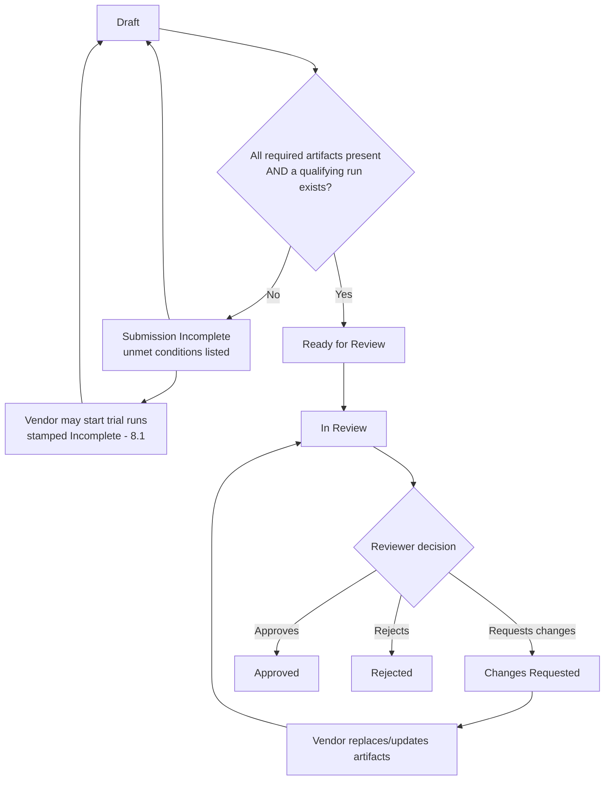

# Certification Automation Platform — MVP PRD

**Status:** Draft for review
**Parent document:** [Certification Automation Platform PRD](https://edfi.atlassian.net/wiki/spaces/OTD/pages/2660139020/Certification+Automation+Platform+PRD) (local copy: `docs/PRD-Certification-v2.md`)
**Primary audience:** The development team implementing this work.
**Relationship to parent:** This document is self-contained. It narrows the parent PRD to the first shippable release and restates everything a reader needs, so no one has to open the parent to start building. Where the parent and this document disagree, **this document governs the MVP**; the parent governs the long-term platform.

---

# 1. Overview

As we move toward improving self-servicing of vendor products against Ed-Fi's Certification, we seek to reduce friction for users validating their sample data and mapping against the Ed-Fi Alliance's requirements.

Previously, Bruno scripts were used to automate the execution order of predictable Student Information System (SIS) scenarios. The newly designed MTSS / Interventions certification closely resembles that approach. The Ed-Fi Domains API v5 takes a different approach: it allows vendors to curate the resources critical to the functionality of their application. That flexibility is valuable to vendors, but it adds operational complexity for the Ed-Fi Alliance representatives who must validate a submission and ultimately issue badging.

The goal of this product is to reduce that operational complexity and to introduce a phased approach to expanding current and future offerings, which the Automation Platform will ultimately build upon.

---

# 2. Purpose and Strategic Alignment

The purpose of this PRD is to establish a first step toward integrating the certification functionality currently provided by Bruno into the Ed-Fi Admin App. This carries several strategic benefits:

- **Ed-Fi hosts what vendors use.** Ed-Fi will host a version of Admin App that manages and reflects what other users see, rather than maintaining a separate certification tool that drifts from the product.
- **Earlier value from platform work.** Bruno scripts for the Domains API are of lower value than they are for SIS scenarios, so beginning platform work earlier means realizing value sooner.
- **A narrow domain proves the mechanics.** Focusing on a subset of domains (the Assessments Domain) allows focus on fewer resources and domain elements, so certification platform mechanics can be validated before breadth is added.
- **Reusable platform foundation.** The machinery built for Assessments — mapping ingestion, run execution, result rendering, status tracking — is the same machinery every future domain certification will reuse. MVP cost is amortized across the full CAP roadmap.
- **Reduces Alliance reviewer toil now.** Domains API v5's vendor-curated resource lists are today a manual reviewer burden. Automating Assessments removes measurable operational load immediately, before the full platform exists.
- **Establishes auditability of certification decisions.** Moving runs out of local Bruno and into a hosted platform makes every certification run attributable, timestamped, and reproducible — a governance gap that exists today.

---

# 3. Scope

All four areas below are in scope for a single MVP release. They are presented as parallel workstreams, not sequential phases.

## 3.1 Automation Platform

- **Hosted Ed-Fi Admin App.** Certification functionality is built as a new module inside the existing Ed-Fi Admin App codebase, reusing its vendor, application, and environment data model. It is not a separate service.
- **Vendor identity and profile.** Vendor records, teams, users, and the product profile a certification attaches to.
- **Event notifications (in-app).** Status is surfaced in the UI — persistent status badges on submissions and runs, and a reviewer-visible indicator when artifacts have changed since the last review. No outbound email in MVP.
- **Vendor uploading artifacts.** Upload, versioning, and replacement of vendor-owned certification artifacts.
- **Certification management view.** The reviewer's working surface: submissions awaiting review, their artifacts, and their run results.
- **Administrator dashboard.** Because notifications are in-app only, Ed-Fi staff need a dashboard that makes work visible without being told about it: submissions that have newly reached Ready for Review, submissions whose artifacts changed during review, and runs in flight or recently failed. This is the substitute for an outbound notification channel, not an optional convenience.
- **Tracking certification runs.** Every run is recorded with who started it, when, against which environment, at which scenario/collection version, and with what result.

## 3.2 Assessments Domain — proof of Domains API v5 connectivity

- Calling tenant-owned data store resource endpoints based on the vendor's mapping.
- Comparing tenant resource responses against the vendor's sample data and mapping.
- Validating and issuing appropriate certification status updates.

## 3.3 MTSS / Interventions Domain — new set of scenarios

Unlike SIS v5 (§3.4), these scenarios do not yet exist. **Authoring them is in scope for this MVP** (D19). They land in the certification testing repository alongside the SIS scenarios and are executed through the same path, so no separate execution mechanism is required — only the scenario content is new.

- Adding new test scenarios to the Bruno certification testing repository.
- Test scenarios are executable both by the platform and directly from Bruno by a developer.
- Run results produced by the Bruno executor are displayed in the platform UI.

## 3.4 Student Information System v5

**The Bruno scenarios for SIS v5 already exist.** Unlike MTSS / Interventions (§3.3), no scenario authoring is required here. The MVP work is to complete these runs end to end through the platform — invoked by the platform, executed against a certification environment, results ingested, displayed, and recorded. SIS v5 is therefore the shortest path to proving the platform's Bruno execution pipeline, since the scenario content is already settled.

- Scenarios are executable both by the platform and directly from Bruno by a developer.
- Existing SIS v5 scenarios must run to completion end to end via the platform for the MVP to be considered done.
- Run results produced by the Bruno executor are displayed in the platform UI.
- Runs are auditable by the platform.

## 3.5 Scope clarification: platform-initiated vs. local Bruno runs

Vendors and Ed-Fi engineers may continue to run Bruno collections locally for their own development and debugging. **Only platform-initiated runs are auditable and count toward certification.** A locally produced run report is not ingested as certification evidence in the MVP.

---

# 4. Dependencies — Required for Launch, Not Built by This Team

Ed-Fi owns these. They must be in place for a successful launch, but they are not development work in this MVP.

| Dependency | Owner | Why it blocks launch |
| --- | --- | --- |
| Cloud platform resources for hosting Admin App services | Ed-Fi | Nothing runs without them; Azure is the confirmed target. |
| Cloud identity provider resource | Ed-Fi | Entra ID tenant and app registration must exist before login can be built against it. |
| Platform security review | Ed-Fi | Required before a hosted, vendor-facing, credential-holding service goes live. |
| Mapping CSV **template** — the standardized format for vendor data mappings | Ed-Fi Product Owner (D18) | The platform validates uploaded mappings against this template (D9); it cannot do so until the template is fixed and published. The template is expected to be stable once set — it is the values vendors fill in, not the template, that change over a certification. |

---

# 5. Out of Scope / Future Considerations

- **Mapping vendor requirements to Ed-Fi elements.** The vendor's mapping document already provides this. The platform consumes the mapping; it does not derive it.
- **Writes or updates during Assessments Domain validation.** GETs only.
- **AI / non-deterministic resolution of issues.** Validating elements must be deterministic and repeatable by script.
- **Artifact generation.** The platform stores and presents vendor artifacts; it does not create them.
- **Outbound email notifications.** Deferred; status is in-app only for MVP.
- **Certifying Agent / automated pre-review readiness determination** (parent PRD §7.7.2). MVP uses a deterministic rules gate instead. See §11 FR13.
- **Domains beyond Assessments.** Additional Domains API v5 domains follow once Assessments proves the mechanics.

---

# 6. Personas

Carried forward from the parent PRD without change.

**Vendor Certification Administrator**
*Motivations:* Register products; manage certification submissions; monitor certification progress.
*Success looks like:* Minimal waiting on Ed-Fi staff; clear certification status; self-service management.

**Vendor Integration Engineer**
*Motivations:* Validate Ed-Fi integrations; understand certification requirements; resolve certification issues quickly.
*Success looks like:* Immediate feedback; clear validation failures; guided certification workflow.

**Certification Reviewer**
*Motivations:* Validate submissions; ensure certification quality; reduce manual effort.
*Success looks like:* Standardized evidence; efficient review process; consistent certification decisions.

**Ed-Fi Platform Administrator**
*Motivations:* Provision environments; manage tenants; manage credentials; support certification infrastructure.
*Success looks like:* Automated provisioning; reduced operational overhead; repeatable deployment processes.

---

# 7. Confirmed Product and Architectural Decisions

| # | Decision |
| --- | --- |
| D1 | For SIS and MTSS / Interventions, the **certification testing repository is the source of truth** for scenarios. The platform connects to it to enable CLI / SDK execution. |
| D2 | The **vendor mapping CSV for Assessments is the source of truth** for identifying which Ed-Fi resources and corresponding descriptors are in scope for that vendor's certification. |
| D3 | **Azure** hosts the Ed-Fi Admin App services. |
| D4 | **Entra ID** is the identity provider for the hosted Admin App. |
| D5 | Certification functionality is a **module inside the existing Admin App codebase**, not a separate service. It reuses Admin App's vendor / application / environment data model and its authentication. |
| D6 | **Ed-Fi manages provisioning of the certification environment on behalf of the vendor.** The environment exists for the vendor's use, but Ed-Fi stands it up and operates it; the vendor does not point the platform at a self-hosted ODS/API instance. The vendor's team and application are associated with the environment Ed-Fi provisions for them. |
| D7 | **Ed-Fi administrators onboard vendors.** An Ed-Fi Platform Administrator creates the vendor record and invites the vendor's first administrator via Entra ID. That vendor administrator then invites their own teammates. There is no public self-signup. |
| D8 | Assessments validation is **presence + descriptors + values**: every element the vendor declared in their mapping must be present and populated, returned descriptor values must resolve to legitimate Ed-Fi descriptor URIs, and returned values must reconcile to the vendor's submitted sample data. |
| D9 | Mapping CSVs are **validated structurally on upload**. Malformed files are rejected before a run can be started. |
| D10 | Readiness for review is a **deterministic rules gate**, not an agent. |
| D11 | The **certification status model from parent PRD §10.4 is reused verbatim**. No second model is invented. |
| D12 | Notifications in MVP are **in-app only**. Because nothing is pushed to Ed-Fi staff, an **administrator dashboard** is required so pending work is discoverable in the UI (§3.1, FR12). |
| D13 | **Vendors may start runs before their artifacts are complete.** Certification runs are a trial-and-error tool, not only a final submission step. Every run is stamped with a completeness designation at start time, and only runs stamped **Complete** can satisfy the readiness gate (§8.1, FR13). |
| D14 | **A run's completeness designation and pinned artifact versions are fixed at start and never recalculated**, so that every run is an unambiguous record of which artifacts it was validated against. The cost — a vendor occasionally re-running after a late upload — is accepted for the MVP. |
| D15 | **Assessments validation requires a mapping CSV at minimum.** This is a hard precondition, not an artifact-completeness gate: without the mapping the platform does not know what to validate against. Sample data and product documentation are not required to start an Assessments run. |
| D16 | **Value reconciliation uses type-aware normalized comparison**, not exact string matching. Both sides are parsed to their Ed-Fi data type before comparison, so formatting differences do not fail a correct integration while genuine value mismatches still do (§9.1). *Resolves OQ2.* |
| D17 | **The vendor loads the certification environment through their own application's Ed-Fi integration.** The platform does not load data on the vendor's behalf. The uploaded sample data file is the expected-result set the validator compares against, not a load source. This means an Assessments run exercises the vendor's real integration rather than the platform's loader. *Resolves OQ5.* |
| D18 | **The mapping CSV template is owned by the Product Owner and is expected to change rarely.** The template is the stable part; the *values* a vendor fills into it are the variable part, adjusted by the vendor until their source data reaches the target resources as expected. Mapping content is therefore versioned as an ordinary artifact (FR6) and pinned per run (D14) — no separate template-versioning machinery is needed. *Resolves OQ4.* |
| D19 | **Authoring the new MTSS / Interventions scenarios is in MVP scope for this team.** The scenarios land in the certification testing repository alongside the existing SIS scenarios and are executed the same way (D1). This is not an external content dependency. *Resolves OQ7.* |
| D20 | **Vendor environment credentials reuse Admin App's existing mechanism.** Admin App already provisions a client ID and client secret for tenant environments; the MVP does not introduce a new credential store or a new provisioning path. The engineering work is **delivering those existing credentials securely to the Bruno CLI executor** so a run targets the correct environment. *Resolves OQ3.* |
| D21 | **Runs execute a named tag that the Product Owner promotes, and record the resolved commit SHA.** Certification behavior changes only by a deliberate act of the requirements owner — consistent with the rule that the platform implements certification requirements but does not govern them — while the recorded SHA keeps every run reproducible to an exact commit. *Resolves OQ1.* |
| D22 | **One execution at a time per product; submissions may be concurrent.** SIS, Assessments, and MTSS are distinct certification models (§6 of the parent PRD), so a product may have an open submission in more than one at once. Only one *run* may be executing at any moment, which prevents two runs contending for the same environment without forcing a vendor to serialize independent certifications. *Resolves OQ6.* |
| D23 | **Reviewer awareness is same-business-day, via routine dashboard checks.** The dashboard must be accurate when loaded; it is not required to update live. Outbound email is a fast-follow, not an MVP gap. *Resolves OQ8.* |
| D24 | **A structurally valid mapping runs even if the environment holds no data for the resources it declares.** The run fails loudly and reports what was missing. This is consistent with §8.1's trial-run philosophy: "this resource returned nothing" is the actionable feedback the vendor needs, and pre-screening would report the same thing later in the vendor's debugging loop, not earlier. *Resolves OQ9.* |

---

# 8. Certification Status Model

Reused from parent PRD §10.4. These are the only statuses in the MVP.

| Status | Meaning | Who clears it |
| --- | --- | --- |
| **Draft** | Submission created; vendor is assembling artifacts. | Vendor |
| **Submission Incomplete** | One or more required artifact types is missing. The missing types are listed explicitly. | Vendor |
| **Ready for Review** | All required artifact types are present and at least one qualifying run — a finished run stamped **Complete** (§8.1) — exists. | Reviewer picks it up |
| **In Review** | A reviewer has started reviewing. Visible to the vendor. | Reviewer |
| **Changes Requested** | Reviewer has asked for artifact or run changes, with comments. | Vendor |
| **Approved** | Reviewer approved the submission. | Terminal |
| **Rejected** | Reviewer rejected the submission. | Terminal |

**Rules carried from the parent PRD:**

- Vendors may submit incomplete packages; missing artifacts are clearly identified.
- Vendors may replace artifacts during review. Reviewers see an indicator that artifacts changed since they last looked.
- Reviewers do not upload artifacts on behalf of vendors.
- Vendors can see submission and review status at any time. It is a persistent, checkable state, not a one-time confirmation.
- Certifications are granted to **products**, not vendors.
- A product may have concurrent open submissions across different certification models — SIS, Assessments, and MTSS are distinct models and a vendor is not made to finish one before starting another. Only one run may be *executing* for a product at any moment (D22).

## 8.1 Run Completeness — Trial Runs vs. Qualifying Runs

Submission status (§8) and run completeness are two separate things. A vendor must not have to assemble a complete artifact package before they can find out whether their integration works — running early, failing, fixing, and running again is the normal path to a passing integration. The platform therefore lets a vendor start a certification run at any time, and distinguishes the resulting runs rather than blocking them.

Every run is stamped at start time with a completeness designation, derived from the state of the submission at that moment:

| Designation | When it is assigned | What it is good for |
| --- | --- | --- |
| **Incomplete** | One or more required artifact types (§9) was missing when the run started. | Vendor trial and error. Results are real and fully displayed, but the run cannot make a submission Ready for Review. |
| **Complete** | All required artifact types were present when the run started. | A qualifying run. Satisfies the run half of the readiness gate (FR13). |

Rules:

- **The designation is assigned once, at run start, and never recalculated.** The purpose is provenance: a run's designation tells us which artifacts that run was actually validated against. A run started against an incomplete package stays **Incomplete** even if the vendor uploads the missing artifacts a minute later, because the run did not execute against the package as it now stands. This costs a vendor one extra run in that narrow case, and that friction is accepted for the MVP in exchange for every run being unambiguous about what it proved.
- **A run pins the artifact versions it executed against.** Because artifacts are versioned and replaceable (FR6), "which artifacts" means which *versions*. The run record captures the specific version of each artifact present at start, so a reviewer looking at a six-week-old passing run can tell whether it ran against the mapping CSV currently attached to the submission or an earlier one.
- Incomplete runs are displayed with the same result detail as Complete runs. They are not second-class evidence for the vendor; they are simply not admissible for review.
- To reach **Ready for Review**, a vendor with only Incomplete runs must upload the missing artifacts and start one more run.
- Run designation is visible to both vendors and reviewers, so a reviewer never mistakes a trial run for a qualifying one.

---

# 9. Required Artifacts

A submission cannot reach **Ready for Review** until all three are present.

| Artifact | Description | Validated on upload? |
| --- | --- | --- |
| **Vendor mapping CSV** | Identifies the Ed-Fi resources and corresponding descriptors the product uses. Conforms to the Ed-Fi-published template (see §4 dependency). | Yes — structural/schema validation; malformed files rejected. |
| **Sample data** | The data set the certification environment is loaded with. Serves as the expected-result set for value-level reconciliation. | Yes — parseable and non-empty. |
| **Product documentation** | For the Assessments domain specifically, this is an **example score report produced by the vendor's application**. | No — accepted as an opaque document; reviewed by a human. |

Run reports are generated by the platform and attached to the submission automatically. They are not an uploaded artifact and are not part of the upload gate.

**These three artifacts gate *review*, not *execution*.** A vendor may start certification runs with any or none of them present; such runs are stamped **Incomplete** (§8.1). The one exception is Assessments validation, which cannot run at all without a valid mapping CSV — not because of the artifact gate, but because the mapping is the input that tells the validator which resources and elements to check.

**Sample data is an expected-result set, not a load source.** The vendor loads the certification environment through their own application's Ed-Fi integration (D17); the uploaded file is what the validator compares the environment's responses against. A run therefore exercises the vendor's real integration path, which is the thing being certified.

## 9.1 Value Reconciliation Rules

D16 resolves how the validator compares a returned value to the vendor's sample data. Both sides are parsed to their Ed-Fi data type before comparison; a difference in representation is not a failure, a difference in value is.

| Ed-Fi type | Normalization applied | Passes | Fails |
| --- | --- | --- | --- |
| Date / DateTime | Parse both sides; compare instants | `9/14/2026` vs `2026-09-14T00:00:00Z` | `2026-09-14` vs `2026-09-15` |
| Decimal / Integer | Parse both sides; compare numerically | `85` vs `85.0` | `85` vs `87` |
| String | Trim leading and trailing whitespace; compare case-sensitively | `"Smith "` vs `"Smith"` | `"Smith"` vs `"smith"` |
| Boolean | Parse both sides to boolean | `true` vs `True` | `true` vs `false` |
| Descriptor | Compare resolved descriptor URI (see D8) | Same URI, different display text | Different URI |

Rules:

- A value that cannot be parsed to its declared Ed-Fi type is a **failure**, reported as a type error rather than a value mismatch — the two mean different things to a vendor fixing them.
- Normalization is applied symmetrically to expected and actual values. The validator never normalizes only one side.
- Failure output shows the raw returned value alongside the normalized comparison, so a vendor can see both what their API returned and why it did not match.
- Normalization rules are fixed and versioned with the validator. They are not configurable per vendor, because that would make results incomparable across certifications.

---

# 10. Workflow Assumptions

## 10.1 Setting up a new vendor

1. An Ed-Fi Platform Administrator creates the vendor record in the hosted Admin App.
2. The administrator creates a team for that vendor and invites the vendor's first administrator by email address through Entra ID.
3. The invited user accepts, authenticates via Entra ID, and lands as a Vendor Certification Administrator on that team.
4. The vendor administrator invites additional teammates to the team.
5. The Ed-Fi Platform Administrator provisions a certification environment and associates the vendor's team with it.
6. An application is created within that environment, and its credentials are issued to the vendor team.

## 10.2 Vendor uploading artifacts

1. The vendor opens their product's certification submission (creating one puts it in **Draft**).
2. The vendor uploads the mapping CSV. The platform validates its structure immediately and either accepts it or rejects it with the specific structural errors.
3. The vendor uploads sample data and product documentation.
4. As each artifact lands, the submission's missing-artifact list shrinks. While anything is missing, the status reads **Submission Incomplete**.
5. At any point in this sequence — including before any artifact is uploaded — the vendor may start certification runs to test their integration. Those runs are stamped **Incomplete** (§8.1) and are for the vendor's own trial and error.
6. The vendor may replace any artifact at any time, including during review. Replacement creates a new version; prior versions remain in the audit history.

## 10.3 Reviewer assessing uploaded artifacts

1. A Certification Reviewer opens the certification management view, sees on the dashboard what has newly reached **Ready for Review**, and picks up a submission; it moves to **In Review**.
2. The reviewer reads the mapping documentation, the sample data, and the example score report.
3. The reviewer evaluates semantic alignment — whether the vendor's mapping is a defensible representation of their product. This is human judgment and is not automated.
4. The reviewer either requests changes (with comments), approves, or rejects.

## 10.4 Vendor SIS v5 certification run

1. The vendor selects the SIS v5 scenario set on their submission and starts a run.
2. The platform executes the corresponding Bruno collection from the certification testing repository, pinned to a specific repository version, against the vendor's certification environment.
3. The platform ingests the Bruno run output and renders per-scenario pass/fail results in the UI.
4. The run is recorded with its initiator, timestamp, environment, repository version, and result.

## 10.5 Vendor Assessments v5 certification run

1. The vendor loads their certification environment with their sample data, using their application's normal integration path.
2. The vendor starts an Assessments validation run.
3. The platform reads the uploaded mapping CSV to determine which Ed-Fi resources and elements are in scope.
4. For each in-scope resource, the platform issues **GET requests only** against the tenant-owned data store endpoints.
5. For each in-scope element the platform checks: the element is present and populated; any descriptor value resolves to a legitimate Ed-Fi descriptor URI; and the returned value reconciles to the submitted sample data.
6. Results are rendered as pass/fail by domain, resource, and element.

## 10.6 Vendor MTSS / Interventions v5 certification run

Identical in shape to §10.4. The vendor selects the MTSS / Interventions scenario set, the platform executes the corresponding Bruno collection from the certification testing repository, and results are ingested and displayed.

## 10.7 Reviewer assessing run results

1. The reviewer opens the run results attached to the submission.
2. The reviewer spot-checks results rather than re-verifying every element; the platform is trusted to have executed the checks correctly.
3. The reviewer determines whether a re-run is needed. The platform does not decide this.
4. The reviewer makes the certification decision. **The platform never approves or rejects a certification.**

---

# 11. Functional Requirements

Each requirement is written as a user story with acceptance criteria. All are Must-have for the MVP.

### FR1 — Platform login
**As** any platform user, **I can** sign in to the hosted Admin App with my Entra ID credentials **so that** my actions are attributable to me.
- Authentication is delegated to Entra ID; the platform stores no passwords.
- An unauthenticated request to any certification page redirects to the identity provider.
- A signed-in user's identity is recorded on every action captured in audit history.
- Sign-out terminates the platform session.

### FR2 — Associate a vendor to a team
**As** an Ed-Fi Platform Administrator, **I can** create a vendor record and associate it with a team **so that** certification work is scoped to an organization.
- A vendor record can be created with, at minimum, a name and a primary contact.
- A vendor has at least one team; a team belongs to exactly one vendor.
- A vendor may hold multiple products.
- Only an Ed-Fi Platform Administrator can create vendor records.

### FR3 — Associate a user to a team
**As** an Ed-Fi Platform Administrator, **I can** invite a vendor's first administrator, and **as** a Vendor Certification Administrator, **I can** invite my teammates **so that** the vendor manages its own membership.
- Invitations are sent to an email address and resolved through Entra ID.
- An invited user who has not accepted appears in a pending state.
- A vendor administrator can invite and remove members of their own team only.
- A user can belong to more than one team.

### FR4 — Associate a team to a certification environment
**As** an Ed-Fi Platform Administrator, **I can** provision a certification environment on a vendor's behalf and associate their team with it **so that** the team has a controlled target for certification runs without having to stand up infrastructure themselves.
- Ed-Fi manages provisioning on the vendor's behalf; vendors cannot register an arbitrary external base URL.
- An environment is associated with exactly one team.
- Team members can see the environment's connection details and its status.
- Environment provisioning is recorded in audit history.

### FR5 — Associate an application with an environment
**As** an Ed-Fi Platform Administrator, **I can** create an application within a certification environment **so that** the vendor receives credentials for API access.

Admin App already provisions a client ID and client secret for tenant environments. **This requirement reuses that mechanism rather than replacing it** (D20); the MVP adds no new credential store and no new provisioning path.

- Application creation and credential issuance use Admin App's existing tenant-environment mechanism.
- Credentials are associated with the certification environment so a run can resolve which credentials to use.
- Credential lifecycle behavior (display-once, regeneration) follows whatever Admin App does today; this PRD does not redefine it.
- Regeneration is recorded in certification audit history (FR17) so a run failure after a rotation is explicable.
- Credentials are never written to run logs, run reports, or UI output.

### FR6 — Associate vendor artifacts with a product profile
**As** a Vendor Certification Administrator, **I can** upload my mapping CSV, sample data, and product documentation to my product's submission **so that** it can be reviewed.
- All three artifact types from §9 can be uploaded and replaced.
- The mapping CSV is structurally validated on upload; a malformed file is rejected with specific errors and is not stored as the active mapping.
- Replacing an artifact creates a new version; prior versions remain visible in audit history.
- The submission always displays which required artifact types are still missing.
- Reviewers cannot upload artifacts on a vendor's behalf.

### FR7 — Select and start scenarios to run
**As** a Vendor Integration Engineer, **I can** choose which certification scenario set to run and start it **so that** I get validation feedback without contacting Ed-Fi staff.
- Selectable sets in MVP: SIS v5, MTSS / Interventions v5, Assessments v5.
- A run can be started regardless of whether the submission's required artifacts are complete, so the vendor can work by trial and error.
- Each run is stamped **Complete** or **Incomplete** at start time per §8.1, and the UI states which it will be *before* the vendor starts it.
- Assessments is the one exception: it cannot be started without a valid mapping CSV (D15), because the mapping is what tells the platform what to validate against. Sample data and product documentation are not required to start an Assessments run — only the mapping is. The UI explains this precondition specifically rather than reporting a generic "artifacts missing" error.
- Only one run per product may be executing at a time, across all certification models (D22). A vendor with open SIS and Assessments submissions can start either, but not both at once; the UI says which run is holding the slot rather than greying out the button without explanation.
- The run's state (queued / running / completed / failed) is visible while it executes.

### FR8 — Execute Bruno-based scenario runs (SIS v5, MTSS)
**As** the platform, **I** execute the selected Bruno collection from the certification testing repository against the vendor's certification environment **so that** results are produced consistently and auditably.
- The certification testing repository is the source of truth for collections (D1). Both SIS v5 and the new MTSS / Interventions scenarios (D19) execute through this same path.
- The executor receives the target environment's credentials from Admin App's existing mechanism (D20) and runs against the correct environment. **This credential hand-off is the substantive engineering work in this requirement** — the execution itself is a CLI invocation.
- Credentials are passed to the executor without landing in process listings, shell history, run logs, or the persisted run output.
- The executor runs a **named tag promoted by the Product Owner**, and records the **commit SHA that tag resolved to** at run time (D21). The tag is what people reason about; the SHA is what makes the run reproducible.
- Promoting a tag is the only way certification behavior changes. The platform does not track a moving branch.
- Run output is ingested and persisted, not merely streamed to a log.
- A run that fails for infrastructure reasons is distinguishable from a run whose scenarios failed, and an authentication failure is distinguishable from both — a vendor debugging a bad credential should not be reading scenario failures.

### FR9 — Execute Assessments Domain validation
**As** the platform, **I** validate the vendor's certification environment against their mapping CSV and sample data **so that** Domains API v5 connectivity is proven without manual reviewer effort.
- Only GET requests are issued; no writes or updates (§5).
- A valid mapping CSV is a hard precondition; without it there is nothing to validate against and the run cannot start (D15).
- The mapping CSV determines which resources and elements are in scope.
- A declared resource for which the environment returns no data is a **run failure, not a refusal to run** (D24). The validator executes fully and reports the empty resource, so the vendor learns what is missing rather than being blocked at the door.
- The run pins the mapping CSV version it evaluated, so results can always be traced to the mapping that produced them (D14).
- For each in-scope element, the platform evaluates presence, descriptor validity, and value reconciliation against sample data (D8).
- Validation is deterministic: the same environment, mapping, and sample data produce the same result.

### FR10 — Display run results
**As** a Vendor Integration Engineer or Certification Reviewer, **I can** see the results of a run **so that** I know exactly what passed and what failed.
- Assessments results are shown by domain, resource, and element.
- Bruno-based results are shown by scenario.
- Each failure states what was expected and what was observed.
- Results remain viewable after the run completes and are attached to the submission.
- Results carry the run's completeness designation (§8.1) visibly, so an Incomplete trial run is never mistaken for a qualifying one. Incomplete runs show the same level of result detail as Complete runs.

### FR11 — Track certification runs
**As** a Certification Reviewer, **I can** see the full run history for a product **so that** I can judge whether the evidence in front of me is current.
- Every run records initiator, start and end time, target environment, scenario set, the executed tag and its resolved commit SHA (where applicable, D21), completeness designation (§8.1), the artifact versions it executed against, and outcome.
- Run history is immutable; runs are never edited or deleted. A run's completeness designation is fixed at start and never recalculated, so the run remains an accurate statement of what it validated against.
- A run whose pinned artifact versions are no longer the submission's current versions is visibly marked as stale, so a reviewer does not treat it as evidence for artifacts it never saw.
- The submission clearly indicates which run is the current one, and which run (if any) is the current *qualifying* run.
- Run history can be filtered to qualifying runs only, so a reviewer is not wading through a vendor's trial runs.

### FR12 — Certification management view
**As** a Certification Reviewer, **I can** see all submissions and their statuses in one place **so that** I can work through a queue rather than chase vendors.
- Submissions are listable and filterable by status.
- Opening a submission shows its artifacts, its run results, and its status history.
- The view indicates when artifacts have changed since the reviewer last opened the submission.
- The view defaults to qualifying runs, with trial runs available but not in the way (§8.1).
- The view includes a **dashboard surface for Ed-Fi staff** that answers, without anyone being notified: what newly reached Ready for Review, what changed during review, and what runs are in flight or recently failed. With no outbound email in the MVP (D12), this is how pending work becomes visible at all.
- The dashboard must be accurate as of page load. It is **not** required to update live (D23) — the operating assumption is that reviewers check it as part of their normal workday and pick work up the same business day.

### FR13 — Deterministic readiness gate
**As** the platform, **I** block a submission from reaching Ready for Review until it is complete **so that** reviewers never spend time on an incomplete package.
- The gate is a rules check: all three required artifact types present, **and** at least one finished run stamped **Complete** (§8.1).
- Runs stamped **Incomplete** never satisfy the gate, no matter how many of them passed.
- The gate is deterministic. There is no agent and no inference (D10).
- When the gate is not met, the submission shows **Submission Incomplete** listing the specific unmet conditions — distinguishing "artifact X is missing" from "artifacts are complete, but no qualifying run has been executed since," because those need different actions from the vendor.
- The gate re-evaluates automatically whenever an artifact or run changes.

### FR14 — Reviewer can request changes
**As** a Certification Reviewer, **I can** request changes on a submission with comments **so that** the vendor knows exactly what to fix.
- Requesting changes moves the submission to **Changes Requested** and requires a comment.
- The vendor sees the comment and can replace artifacts or start a new run without an intermediate approval step.
- The reviewer sees when the vendor has responded.
- Comments are retained in the submission's history.

### FR15 — Reviewer approves or rejects
**As** a Certification Reviewer, **I can** approve or reject a submission **so that** the certification decision is recorded in the system of record.
- Only a Certification Reviewer can approve or reject.
- Approval and rejection are terminal for that submission.
- A rejection requires a reason.
- The decision, its author, and its timestamp are recorded in audit history.

### FR16 — In-app status visibility and change indicators
**As** a vendor user, **I can** check my submission's status at any time; **as** a reviewer, **I can** see when something I am reviewing has changed.
- Submission and run status are visible to the vendor at all times without contacting Ed-Fi.
- Reviewers see an indicator on submissions whose artifacts changed since their last review action.
- Ed-Fi staff have a dashboard (FR12) that surfaces newly-ready submissions, mid-review artifact changes, and run failures — the in-app substitute for being notified.
- No outbound email is sent in MVP (D12).

### FR17 — Audit history
**As** a Certification Reviewer or Ed-Fi Platform Administrator, **I can** see who did what and when on a certification **so that** decisions are defensible after the fact.
- Recorded events include artifact upload and replacement, run start and completion, status transitions, reviewer comments, and the final decision.
- Each entry carries actor identity and timestamp.
- History is append-only.

---

# 12. Ownership: Platform vs. Reviewer

The platform orchestrates workflow, executes validation, collects evidence, and reports. **Reviewers remain responsible for certification judgment.**

| Activity | Platform | Reviewer |
| --- | :---: | :---: |
| Provision environment | ✅ | |
| Manage credentials | ✅ | |
| Execute validation | ✅ | |
| Track certification workflow | ✅ | |
| Store artifacts | ✅ | |
| Report validation outcomes | ✅ | |
| Identify missing artifacts | ✅ | |
| Stamp run completeness (§8.1) | ✅ | |
| Enforce readiness gate | ✅ | |
| Review artifacts | | ✅ |
| Spot-check validation results | | ✅ |
| Review mapping documentation | | ✅ |
| Evaluate semantic alignment | | ✅ |
| Determine if re-validation is needed | | ✅ |
| Approve / reject certification | | ✅ |

---

# 13. Non-Functional Requirements

- **Security.** Vendor API credentials continue to be held by Admin App's existing tenant-environment mechanism (D20); the MVP introduces no new credential store. Credentials must never appear in run logs, run reports, process listings, or UI output. The credential hand-off to the Bruno CLI executor (FR8) is the new surface this MVP adds and is the part a security review (§4) should focus on.
- **Determinism.** Re-running an unchanged submission against an unchanged environment produces the same result. This is a hard requirement, not a goal — it is what makes results auditable.
- **Isolation.** One vendor's users, artifacts, runs, and environments are never visible to another vendor.
- **Extensibility.** Adding a further Domains API v5 domain after Assessments should require configuration and a mapping template, not a new validation engine.

---

# 14. Success Metrics

Two things are being measured, and they answer different questions. §14.1 asks whether the scope in §3 actually landed — it is a completion checklist, and every line must be true to call the MVP done. §14.2 asks whether what landed is any good.

## 14.1 Release Criteria — Did the Scope Land?

One criterion per scope bucket in §3. An MVP that certifies an Assessments vendor but never ran an MTSS scenario is not done.

| # | Scope bucket | Criterion |
| --- | --- | --- |
| RC1 | Automation Platform (§3.1) | A vendor is onboarded, associated with a team and an Ed-Fi-provisioned environment, uploads all three required artifacts, and reaches **Ready for Review** — with each step visible on the administrator dashboard and recorded in audit history. |
| RC2 | Assessments Domain (§3.2) | An Assessments validation run executes from an uploaded mapping CSV, issues GETs only, and reports pass/fail by domain, resource, and element — including at least one genuine failure of each kind the validator distinguishes (missing element, invalid descriptor, value mismatch, empty declared resource). |
| RC3 | MTSS / Interventions (§3.3) | The new scenarios exist in the certification testing repository, execute end to end when invoked by the platform, and their results render in the UI. Authoring alone does not satisfy this criterion — the scenarios must have run through the platform. |
| RC4 | SIS v5 (§3.4) | The **existing** SIS v5 scenarios run to completion end to end through the platform, against an Ed-Fi-provisioned environment, with results ingested, displayed, and recorded. This is the bucket with no new scenario content, so failure here points at the execution pipeline rather than the scenarios. |
| RC5 | Bruno execution path (§3.1, FR8) | RC3 and RC4 are both satisfied using the same platform-invoked execution path and the same credential hand-off — demonstrating one pipeline serving both scenario sets, not two one-offs. |

## 14.2 Outcome Metrics — Is It Any Good?

1. **First vendor certified end-to-end.** At least one real vendor completes an Assessments v5 certification entirely through the platform, with no out-of-band steps.
2. **Run reproducibility.** Re-running the same submission produces identical results, demonstrating that validation is deterministic and auditable. This applies to all three certification models, not only Assessments — a Bruno-executed SIS run that is not reproducible undermines the audit claim just as much.

Reviewer time saved and vendor self-service rate are deliberately *not* MVP metrics. Both are the point of the larger platform effort, but neither is measurable against a single certification, and setting them as MVP targets would invite gaming the first vendor's experience.

---

# 15. Open Questions

## 15.1 Still Open

**None.** Every question raised during drafting has been resolved and folded into §7. New questions are expected to surface during design; add them here.

## 15.2 Resolved

Kept here so the reasoning behind each decision is traceable rather than lost.

| # | Question | Resolution |
| --- | --- | --- |
| OQ1 | How is the certification testing repository version pinned per run? | **A named tag promoted by the Product Owner**, with the resolved commit SHA recorded on each run. Certification behavior changes only by deliberate act; runs stay reproducible to an exact commit. See D21, FR8. |
| OQ2 | What tolerance applies to value-level reconciliation? | **Type-aware normalized comparison** — parse both sides to their Ed-Fi type before comparing, so formatting differences pass and value differences fail. See D16 and §9.1. |
| OQ3 | Where are vendor environment credentials stored? | **No new store.** Admin App already provisions client ID and secret for tenant environments; the MVP reuses it. The actual work is delivering those credentials securely to the Bruno CLI executor. See D20, FR5, FR8. |
| OQ4 | Who owns the mapping CSV template, and how is it versioned? | **Product Owner owns the template**, which is expected to change rarely. The variable part is the values vendors fill in, already covered by artifact versioning (FR6) and per-run pinning (D14) — so no separate template-versioning machinery is needed. See D18. |
| OQ5 | How is the certification environment loaded with sample data? | **Vendor-driven, through their own application's Ed-Fi integration.** The uploaded sample data is the expected-result set, not a load source — so a run exercises the vendor's real integration. See D17, §10.5. |
| OQ6 | Does "one active run per product" mean one submission or one execution? | **One execution.** A product may hold concurrent open submissions across the distinct certification models, but only one run executes at a time — preventing environment contention without forcing vendors to serialize independent work. See D22, §8, FR7. |
| OQ7 | Is MTSS / Interventions scenario authoring this team's work? | **Yes, in MVP scope.** The scenarios land in the certification testing repository alongside the SIS scenarios and execute through the same path. See D19, §3.3. |
| OQ8 | What reviewer-awareness latency is acceptable without email? | **Same business day**, via routine dashboard checks. The dashboard must be accurate on load but need not update live, so email becomes a fast-follow rather than an MVP gap. See D23, FR12. |
| OQ9 | Should a valid mapping declaring resources with no data run, or be pre-screened? | **Run and fail loudly.** "This resource returned nothing" is the actionable feedback; pre-screening would surface the same fact later in the vendor's debugging loop. See D24, FR9. |

---

# 16. Glossary

| Term | Definition |
| --- | --- |
| **Admin App** | The Ed-Fi Admin App. In this MVP it is also the host application for certification functionality. |
| **Bruno** | The API client whose collections encode SIS and MTSS certification scenarios; executed by the platform via its CLI. |
| **Certification testing repository** | The Ed-Fi repository holding Bruno collections. Source of truth for SIS and MTSS scenarios (D1). |
| **Certification environment** | An ODS/API environment that a vendor's team certifies against, provisioned and operated by Ed-Fi on the vendor's behalf (D6). |
| **Domains API v5** | The Ed-Fi API surface that lets vendors curate the resources their application depends on. |
| **Mapping CSV** | The vendor-authored file declaring which Ed-Fi resources and descriptors their product uses. Source of truth for Assessments scope (D2). |
| **Product** | The unit that receives certification. A vendor may have several (§8). |
| **Run** | One execution of a scenario set or validation against a certification environment. |
| **Run completeness** | A designation — **Complete** or **Incomplete** — stamped on a run at start time, based on whether all required artifacts were present. Only Complete runs are admissible for review (§8.1). |
| **Trial run** | Informal term for a run stamped Incomplete: real results, used by the vendor for debugging, not admissible as certification evidence. |
| **Submission** | A product's certification package: artifacts, runs, status, and history. |
