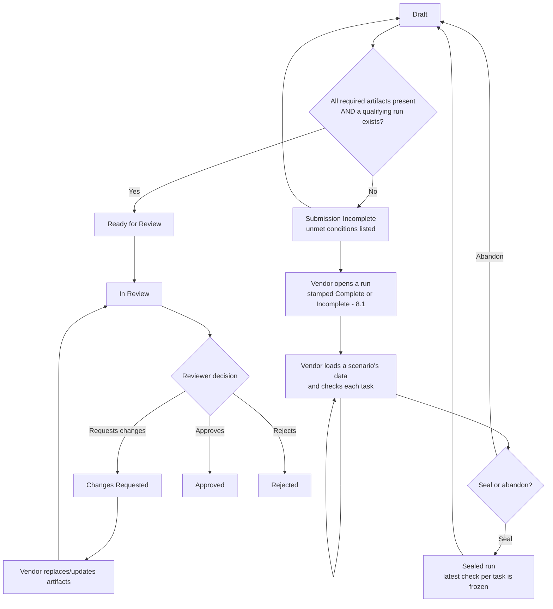

# Interactive Run Model Implementation Plan

> **For agentic workers:** REQUIRED SUB-SKILL: Use superpowers:subagent-driven-development (recommended) or superpowers:executing-plans to implement this plan task-by-task. Steps use checkbox (`- [ ]`) syntax for tracking.

**Goal:** Make a SIS or MTSS certification run something a vendor accumulates task by task — start it, load data, check each task as it lands, seal it when done — while Assessments keeps its existing batch run.

**Architecture:** A Bruno-model run materializes its whole scenario tree at start with every task `unchecked`, and `runCheck()` fills one task's slot in place. Tasks come from each collection folder's documented CREATE/UPDATE/DELETE list; a subset carry a verification step, numbered to match. Sealing freezes the latest check per task and re-executes nothing.

**Tech Stack:** Single-file HTML prototype (vanilla JS, template literals, hash routing, no build step, no server). Tests are `node --test docs/prototypes/certification-prototype.test.mjs` with a DOM-stub harness — no new dependencies, and deliberately outside the repo's nx/jest pipeline because the prototype is a docs artifact, not a package.

**Spec:** `docs/design/2026-09-17-interactive-run-model-design.md`

## Global Constraints

- **The prototype stays a single self-contained file.** `docs/prototypes/certification-prototype.html` has no build step, no imports, and no network calls. It must keep opening correctly from `file://`.
- **Assessments behaviour must not change.** Every change is gated on `MODELS[...].kind === 'bruno'`. The Assessments batch path (`finishRun`'s timer, `assessmentResults`, `assessmentResultsHTML`) is untouched.
- **Run states:** `open`, `sealed`, `abandoned` for Bruno models; `queued`, `running`, `completed` for Assessments. Both sets coexist.
- **An unchecked task is `not attempted`, never `failed`** (ID9). This distinction must survive into every tally and every reviewer-facing view.
- **Completeness stamps at run start and never recalculates** (§8.1). **Artifact versions pin at run start**; mid-run changes flag the run stale and invalidate nothing (ID7).
- **A run holds the latest check per task plus an attempt count** — never a history (ID3).
- **Copy rule:** user-facing text says "not attempted" for an unchecked task, "Sealed" for a sealed run, and "Abandoned" for an abandoned one.
- **Element-detail rendering already exists and is correct.** `stepElementsHTML`, `decodeElement`, `ASSERT_TYPE`, `SAMPLE_VALUES`, `DESCRIPTOR_VALUES` and `ST_LABEL`'s Bruno kinds ship in commit `6ae82a2`. Reuse them; do not reimplement.

---

## File Structure

| File | Responsibility |
| --- | --- |
| `docs/prototypes/certification-prototype.html` | The prototype. Single file by design — do not split it. |
| `docs/prototypes/certification-prototype.test.mjs` | **New.** Test harness plus all tests. Run with `node --test docs/prototypes/certification-prototype.test.mjs`. |
| `docs/prototypes/tools/build-collection-data.mjs` | **New.** Regenerates the `COLLECTION` literal from a local clone of `certification-testing`. Committed so the data can be rebuilt when the upstream collection changes or MTSS lands. |
| `docs/PRD-Platform-Automation-MVP.md` | §8 mermaid diagram only — canonical in this repo. Prose lives in Confluence. |
| `docs/design/2026-09-17-interactive-run-model-design.md` | The spec. Read-only for this plan. |

---

### Task 1: Test harness

Everything downstream depends on being able to load the prototype's script in Node and reach its internals. The harness uses an `eval`-by-name closure so it never needs editing when a later task adds a function.

**Files:**
- Create: `docs/prototypes/certification-prototype.test.mjs`

**Interfaces:**
- Produces: `loadPrototype()` → a Proxy whose property access returns any top-level binding in the prototype's script by name. Each call builds a fresh sandbox, so `APP` mutations never leak between tests.

- [ ] **Step 1: Write the failing test**

Create `docs/prototypes/certification-prototype.test.mjs`:

```js
import { test } from 'node:test';
import assert from 'node:assert/strict';
import { readFileSync } from 'node:fs';

/* The prototype is a single HTML file with one inline <script>. We run that
   script inside a Function with DOM stubs passed as parameters, then hand back
   a Proxy over an eval closure so tests can reach any top-level binding by name
   without the harness needing to know what exists. */
export function loadPrototype(){
  const html = readFileSync(new URL('./certification-prototype.html', import.meta.url), 'utf8');
  const js = html.match(/<script>([\s\S]*)<\/script>/)[1];

  const noop = () => {};
  const el = {
    addEventListener:noop, appendChild:noop, setAttribute:noop, remove:noop, focus:noop,
    classList:{add:noop, remove:noop}, style:{}, dataset:{}, innerHTML:'', value:'',
    querySelector:() => null, querySelectorAll:() => []
  };
  const document = {
    addEventListener:noop, querySelector:() => el, querySelectorAll:() => [],
    getElementById:() => el, createElement:() => el, body:el, documentElement:el
  };
  const location = {hash:'#/dashboard'};
  const window = {
    addEventListener:noop, location,
    matchMedia:() => ({matches:false, addEventListener:noop})
  };

  let lookup;
  const factory = new Function(
    'window', 'document', 'location', 'setTimeout', 'navigator', '__bind',
    js + '\n__bind(n => eval(n));'
  );
  factory(window, document, location, noop, {}, fn => { lookup = fn; });

  return new Proxy({}, {get: (_, name) => lookup(String(name))});
}

test('harness exposes the collection data', () => {
  const p = loadPrototype();
  assert.equal(p.COLLECTION.sis.length, 45, 'SIS has 45 scenarios');
  assert.equal(p.COLLECTION.mtss.length, 8, 'MTSS has 8 scenarios');
});

test('each loadPrototype call is isolated', () => {
  const a = loadPrototype(), b = loadPrototype();
  a.APP.submissions.length = 0;
  assert.ok(b.APP.submissions.length > 0, 'mutating one instance must not affect another');
});
```

- [ ] **Step 2: Run the tests to verify they pass**

Run: `node --test docs/prototypes/certification-prototype.test.mjs`
Expected: 2 tests pass. (This task is the harness itself, so its "failing" state is the file not existing.)

- [ ] **Step 3: Verify the harness reaches a function, not just data**

Add to the test file:

```js
test('harness reaches functions as well as data', () => {
  const p = loadPrototype();
  assert.equal(typeof p.brunoResults, 'function');
  assert.equal(typeof p.resultTally, 'function');
  const r = p.brunoResults('sis', 'realistic');
  assert.equal(r.scenarios.length, 45);
});
```

- [ ] **Step 4: Run the tests**

Run: `node --test docs/prototypes/certification-prototype.test.mjs`
Expected: 3 tests pass.

- [ ] **Step 5: Commit**

```bash
git add docs/prototypes/certification-prototype.test.mjs
git commit -m "Add a Node test harness for the certification prototype

The prototype is a single HTML file with no build step, so there was no way
to assert on its behaviour except by opening it. This loads its inline script
in a Function with DOM stubs and hands back a Proxy over an eval closure, so
tests reach any top-level binding by name and the harness never needs editing
when a new function appears.

Co-Authored-By: Claude Opus 5 (1M context) <noreply@anthropic.com>"
```

---

### Task 2: Collection tasks, load order and prerequisites

Adds a fourth element to each `COLLECTION` tuple carrying the scenario's documented load tasks, its `seq`, and its prerequisites. Pure data plus one decode function — no behaviour changes yet.

**Files:**
- Create: `docs/prototypes/tools/build-collection-data.mjs`
- Modify: `docs/prototypes/certification-prototype.html` (the `SIS_V5` / `MTSS_V1` literals, and a new `scenarioTasks` function beside them)
- Test: `docs/prototypes/certification-prototype.test.mjs`

**Interfaces:**
- Consumes: `loadPrototype()` from Task 1.
- Produces:
  - `COLLECTION[model]` entries become `[area, scenario, steps, meta]` where
    `meta = {seq: Number, prereqs: String[], tasks: Array<[n, text, outOfScope]>}`.
    `tasks` is `[]` for the 10 scenarios that document none.
  - `scenarioTasks(rawSteps, meta)` → `Array<{n, text, outOfScope, stepIndex}>`.
    `stepIndex` is the index into `rawSteps`, or `-1` when the task has no
    verification step. Never returns an empty array.

- [ ] **Step 1: Write the failing test**

Add to `docs/prototypes/certification-prototype.test.mjs`:

```js
const findScenario = (p, model, name) =>
  p.COLLECTION[model].find(s => s[1] === name);

test('scenario metadata carries load order and prerequisites', () => {
  const p = loadPrototype();
  const [, , , meta] = findScenario(p, 'sis', 'Sections');
  assert.equal(meta.seq, 12, 'Sections is 12th in the documented load order');
  assert.deepEqual(meta.prereqs, ['Class Period', 'Location', 'Course Offering']);
  assert.equal(meta.tasks.length, 4);
});

test('tasks map to verification steps by their leading number', () => {
  const p = loadPrototype();
  const [, , steps, meta] = findScenario(p, 'sis', 'Sections');
  const tasks = p.scenarioTasks(steps, meta);
  assert.deepEqual(tasks.map(t => t.stepIndex), [0, 1, 2, 3], 'Sections is one step per task');
});

test('a task with no verification step reports stepIndex -1', () => {
  const p = loadPrototype();
  const [, , steps, meta] = findScenario(p, 'sis', 'StudentSchoolAttendanceEvents');
  const tasks = p.scenarioTasks(steps, meta);
  assert.equal(tasks.length, 5, 'five documented load tasks');
  assert.deepEqual(
    tasks.map(t => t.stepIndex), [0, 1, -1, -1, 2],
    'steps 01, 02 and 05 exist; tasks 3 and 4 are not asserted'
  );
});

test('struck-through tasks are marked out of scope', () => {
  const p = loadPrototype();
  const [, , steps, meta] = findScenario(p, 'sis', 'BellSchedules');
  const tasks = p.scenarioTasks(steps, meta);
  assert.equal(tasks.filter(t => t.outOfScope).length, 3, 'tasks 2-4 are struck through');
  assert.equal(tasks[0].outOfScope, false);
  assert.equal(tasks[0].stepIndex, 0);
});

test('scenarios documenting no tasks fall back to their step list', () => {
  const p = loadPrototype();
  const [, , steps, meta] = findScenario(p, 'sis', 'Grades');
  assert.equal(meta.tasks.length, 0, 'Grades documents no task list upstream');
  const tasks = p.scenarioTasks(steps, meta);
  assert.equal(tasks.length, steps.length, 'one synthetic task per step');
  assert.equal(tasks[0].text, steps[0][0], 'synthetic task text is the step name');
  assert.deepEqual(tasks.map(t => t.stepIndex), steps.map((_, i) => i));
});

test('every SIS and MTSS scenario yields at least one task', () => {
  const p = loadPrototype();
  for (const model of ['sis', 'mtss']){
    for (const [area, scenario, steps, meta] of p.COLLECTION[model]){
      const tasks = p.scenarioTasks(steps, meta);
      assert.ok(tasks.length > 0, `${area}/${scenario} produced no tasks`);
      assert.ok(typeof meta.seq === 'number', `${area}/${scenario} has no seq`);
    }
  }
});
```

- [ ] **Step 2: Run the tests to verify they fail**

Run: `node --test docs/prototypes/certification-prototype.test.mjs`
Expected: FAIL. `meta` is `undefined` (tuples are 3 long) and `scenarioTasks` does not exist.

- [ ] **Step 3: Write the generator**

Create `docs/prototypes/tools/build-collection-data.mjs`:

```js
/* Regenerates the SIS_V5 literal in certification-prototype.html from a local
   clone of Ed-Fi-Alliance-OSS/certification-testing.
   Usage: node build-collection-data.mjs <path-to-clone>/bruno/SIS/v5 > sis.txt
   Paste the output between the `const SIS_V5 = [` and `];` markers. */
import { readFileSync, readdirSync, existsSync } from 'node:fs';
import path from 'node:path';

const ROOT = process.argv[2];
const CANON = {S:'isString,isNotEmpty', N:'isNumber,neq 0', A:'isArray,isNotEmpty',
               O:'isDefined', B:'isBoolean'};
const dirs = d => readdirSync(d, {withFileTypes:true})
  .filter(e => e.isDirectory()).map(e => e.name).sort();

function classify(ops){
  const set = new Set(ops);
  if (set.has('isString'))  return 'S';
  if (set.has('isNumber'))  return 'N';
  if (set.has('isArray'))   return 'A';
  if (set.has('isBoolean')) return 'B';
  if (set.has('isDefined')) return 'O';
  return 'X';
}
/* An X entry uses an unusual operator set; infer a display type from it. */
function letterFor(letter, ops){
  if (letter !== 'X') return letter;
  const joined = ops.join(',');
  if (/gte|gt |length|eq \d/.test(joined)) return 'N';
  if (/isUndefined|isJson/.test(joined))   return 'O';
  return 'S';
}

function parseStep(file){
  const t = readFileSync(file, 'utf8');
  const name = (t.match(/^\s*name:\s*(.+)$/m) || [, ''])[1].trim();
  const seq = +(t.match(/^\s*seq:\s*(\d+)/m) || [, 999])[1];
  const assertBlock = t.match(/^assert \{([\s\S]*?)^\}/m);

  let status = 200;
  const byPath = new Map();
  if (assertBlock){
    for (const line of assertBlock[1].split('\n')){
      const m = line.match(/^\s*(res\.[^\s:]*)\s*:\s*(.+?)\s*$/);
      if (!m) continue;
      const [, p, op] = m;
      if (p === 'res.status'){ status = /404/.test(op) ? 404 : 200; continue; }
      /* Strip the body prefix so a list step (res.body[0].x) and a single-resource
         step (res.body.x) share one element spec. */
      const el = p.replace(/^res\.body(\[0\])?\.?/, '');
      if (el === '') continue;
      if (!byPath.has(el)) byPath.set(el, []);
      byPath.get(el).push(op);
    }
  }
  const spec = [...byPath].map(([el, ops]) => {
    const L = letterFor(classify(ops), ops), joined = ops.join(',');
    return joined === CANON[L] ? `${el}:${L}` : `${el}:${L}?${joined}`;
  }).join(';');

  /* expectChanged() in the post-response script is the collection's only value
     check. Some Update steps assert the change out of the parser's reach, so the
     step name is the fallback. */
  const chg = t.match(/expectChanged\([^,]+,[^,]+,\s*'([^']+)'/);
  const src = chg ? chg[1] : (name.match(/- (\S+) was Updated/) || [, ''])[1];
  const changed = src
    ? (src.trim().match(/^[A-Za-z_]\w*(\[\d+\])?(\.\w+(\[\d+\])?)*/) || [src.trim()])[0]
    : '';

  return {name, seq, status, changed, spec};
}

function parseFolder(dir){
  const t = existsSync(path.join(dir, 'folder.bru'))
    ? readFileSync(path.join(dir, 'folder.bru'), 'utf8') : '';
  const seq = +(t.match(/^\s*seq:\s*(\d+)/m) || [, 999])[1];
  const prereqs = ((t.match(/## Prerequisites([\s\S]*?)(\n\s*##|```)/) || [, ''])[1])
    .split('\n').map(x => x.replace(/^\s*\*\s*/, '').trim()).filter(Boolean);
  const tasks = ((t.match(/## Scenarios tasks([\s\S]*?)(\n\s*##|```)/) || [, ''])[1])
    .split('\n').map(x => x.trim()).filter(x => /^\d+\./.test(x))
    .map(line => {
      const n = +line.match(/^(\d+)\./)[1];
      let text = line.replace(/^\d+\.\s*/, '').trim();
      /* ~~text~~ marks a task the collection has taken out of scope. */
      const outOfScope = /^~~[\s\S]*~~$/.test(text);
      text = text.replace(/~~/g, '').replace(/__/g, '').replace(/`/g, '').trim();
      return [n, text, outOfScope ? 1 : 0];
    });
  return {seq, prereqs, tasks};
}

const BS = String.fromCharCode(92);
const q = s => "'" + String(s).split(BS).join(BS + BS).split("'").join(BS + "'") + "'";
const out = [];
for (const area of dirs(ROOT)){
  for (const scen of dirs(path.join(ROOT, area))){
    const dir = path.join(ROOT, area, scen);
    const files = readdirSync(dir)
      .filter(f => f.endsWith('.bru') && f !== 'folder.bru')
      .map(f => path.join(dir, f));
    if (!files.length) continue;
    const steps = files.map(parseStep).sort((a, b) => a.seq - b.seq);
    const meta = parseFolder(dir);

    let prev = null;
    const stepLines = steps.map(s => {
      let field;
      if (!s.spec) field = "''";
      else if (s.spec === prev) field = "'='";
      else field = q(s.spec);
      if (s.spec) prev = s.spec;
      return `  [${q(s.name)},${s.status},${q(s.changed)},${field}]`;
    });
    const taskLines = meta.tasks.map(([n, text, oos]) => `  [${n},${q(text)},${oos}]`);
    out.push(
      ` [${q(area)},${q(scen)},[\n${stepLines.join(',\n')}],\n` +
      `  {seq:${meta.seq},prereqs:[${meta.prereqs.map(q).join(',')}],tasks:[` +
      (taskLines.length ? `\n${taskLines.join(',\n')}` : '') + `]}]`
    );
  }
}
process.stdout.write(out.join(',\n') + '\n');
```

- [ ] **Step 4: Regenerate the SIS data and paste it in**

```bash
git clone --depth 1 https://github.com/Ed-Fi-Alliance-OSS/certification-testing.git /tmp/cert
node docs/prototypes/tools/build-collection-data.mjs /tmp/cert/bruno/SIS/v5 > /tmp/sis.txt
```

Replace everything between `const SIS_V5 = [` and the closing `];` in
`docs/prototypes/certification-prototype.html` with the contents of `/tmp/sis.txt`.

Two directories may fail to check out on Windows because of characters in their
filenames — `StudentDiscipline/StudDisciplineIncidentBehaviorAssocs` and
`StudentProgram/StudentMigrantProgramAssociations`. If either is empty after
cloning, fetch its `.bru` files with `gh api` before generating, or the scenario
count will come out at 43 instead of 45.

- [ ] **Step 5: Add the same metadata to the MTSS literal by hand**

No MTSS collection exists upstream, so `MTSS_V1` is hand-authored. Give each of
its 8 entries a fourth element. Use sequential `seq` values in dependency order
and prerequisites consistent with the Ed-Fi Intervention model — for example:

```js
 ['Intervention','Interventions',[
  ['01 - 1st Intervention is valid',200,'','id:S;interventionIdentificationCode:S;…'],
  ['02 - 2nd Intervention is valid',200,'','='],
  ['03 - 1st Intervention - minutesPerSession was Updated',200,'minutesPerSession','='],
  ['04 - 2nd Intervention - endDate was Updated',200,'endDate','=']],
  {seq:1, prereqs:['Education Organization'], tasks:[
   [1,'CREATE a first Intervention for Grand Bend Elementary School',0],
   [2,'CREATE a second Intervention for Grand Bend High School',0],
   [3,'UPDATE the minutesPerSession on the first Intervention',0],
   [4,'UPDATE the endDate on the second Intervention',0]]}],
```

The remaining seven metas, in full — append each as the fourth element of its
existing `MTSS_V1` entry:

```js
/* Intervention/InterventionPrescriptions */
  {seq:2, prereqs:['Education Organization'], tasks:[
   [1,'CREATE a first InterventionPrescription for Grand Bend Elementary School',0],
   [2,'CREATE a second InterventionPrescription for Grand Bend High School',0],
   [3,'DELETE the first InterventionPrescription',0]]}

/* Cohort/Cohorts */
  {seq:3, prereqs:['Education Organization'], tasks:[
   [1,'CREATE a first Cohort for Grand Bend Elementary School',0],
   [2,'CREATE a second Cohort for Grand Bend High School',0],
   [3,'UPDATE the cohortDescription on the first Cohort',0]]}

/* Cohort/StudentCohortAssociations */
  {seq:4, prereqs:['Student','Cohort'], tasks:[
   [1,'CREATE a first StudentCohortAssociation for the first Cohort',0],
   [2,'CREATE a second StudentCohortAssociation for the second Cohort',0],
   [3,'UPDATE the endDate on the first StudentCohortAssociation',0]]}

/* StudentIntervention/StudentInterventionAssociations */
  {seq:5, prereqs:['Student','Intervention','Cohort'], tasks:[
   [1,'CREATE a first StudentInterventionAssociation for the first Intervention',0],
   [2,'CREATE a second StudentInterventionAssociation for the second Intervention',0],
   [3,'UPDATE the dosage on the first StudentInterventionAssociation',0],
   [4,'DELETE the first StudentInterventionAssociation',0]]}

/* StudentIntervention/StudentInterventionAttendanceEvents */
  {seq:6, prereqs:['Student','Intervention','StudentInterventionAssociation'], tasks:[
   [1,'CREATE a first StudentInterventionAttendanceEvent for the first Intervention',0],
   [2,'CREATE a second StudentInterventionAttendanceEvent for the second Intervention',0],
   [3,'UPDATE the interventionDuration on the first StudentInterventionAttendanceEvent',0]]}

/* Goal/StudentGoals */
  {seq:7, prereqs:['Student','Education Organization'], tasks:[
   [1,'CREATE a first StudentGoal for an elementary Student',0],
   [2,'CREATE a second StudentGoal for a high school Student',0],
   [3,'UPDATE the goalEndDate on the first StudentGoal',0]]}

/* ProgressMonitoring/StudentProgressMonitoringResults */
  {seq:8, prereqs:['Student','Education Organization','StudentGoal'], tasks:[
   [1,'CREATE a first StudentProgressMonitoringResult for an elementary Student',0],
   [2,'CREATE a second StudentProgressMonitoringResult for a high school Student',0],
   [3,'UPDATE the result on the first StudentProgressMonitoringResult',0]]}
```

Task counts match each entry's step count, so `scenarioTasks` maps them one to one.

- [ ] **Step 6: Add the decode function**

In `docs/prototypes/certification-prototype.html`, immediately after the
`const COLLECTION = {sis: SIS_V5, mtss: MTSS_V1};` line:

```js
/* Tasks are what the vendor loads; a subset carry a verification step, numbered
   to match (StudentSchoolAttendanceEvents documents 5 tasks and ships steps 01,
   02 and 05). Ten scenarios document no tasks at all, so their step list stands
   in — those show verification without prose instructions, which is a content
   gap upstream rather than something the platform can invent. */
function scenarioTasks(rawSteps, meta){
  const stepNumber = s => parseInt(s[0], 10);
  if (!meta.tasks.length){
    return rawSteps.map((s, i) => ({n: stepNumber(s), text: s[0], outOfScope: false, stepIndex: i}));
  }
  return meta.tasks.map(([n, text, outOfScope]) => ({
    n, text, outOfScope: !!outOfScope,
    stepIndex: rawSteps.findIndex(s => stepNumber(s) === n)
  }));
}
```

- [ ] **Step 7: Run the tests to verify they pass**

Run: `node --test docs/prototypes/certification-prototype.test.mjs`
Expected: all tests pass, including the 6 added in Step 1.

- [ ] **Step 8: Commit**

```bash
git add docs/prototypes/certification-prototype.html \
        docs/prototypes/certification-prototype.test.mjs \
        docs/prototypes/tools/build-collection-data.mjs
git commit -m "Add load tasks, order and prerequisites to the collection data

A scenario's verification steps are not the work — they check it. The work is
the documented CREATE/UPDATE/DELETE task list, and only some of those tasks are
asserted: StudentSchoolAttendanceEvents documents five and ships steps 01, 02
and 05. Carrying tasks as their own data lets the Prepare panel show the vendor
what to load, not just what gets checked.

Commits the generator so the data can be rebuilt when the upstream collection
changes or an MTSS collection appears.

Co-Authored-By: Claude Opus 5 (1M context) <noreply@anthropic.com>"
```

---

### Task 3: Interactive run state

Replaces `brunoResults()` with `brunoRunState()`, which materializes every task `unchecked`. `startRun` branches on model kind: Bruno models open immediately with no timers, Assessments keeps its queued → running → completed path.

**Files:**
- Modify: `docs/prototypes/certification-prototype.html` — `brunoResults` (≈line 890), `startRun` (≈line 1049), `finishRun` (≈line 1066), `brunoResultsHTML` (≈line 1757)
- Test: `docs/prototypes/certification-prototype.test.mjs`

**Interfaces:**
- Consumes: `scenarioTasks(rawSteps, meta)` from Task 2.
- Produces:
  - `brunoRunState(model)` → `{kind:'bruno', scenarios: Array<Scenario>}` where
    `Scenario = {area, scenario, seq, prereqs, params:{}, tasks: Array<Task>}` and
    `Task = {n, text, outOfScope, step: Step|null, check: null}`.
    `Step = {name, status, changed, spec}` with `spec` already resolved through `'='`.
  - `startRun(sub, outcomeMode)` returns a run whose `state` is `'open'` for a
    Bruno model and `'queued'` for Assessments.
  - `scenarioOf(run, key)` → the scenario whose `area + '/' + scenario` matches `key`.

- [ ] **Step 1: Write the failing test**

```js
const openSisRun = p => {
  const sub = p.APP.submissions.find(s => s.model === 'sis');
  return p.startRun(sub, 'realistic');
};

test('a Bruno run opens with every task unchecked', () => {
  const p = loadPrototype();
  const run = openSisRun(p);
  assert.equal(run.state, 'open');
  assert.equal(run.ended, null);
  const scen = p.scenarioOf(run, 'MasterSchedule/Sections');
  assert.equal(scen.tasks.length, 4);
  assert.ok(scen.tasks.every(t => t.check === null), 'nothing is checked at start');
  assert.equal(scen.seq, 12);
});

test('a task with a verification step carries its resolved spec', () => {
  const p = loadPrototype();
  const scen = p.scenarioOf(openSisRun(p), 'MasterSchedule/Sections');
  const third = scen.tasks[2];
  assert.ok(third.step, 'task 3 has a verification step');
  assert.equal(third.step.changed, 'availableCredits');
  assert.ok(third.step.spec.includes('sectionIdentifier:S'),
    "step 3 inherits step 1's spec through '='");
});

test('a task without a verification step has a null step', () => {
  const p = loadPrototype();
  const scen = p.scenarioOf(openSisRun(p), 'StudentAttendance/StudentSchoolAttendanceEvents');
  assert.equal(scen.tasks.length, 5);
  assert.equal(scen.tasks[2].step, null, 'task 3 is not asserted');
  assert.ok(scen.tasks[4].step, 'task 5 is the Delete check');
  assert.equal(scen.tasks[4].step.status, 404);
});

test('completeness and artifact pins are stamped at start', () => {
  const p = loadPrototype();
  const run = openSisRun(p);
  assert.ok(['Complete', 'Incomplete'].includes(run.completeness));
  assert.ok('mapping' in run.pinned, 'artifact versions pinned at start');
});

test('an Assessments run still uses the batch path', () => {
  const p = loadPrototype();
  const sub = p.APP.submissions.find(s => s.model === 'assessments');
  const run = p.startRun(sub, 'realistic');
  assert.equal(run.state, 'queued', 'Assessments is unchanged');
});
```

- [ ] **Step 2: Run the tests to verify they fail**

Run: `node --test docs/prototypes/certification-prototype.test.mjs`
Expected: FAIL — `scenarioOf` is not a function, and a SIS run's state is `'queued'`.

- [ ] **Step 3: Replace `brunoResults` with `brunoRunState`**

Replace the whole `function brunoResults(model, mode){ … }` body with:

```js
/* A Bruno run materializes its whole scenario tree at start with every task
   unchecked, and runCheck() fills one task's slot in place. That keeps "latest
   check per task" structurally true — there is one slot per task, and
   re-checking overwrites it. */
function brunoRunState(model){
  return {kind:'bruno', scenarios: COLLECTION[model].map(([area, scenario, rawSteps, meta]) => {
    let spec = '';
    const steps = rawSteps.map(([name, status, changed, elementSpec]) => {
      if (elementSpec && elementSpec !== '=') spec = elementSpec;
      return {name, status, changed, spec: elementSpec === '' ? '' : spec};
    });
    return {
      area, scenario, seq: meta.seq, prereqs: meta.prereqs, params: {},
      tasks: scenarioTasks(rawSteps, meta).map(t => ({
        n: t.n, text: t.text, outOfScope: t.outOfScope,
        step: t.stepIndex >= 0 ? steps[t.stepIndex] : null,
        check: null
      }))
    };
  })};
}
const scenarioOf = (run, key) =>
  run.results.scenarios.find(s => s.area + '/' + s.scenario === key);
```

- [ ] **Step 4: Branch `startRun` on model kind**

In `startRun`, after `ARTIFACTS.forEach(...)` and before `APP.runs.push(r)`:

```js
  /* A Bruno run is worked through by the vendor, so it opens and waits. An
     Assessments run is a batch the platform executes, so it keeps its timers. */
  if (MODELS[sub.model].kind === 'bruno'){
    r.state = 'open';
    r.results = brunoRunState(sub.model);
    APP.runs.push(r);
    hist(sub, 'Run opened — ' + m.label + ' — stamped ' + r.completeness +
      '. Check each task as its data lands.');
    return r;
  }
```

Leave everything below it — `APP.runs.push(r)`, the existing `hist` call and the
two `setTimeout` calls — untouched for Assessments.

- [ ] **Step 5: Keep `finishRun` off the Bruno path**

At the top of `finishRun`, change the guard:

```js
function finishRun(r){
  if (r.state === 'completed') return;
  if (MODELS[r.model].kind === 'bruno') return;   /* Bruno runs seal, they do not finish */
```

- [ ] **Step 6: Teach the run-results view to read tasks**

In `brunoResultsHTML`, the scenario drill-down maps over `scen.steps`. Change it
to map over `scen.tasks`, rendering only tasks that have a verification step, and
showing an unchecked task as not attempted. Replace the `<tbody>` expression in
the step table with:

```js
        <tbody>${scen.tasks.filter(t => t.step).map((t, i) => {
          const open = APP.openSteps[sel + '#' + i];
          const c = t.check;
          return `<tr>
          <td>${esc(t.step.name)}</td>
          <td>${!c ? '<span class="dotstate">Not attempted</span>'
              : c.st === 'pass' ? '<span class="dotstate ok"><i></i>Passed</span>'
              : '<span class="dotstate bad"><i></i>Failed</span>'}</td>
          <td class="muted">${c ? esc(c.msg) : 'No check has been recorded for this task.'}
            ${c ? `<div style="margin-top:4px"><button class="linkish"
              data-act="togglestepels" data-key="${esc(sel + '#' + i)}">${open
                ? 'Hide elements &#9652;' : 'View elements &#9662;'}</button></div>` : ''}</td>
        </tr>${open && c ? stepElementsHTML(scen, Object.assign({}, t.step, c)) : ''}`;
        }).join('')}</tbody>
```

`stepElementsHTML` expects `status`, `observedStatus`, `elements` and `msg` on one
object; merging the step with its check supplies all four.

- [ ] **Step 7: Run the tests to verify they pass**

Run: `node --test docs/prototypes/certification-prototype.test.mjs`
Expected: all tests pass.

- [ ] **Step 8: Verify the prototype still opens**

Open `docs/prototypes/certification-prototype.html` in a browser, navigate to a
SIS submission, and confirm the page renders with no console errors. A SIS run
now shows every task as "Not attempted" — expected until Task 4 lands.

- [ ] **Step 9: Commit**

```bash
git add docs/prototypes/certification-prototype.html docs/prototypes/certification-prototype.test.mjs
git commit -m "Open a Bruno run with every task unchecked instead of executing it

A SIS or MTSS run is no longer a batch the platform executes. startRun now
materializes the whole scenario tree with every task unchecked and leaves the
run open for the vendor to work through; Assessments keeps its queued/running
path and its timers. Re-checking a task overwrites one slot, which is what makes
'latest check per task' structurally true rather than a rule to enforce.

Co-Authored-By: Claude Opus 5 (1M context) <noreply@anthropic.com>"
```

---

### Task 4: Checking a task

Adds `runCheck()`, which executes one task's verification step and records the result, the parameters in effect, and an attempt count. Revises D22 so concurrency is about a check in flight rather than an open run.

**Files:**
- Modify: `docs/prototypes/certification-prototype.html` — add `runCheck` after `brunoRunState`; replace `busyRun` (≈line 988) and its two call sites (≈lines 1363, 1548)
- Test: `docs/prototypes/certification-prototype.test.mjs`

**Interfaces:**
- Consumes: `scenarioOf`, `decodeElement`, `BRUNO_FAILS`, `tick()`, `me()`.
- Produces:
  - `runCheck(run, scenarioKey, taskNo)` → the stored check object, or `null` if
    the task has no verification step. The check is
    `{st:'pass'|'fail', kind, msg, observedStatus, elements, params, at, by, attempts}`.
  - `busyEnv(env)` → the Assessments run queued or running against `env`,
    otherwise `undefined`. A prototype check is synchronous, so no Bruno run is
    ever mid-check when this is read; a real executor would also test for that.

- [ ] **Step 1: Write the failing test**

```js
const sectionsRun = p => {
  const run = openSisRun(p);
  return {run, key: 'MasterSchedule/Sections'};
};

test('checking a task records a pass with its element rows', () => {
  const p = loadPrototype();
  const {run, key} = sectionsRun(p);
  const check = p.runCheck(run, key, 1);
  assert.equal(check.st, 'pass');
  assert.equal(check.attempts, 1);
  assert.ok(check.elements.length > 10, 'Sections asserts on 19 elements');
  assert.ok(check.at, 'records when');
  assert.ok(check.by, 'records who');
  assert.equal(p.scenarioOf(run, key).tasks[0].check, check, 'stored on the task');
});

test('re-checking overwrites the slot and increments attempts', () => {
  const p = loadPrototype();
  const {run, key} = sectionsRun(p);
  p.runCheck(run, key, 1);
  const second = p.runCheck(run, key, 1);
  assert.equal(second.attempts, 2);
  assert.equal(p.scenarioOf(run, key).tasks[0].check, second, 'only the latest is kept');
});

test('a seeded failure fails the task it names and marks the element', () => {
  const p = loadPrototype();
  const {run, key} = sectionsRun(p);
  const check = p.runCheck(run, key, 4);
  assert.equal(check.st, 'fail');
  assert.equal(check.kind, 'fail-unchanged');
  const bad = check.elements.filter(e => e.st !== 'pass');
  assert.equal(bad.length, 1, 'exactly one element carries the failure');
  assert.equal(bad[0].el, 'availableCredits');
  assert.match(check.msg, /availableCredits/);
});

test('a status failure records no element rows', () => {
  const p = loadPrototype();
  const sub = p.APP.submissions.find(s => s.model === 'mtss');
  const run = p.startRun(sub, 'realistic');
  const check = p.runCheck(run, 'StudentIntervention/StudentInterventionAttendanceEvents', 1);
  assert.equal(check.kind, 'fail-status');
  assert.equal(check.observedStatus, 404);
  assert.deepEqual(check.elements, [], 'no body was returned, so nothing was asserted');
});

test('a task with no verification step cannot be checked', () => {
  const p = loadPrototype();
  const run = openSisRun(p);
  const result = p.runCheck(run, 'StudentAttendance/StudentSchoolAttendanceEvents', 3);
  assert.equal(result, null);
});

test('pass mode makes every check pass', () => {
  const p = loadPrototype();
  const sub = p.APP.submissions.find(s => s.model === 'sis');
  const run = p.startRun(sub, 'pass');
  assert.equal(p.runCheck(run, 'MasterSchedule/Sections', 4).st, 'pass');
});

test('the check records the scenario parameters in effect', () => {
  const p = loadPrototype();
  const {run, key} = sectionsRun(p);
  p.scenarioOf(run, key).params = {schoolId: '255901107'};
  const check = p.runCheck(run, key, 1);
  assert.deepEqual(check.params, {schoolId: '255901107'});
  p.scenarioOf(run, key).params.schoolId = 'changed-later';
  assert.equal(check.params.schoolId, '255901107', 'the check keeps a snapshot');
});

test('an open run does not block the product', () => {
  const p = loadPrototype();
  const run = openSisRun(p);
  assert.equal(run.state, 'open');
  assert.equal(p.busyEnv(run.env), undefined, 'idle between checks');
});
```

- [ ] **Step 2: Run the tests to verify they fail**

Run: `node --test docs/prototypes/certification-prototype.test.mjs`
Expected: FAIL — `runCheck` and `busyEnv` are not functions.

- [ ] **Step 3: Implement `runCheck`**

Add immediately after `scenarioOf`:

```js
/* Executes one task's verification step and records the result. The run keeps
   only the latest check per task plus a count of attempts (ID3) — enough for a
   reviewer to see that a passing task took five tries, without retaining a
   history we have decided not to show. */
function runCheck(run, scenarioKey, taskNo){
  const scen = scenarioOf(run, scenarioKey);
  if (!scen) return null;
  const task = scen.tasks.find(t => t.n === taskNo);
  if (!task || !task.step) return null;

  const fails = run.mode === 'pass' ? {} : (BRUNO_FAILS[run.model] || {});
  const f = fails[scenarioKey];
  const isFail = !!f && f.step === taskNo;
  const statusFailed = isFail && f.kind === 'fail-status';

  task.check = {
    st: isFail ? 'fail' : 'pass',
    kind: isFail ? f.kind : 'pass',
    msg: isFail ? f.msg : '',
    observedStatus: statusFailed ? 404 : task.step.status,
    elements: statusFailed || !task.step.spec ? []
      : task.step.spec.split(';').map(tok =>
          decodeElement(tok, scenarioKey, task.step.changed, f, isFail)),
    params: Object.assign({}, scen.params),
    at: tick(), by: me(),
    attempts: (task.check ? task.check.attempts : 0) + 1
  };
  return task.check;
}
```

- [ ] **Step 4: Replace `busyRun` with `busyEnv`**

Replace:

```js
/* D22 — one execution at a time per product. */
const busyRun = productId => APP.runs.find(r => r.productId === productId &&
  (r.state === 'queued' || r.state === 'running'));
```

with:

```js
/* D22 as revised (ID6) — one check executing per environment at a time. An open
   run is idle between checks, so it does not hold the slot; blocking a product
   for the days a SIS run takes would serialize independent certifications for
   no benefit. */
const busyEnv = env => APP.runs.find(r => r.env === env &&
  (r.state === 'queued' || r.state === 'running'));
```

Update both call sites — `const busy = busyRun(sub.productId);` becomes
`const busy = busyEnv(product(sub.productId).env);` at ≈line 1363 and ≈line 1548.

- [ ] **Step 5: Run the tests to verify they pass**

Run: `node --test docs/prototypes/certification-prototype.test.mjs`
Expected: all tests pass.

- [ ] **Step 6: Commit**

```bash
git add docs/prototypes/certification-prototype.html docs/prototypes/certification-prototype.test.mjs
git commit -m "Record a check per task, and scope concurrency to the check

runCheck executes one task's verification step and stores the result, the
parameters in effect and an attempt count. Re-checking overwrites the slot, so
a reviewer sees the state a task ended in and how many tries it took, without
the platform retaining a history.

D22 moves from one run per product to one check per environment: an open run is
idle between checks, and holding a product for the days a SIS run takes would
serialize certifications that have no reason to contend.

Co-Authored-By: Claude Opus 5 (1M context) <noreply@anthropic.com>"
```

---

### Task 5: Three-way tallies

An unchecked task is *not attempted*, never *failed* (ID9). This threads that distinction through every place a Bruno run is summarized.

**Files:**
- Modify: `docs/prototypes/certification-prototype.html` — `resultTally` (≈line 915), the run header (≈line 1400), the scenario table in `brunoResultsHTML` (≈line 1790), the submission runs table, the reviewer dashboard
- Test: `docs/prototypes/certification-prototype.test.mjs`

**Interfaces:**
- Consumes: `brunoRunState`, `runCheck` (Task 4).
- Produces: `resultTally(results)` → `{pass, fail, notAttempted, total, unit}`.
  For a Bruno run, `unit` is `'scenarios'` and a scenario counts as `fail` if any
  checked task failed, `pass` if at least one task was checked and none failed,
  and `notAttempted` if no task in it was checked. For Assessments the shape gains
  `notAttempted: 0` and is otherwise unchanged.

- [ ] **Step 1: Write the failing test**

```js
test('an untouched Bruno run is all not-attempted', () => {
  const p = loadPrototype();
  const run = openSisRun(p);
  const t = p.resultTally(run.results);
  assert.equal(t.total, 45);
  assert.equal(t.notAttempted, 45);
  assert.equal(t.pass, 0);
  assert.equal(t.fail, 0);
  assert.equal(t.unit, 'scenarios');
});

test('a scenario counts as passed once a task passes and none fail', () => {
  const p = loadPrototype();
  const {run, key} = sectionsRun(p);
  p.runCheck(run, key, 1);
  const t = p.resultTally(run.results);
  assert.equal(t.pass, 1);
  assert.equal(t.notAttempted, 44);
  assert.equal(t.fail, 0);
});

test('one failed task fails its scenario even with other tasks passing', () => {
  const p = loadPrototype();
  const {run, key} = sectionsRun(p);
  p.runCheck(run, key, 1);
  p.runCheck(run, key, 4);
  const t = p.resultTally(run.results);
  assert.equal(t.fail, 1);
  assert.equal(t.pass, 0, 'the scenario is failed, not both');
  assert.equal(t.notAttempted, 44);
});

test('the three counts always sum to the total', () => {
  const p = loadPrototype();
  const {run, key} = sectionsRun(p);
  p.runCheck(run, key, 1);
  p.runCheck(run, 'Student/Students', 1);
  p.runCheck(run, 'StudentGrade/Grades', 1);
  const t = p.resultTally(run.results);
  assert.equal(t.pass + t.fail + t.notAttempted, t.total);
});

test('an Assessments tally still counts element checks', () => {
  const p = loadPrototype();
  const t = p.resultTally(p.assessmentResults('realistic'));
  assert.equal(t.unit, 'element checks');
  assert.equal(t.notAttempted, 0);
  assert.ok(t.fail > 0);
});
```

- [ ] **Step 2: Run the tests to verify they fail**

Run: `node --test docs/prototypes/certification-prototype.test.mjs`
Expected: FAIL — `resultTally` reads `r.scenarios[].steps`, which no longer exists,
and returns no `notAttempted`.

- [ ] **Step 3: Rewrite `resultTally`**

```js
function resultTally(r){
  if (!r) return {pass:0, fail:0, notAttempted:0, total:0, unit:'scenarios'};
  if (r.kind === 'bruno'){
    let pass = 0, fail = 0, notAttempted = 0;
    r.scenarios.forEach(s => {
      const checked = s.tasks.filter(t => t.check);
      if (!checked.length) notAttempted++;
      else if (checked.some(t => t.check.st === 'fail')) fail++;
      else pass++;
    });
    return {pass, fail, notAttempted, total:r.scenarios.length, unit:'scenarios'};
  }
  let pass = 0, fail = 0;
  r.groups.forEach(g => g.elements.forEach(e => e.st === 'pass' ? pass++ : fail++));
  return {pass, fail, notAttempted:0, total:pass + fail, unit:'element checks'};
}
```

- [ ] **Step 4: Show the third count wherever a run is summarized**

In the run header (`runResults`, ≈line 1400), replace the Checks field:

```js
        ${r.results ? `<div><div class="k">Checks</div><div class="v">${t.pass} passed,
          ${t.fail} failed${t.notAttempted ? ', ' + t.notAttempted + ' not attempted' : ''}
          <span class="muted">of ${t.total} ${esc(t.unit)}</span></div></div>` : ''}
```

In the `brunoResultsHTML` scenario table, replace the right-hand count:

```js
      <div class="right muted" style="font-size:12.5px">${t.pass} passed
        &middot; ${t.fail} failed &middot; ${t.notAttempted} not attempted</div>
```

and give each scenario row a three-way status. Replace the `<td>` holding the
scenario status with:

```js
          <td>${(() => {
            const checked = s.tasks.filter(x => x.check);
            if (!checked.length) return '<span class="dotstate">Not attempted</span>';
            return checked.some(x => x.check.st === 'fail')
              ? '<span class="dotstate bad"><i></i>Failed</span>'
              : '<span class="dotstate ok"><i></i>Passed</span>';
          })()}</td>
```

and its "steps passed" cell:

```js
          <td class="muted">${s.tasks.filter(x => x.check && x.check.st === 'pass').length}
            of ${s.tasks.filter(x => x.step).length} checked</td>
```

- [ ] **Step 5: Run the tests to verify they pass**

Run: `node --test docs/prototypes/certification-prototype.test.mjs`
Expected: all tests pass.

- [ ] **Step 6: Verify in a browser**

Open the prototype, start a SIS run, and confirm the run header reads
"0 passed, 0 failed, 45 not attempted of 45 scenarios" and every scenario row
reads "Not attempted".

- [ ] **Step 7: Commit**

```bash
git add docs/prototypes/certification-prototype.html docs/prototypes/certification-prototype.test.mjs
git commit -m "Report not-attempted separately from failed

'The vendor tried this and it did not work' and 'the vendor never tried this'
call for different responses from a reviewer, so a run summary now carries three
counts rather than two. A scenario fails if any checked task failed, passes if
something was checked and nothing failed, and is not attempted only when none of
its tasks were checked.

Co-Authored-By: Claude Opus 5 (1M context) <noreply@anthropic.com>"
```

---

### Task 6: Sealing and abandoning

Adds the terminal transitions and wires them into the readiness gate, so an open run never qualifies and an abandoned one never counts.

**Files:**
- Modify: `docs/prototypes/certification-prototype.html` — add `sealRun`/`abandonRun` after `runCheck`; `gate` (≈line 979); `recomputeStatus` (≈line 1000)
- Test: `docs/prototypes/certification-prototype.test.mjs`

**Interfaces:**
- Consumes: `runCheck` (Task 4), `resultTally` (Task 5), `recomputeStatus`, `hist`.
- Produces:
  - `sealRun(run)` → the run, now `state:'sealed'` with `ended` set and `outcome`
    one of `'passed'`, `'failed'`, `'not-attempted'`.
  - `abandonRun(run)` → the run, now `state:'abandoned'` with `results` set to
    `null` and `ended` set.
  - `isQualifying(r)` → `true` when `r` is a finished run stamped `Complete`:
    `sealed` for a Bruno model, `completed` for Assessments.

- [ ] **Step 1: Write the failing test**

```js
test('sealing freezes the run and re-executes nothing', () => {
  const p = loadPrototype();
  const {run, key} = sectionsRun(p);
  p.runCheck(run, key, 1);
  const before = p.scenarioOf(run, key).tasks[0].check;
  p.sealRun(run);
  assert.equal(run.state, 'sealed');
  assert.ok(run.ended, 'records when it was sealed');
  assert.equal(p.scenarioOf(run, key).tasks[0].check, before, 'the check object is untouched');
  assert.equal(p.scenarioOf(run, key).tasks[1].check, null, 'unchecked stays unchecked');
});

test('a sealed run with only passing checks reports passed', () => {
  const p = loadPrototype();
  const sub = p.APP.submissions.find(s => s.model === 'sis');
  const run = p.startRun(sub, 'pass');
  p.runCheck(run, 'MasterSchedule/Sections', 1);
  p.sealRun(run);
  assert.equal(run.outcome, 'passed');
});

test('a sealed run with a failure reports failed', () => {
  const p = loadPrototype();
  const {run, key} = sectionsRun(p);
  p.runCheck(run, key, 4);
  p.sealRun(run);
  assert.equal(run.outcome, 'failed');
});

test('a sealed run with no checks at all reports not-attempted', () => {
  const p = loadPrototype();
  const run = openSisRun(p);
  p.sealRun(run);
  assert.equal(run.outcome, 'not-attempted');
});

test('abandoning discards the accumulated checks', () => {
  const p = loadPrototype();
  const {run, key} = sectionsRun(p);
  p.runCheck(run, key, 1);
  p.abandonRun(run);
  assert.equal(run.state, 'abandoned');
  assert.equal(run.results, null, 'checks are discarded');
});

test('an open run never satisfies the readiness gate', () => {
  const p = loadPrototype();
  const sub = p.APP.submissions.find(s => s.model === 'sis');
  const run = p.startRun(sub, 'pass');
  run.completeness = 'Complete';
  assert.equal(p.isQualifying(run), false, 'open is not finished');
  p.sealRun(run);
  assert.equal(p.isQualifying(run), true);
});

test('an abandoned run never qualifies however complete it was', () => {
  const p = loadPrototype();
  const sub = p.APP.submissions.find(s => s.model === 'sis');
  const run = p.startRun(sub, 'pass');
  run.completeness = 'Complete';
  p.abandonRun(run);
  assert.equal(p.isQualifying(run), false);
});

test('a sealed run stamped Complete qualifies even when its checks failed (D25)', () => {
  const p = loadPrototype();
  const {run, key} = sectionsRun(p);
  run.completeness = 'Complete';
  p.runCheck(run, key, 4);
  p.sealRun(run);
  assert.equal(run.outcome, 'failed');
  assert.equal(p.isQualifying(run), true, 'the gate is a completeness check, not a quality check');
});
```

- [ ] **Step 2: Run the tests to verify they fail**

Run: `node --test docs/prototypes/certification-prototype.test.mjs`
Expected: FAIL — `sealRun`, `abandonRun` and `isQualifying` are not functions.

- [ ] **Step 3: Implement the transitions**

Add after `runCheck`:

```js
/* Sealing freezes the latest check per task and re-executes nothing (ID2). The
   accumulated checks are the evidence. A run may be sealed with tasks never
   checked (ID9) — whether partial evidence suffices is the reviewer's call, not
   the platform's (§12, D25). */
function sealRun(run){
  if (run.state !== 'open') return run;
  const sub = submission(run.submissionId);
  run.state = 'sealed';
  run.ended = tick();
  const t = resultTally(run.results);
  run.outcome = t.fail > 0 ? 'failed' : (t.pass > 0 ? 'passed' : 'not-attempted');
  hist(sub, 'Run ' + run.id + ' sealed — ' + run.completeness + ' — ' +
    t.pass + ' passed, ' + t.fail + ' failed, ' + t.notAttempted + ' not attempted');
  recomputeStatus(sub);
  return run;
}
function abandonRun(run){
  if (run.state !== 'open') return run;
  const sub = submission(run.submissionId);
  run.state = 'abandoned';
  run.ended = tick();
  run.results = null;
  run.outcome = 'abandoned';
  hist(sub, 'Run ' + run.id + ' abandoned — its checks were discarded');
  recomputeStatus(sub);
  return run;
}
/* A finished run stamped Complete. Bruno models finish by sealing; Assessments
   finishes on its own. An abandoned run never qualifies. */
const isQualifying = r => r.completeness === 'Complete' &&
  (r.state === 'sealed' || r.state === 'completed');
```

- [ ] **Step 4: Point the gate at `isQualifying`**

In `gate(sub)`, replace:

```js
  const qualifying = runsFor(sub).find(r => r.state === 'completed' && r.completeness === 'Complete');
```

with:

```js
  const qualifying = runsFor(sub).find(isQualifying);
```

- [ ] **Step 5: Run the tests to verify they pass**

Run: `node --test docs/prototypes/certification-prototype.test.mjs`
Expected: all tests pass. `resultTally` already returns `notAttempted` from
Task 5, so the history line reads correctly.

- [ ] **Step 6: Commit**

```bash
git add docs/prototypes/certification-prototype.html docs/prototypes/certification-prototype.test.mjs
git commit -m "Seal or abandon an open run, and gate on finished runs

Sealing freezes the latest check per task; nothing re-executes, because the
accumulated checks are the evidence. A run may be sealed with tasks never
checked — the gate is a completeness check, not a quality check (D25), so
whether partial evidence suffices stays the reviewer's call.

Abandoning discards the checks, which is what a vendor wants when they have
been going the wrong way; the alternative of forcing a seal would push
meaningless records into the review queue.

Co-Authored-By: Claude Opus 5 (1M context) <noreply@anthropic.com>"
```

---

### Task 7: Per-scenario parameters

A scenario's steps share variables — `01 - 1st Section is valid` writes `firstSectionUniqueId`, and `03` reads it back through `validateDependency()` — so parameters belong to the scenario, not the step (ID4).

**Files:**
- Modify: `docs/prototypes/certification-prototype.html` — add `SCENARIO_PARAMS` beside the collection data; add `scenarioParamDefs`; add a `setparam` action case
- Test: `docs/prototypes/certification-prototype.test.mjs`

**Interfaces:**
- Consumes: `scenarioOf`.
- Produces:
  - `scenarioParamDefs(scenarioKey)` → `Array<{key, label}>`, possibly empty.
  - `scenarioParamsComplete(scen)` → `true` when every defined parameter for that
    scenario has a non-empty value in `scen.params`.

- [ ] **Step 1: Write the failing test**

```js
test('a scenario declares the parameters its steps need', () => {
  const p = loadPrototype();
  const defs = p.scenarioParamDefs('MasterSchedule/Sections');
  const keys = defs.map(d => d.key);
  assert.ok(keys.includes('schoolId'));
  assert.ok(keys.includes('sectionIdentifier'));
  assert.ok(defs.every(d => d.label), 'every parameter has a human label');
});

test('parameters are complete only when all are supplied', () => {
  const p = loadPrototype();
  const {run, key} = sectionsRun(p);
  const scen = p.scenarioOf(run, key);
  assert.equal(p.scenarioParamsComplete(scen), false, 'nothing supplied yet');
  p.scenarioParamDefs(key).forEach(d => { scen.params[d.key] = 'x'; });
  assert.equal(p.scenarioParamsComplete(scen), true);
  scen.params[p.scenarioParamDefs(key)[0].key] = '';
  assert.equal(p.scenarioParamsComplete(scen), false, 'blank is not supplied');
});

test('a scenario with no declared parameters is trivially complete', () => {
  const p = loadPrototype();
  const run = openSisRun(p);
  const scen = p.scenarioOf(run, 'DescriptorMapping/Mappings');
  assert.deepEqual(p.scenarioParamDefs('DescriptorMapping/Mappings'), []);
  assert.equal(p.scenarioParamsComplete(scen), true);
});

test('parameters are per scenario, not shared across them', () => {
  const p = loadPrototype();
  const run = openSisRun(p);
  p.scenarioOf(run, 'MasterSchedule/Sections').params.schoolId = '255901107';
  assert.equal(p.scenarioOf(run, 'Student/Students').params.schoolId, undefined);
});
```

- [ ] **Step 2: Run the tests to verify they fail**

Run: `node --test docs/prototypes/certification-prototype.test.mjs`
Expected: FAIL — `scenarioParamDefs` is not a function.

- [ ] **Step 3: Implement the parameter definitions**

Add immediately after `scenarioTasks`:

```js
/* The collection's steps carry [ENTER …] placeholders the vendor fills with the
   identifiers they used. A scenario's steps share variables — 01 writes
   firstSectionUniqueId and 03 reads it back through validateDependency() — so
   the parameter set belongs to the scenario, not the step (ID4). */
const PARAM_LABELS = {
  schoolId:'School ID', secondSchoolId:'Second School ID', schoolYear:'School Year',
  localCourseCode:'Local Course Code', sessionName:'Session Name',
  sectionIdentifier:'Section Identifier', studentUniqueId:'Student Unique ID',
  secondStudentUniqueId:'Second Student Unique ID', staffUniqueId:'Staff Unique ID',
  contactUniqueId:'Contact Unique ID', educationOrganizationId:'Education Organization ID',
  beginDate:'Begin Date (YYYY-MM-DD)', programName:'Program Name',
  programTypeDescriptor:'Program Type Descriptor', cohortIdentifier:'Cohort Identifier',
  gradingPeriodName:'Grading Period Name', gradingPeriodDescriptor:'Grading Period Descriptor',
  interventionIdentificationCode:'Intervention Identification Code'
};
const SCENARIO_PARAMS = {
  'MasterSchedule/Sections':['schoolId','schoolYear','localCourseCode','sessionName','sectionIdentifier'],
  'MasterSchedule/CourseOfferings':['schoolId','schoolYear','localCourseCode','sessionName'],
  'MasterSchedule/BellSchedules':['schoolId'],
  'EducationOrganization/ClassPeriods':['schoolId'],
  'EducationOrganization/Courses':['educationOrganizationId'],
  'EducationOrganization/Locations':['schoolId'],
  'EducationOrganization/Programs':['educationOrganizationId','programName','programTypeDescriptor'],
  'EducationOrganization/Schools':['schoolId','secondSchoolId'],
  'EducationOrganizationCalendar/Calendars':['schoolId','schoolYear'],
  'EducationOrganizationCalendar/CalendarDates':['schoolId','schoolYear'],
  'EducationOrganizationCalendar/GradingPeriods':['schoolId','schoolYear','gradingPeriodName','gradingPeriodDescriptor'],
  'EducationOrganizationCalendar/Sessions':['schoolId','schoolYear','sessionName'],
  'Student/Students':['studentUniqueId','secondStudentUniqueId'],
  'Contact/Contacts':['contactUniqueId'],
  'Contact/StudentContactAssociations':['studentUniqueId','contactUniqueId'],
  'StaffAssociation/Staffs':['staffUniqueId'],
  'StaffAssociation/StaffEdOrgAssociations':['staffUniqueId','educationOrganizationId'],
  'StaffAssociation/StaffSchoolAssociations':['staffUniqueId','schoolId'],
  'StaffAssociation/StaffSectionAssociations':['staffUniqueId','schoolId','schoolYear','localCourseCode','sessionName','sectionIdentifier'],
  'StudentEnrollment/StudentSchoolAssociations':['studentUniqueId','schoolId','beginDate'],
  'StudentEnrollment/StudentSectionAssociations':['studentUniqueId','schoolId','schoolYear','localCourseCode','sessionName','sectionIdentifier','beginDate'],
  'StudentEnrollment/StudentEdOrgAssociations':['studentUniqueId','educationOrganizationId'],
  'StudentEnrollment/StudentEdOrgResponsibilityAssocs':['studentUniqueId','educationOrganizationId','beginDate'],
  'StudentEnrollment/GraduationPlans':['educationOrganizationId','schoolYear'],
  'StudentAttendance/StudentSchoolAttendanceEvents':['studentUniqueId','schoolId','schoolYear','sessionName'],
  'StudentAttendance/StudentSectionAttendanceEvents':['studentUniqueId','schoolId','schoolYear','localCourseCode','sessionName','sectionIdentifier'],
  'StudentGrade/Grades':['studentUniqueId','schoolId','schoolYear','localCourseCode','sessionName','sectionIdentifier','gradingPeriodDescriptor'],
  'StudentCohort/Cohorts':['educationOrganizationId','cohortIdentifier'],
  'StudentCohort/StudentCohortAssociations':['studentUniqueId','educationOrganizationId','cohortIdentifier'],
  'StudentCohort/StaffCohortAssociations':['staffUniqueId','educationOrganizationId','cohortIdentifier'],
  'StudentProgram/StudentProgramAssociations':['studentUniqueId','educationOrganizationId','programName','programTypeDescriptor','beginDate'],
  'StudentTranscript/StudentAcademicRecords':['studentUniqueId','educationOrganizationId','schoolYear'],
  'StudentTranscript/CourseTranscript':['studentUniqueId','educationOrganizationId','schoolYear','localCourseCode'],
  'Intervention/Interventions':['educationOrganizationId','interventionIdentificationCode'],
  'Intervention/InterventionPrescriptions':['educationOrganizationId'],
  'Cohort/Cohorts':['educationOrganizationId','cohortIdentifier'],
  'Cohort/StudentCohortAssociations':['studentUniqueId','educationOrganizationId','cohortIdentifier'],
  'StudentIntervention/StudentInterventionAssociations':['studentUniqueId','educationOrganizationId','interventionIdentificationCode'],
  'StudentIntervention/StudentInterventionAttendanceEvents':['studentUniqueId','educationOrganizationId','interventionIdentificationCode'],
  'Goal/StudentGoals':['studentUniqueId','educationOrganizationId'],
  'ProgressMonitoring/StudentProgressMonitoringResults':['studentUniqueId','educationOrganizationId']
};
const scenarioParamDefs = key => (SCENARIO_PARAMS[key] || [])
  .map(k => ({key:k, label: PARAM_LABELS[k] || k}));
const scenarioParamsComplete = scen =>
  scenarioParamDefs(scen.area + '/' + scen.scenario)
    .every(d => (scen.params[d.key] || '').trim() !== '');
```

Scenarios absent from `SCENARIO_PARAMS` — the remaining StudentProgram and
StudentDiscipline entries — declare none and are trivially complete. That is
deliberate: the prototype demonstrates the mechanism, and enumerating all 45 adds
bulk without adding meaning.

- [ ] **Step 4: Add the input handler**

In the delegated event handler's `switch (act)`, add:

```js
        case 'setparam': {
          const run = APP.runs.find(x => x.id === node.dataset.run);
          const scen = scenarioOf(run, node.dataset.key);
          scen.params[node.dataset.param] = node.value;
          break;
        }
```

Parameters are typed rather than clicked, so the handler needs the `input` event
too. Extract the existing click listener's body into a named function and register
both events against it. The current registration reads:

```js
document.addEventListener('click', ev => {
  const node = ev.target.closest('[data-act]');
  if (!node) return;
  const act = node.dataset.act;
  const sub = node.dataset.sub ? submission(node.dataset.sub) : null;
  switch (act){
    /* … all existing cases … */
  }
});
```

Change it to:

```js
function handleAction(ev, node){
  const act = node.dataset.act;
  const sub = node.dataset.sub ? submission(node.dataset.sub) : null;
  switch (act){
    /* … all existing cases, unchanged … */
  }
}
document.addEventListener('click', ev => {
  const node = ev.target.closest('[data-act]');
  /* A typed field fires input; clicking into it must not re-run its action. */
  if (node && node.dataset.act !== 'setparam') handleAction(ev, node);
});
document.addEventListener('input', ev => {
  const node = ev.target.closest('[data-act="setparam"]');
  if (node) handleAction(ev, node);
});
document.addEventListener('change', ev => {
  const node = ev.target.closest('[data-act="toggleopenruns"]');
  if (node) handleAction(ev, node);
});
```

The `change` listener is registered now so Task 9's reviewer filter has it ready.

- [ ] **Step 5: Run the tests to verify they pass**

Run: `node --test docs/prototypes/certification-prototype.test.mjs`
Expected: all tests pass.

- [ ] **Step 6: Commit**

```bash
git add docs/prototypes/certification-prototype.html docs/prototypes/certification-prototype.test.mjs
git commit -m "Scope run parameters to the scenario

The collection's [ENTER …] placeholders are how a vendor points the suite at
their own data, and a scenario's steps share them — 01 writes
firstSectionUniqueId and 03 reads it back through validateDependency(). Holding
the values on the scenario means the vendor supplies each identifier once per
scenario instead of once per step, and a check records the snapshot it ran
against.

Co-Authored-By: Claude Opus 5 (1M context) <noreply@anthropic.com>"
```

---

### Task 8: The Prepare panel

The vendor's working surface: an ordered task list per scenario, with prerequisites, parameters, and a Check action per task that expands the element table already built.

**Files:**
- Modify: `docs/prototypes/certification-prototype.html` — add `preparePanelHTML`; add `runcheck`, `checkall` and `openprepare` action cases; add a Prepare action to the Scenarios table (≈line 1572)
- Test: `docs/prototypes/certification-prototype.test.mjs`

**Interfaces:**
- Consumes: `scenarioOf`, `runCheck`, `scenarioParamDefs`, `scenarioParamsComplete`, `stepElementsHTML`, `ST_LABEL`.
- Produces:
  - `preparePanelHTML(run, scenarioKey)` → HTML string.
  - `checkAll(run, scenarioKey)` → the number of tasks checked, stopping at the
    first failure.

- [ ] **Step 1: Write the failing test**

```js
test('the panel lists every task, including unverified ones', () => {
  const p = loadPrototype();
  const run = openSisRun(p);
  const html = p.preparePanelHTML(run, 'StudentAttendance/StudentSchoolAttendanceEvents');
  assert.match(html, /Tardy/, 'task text is shown');
  assert.match(html, /no verification step/i, 'tasks 3 and 4 say so');
  assert.equal((html.match(/data-act="runcheck"/g) || []).length, 3,
    'only the three tasks with steps offer a check');
});

test('the panel shows prerequisites and load order', () => {
  const p = loadPrototype();
  const html = p.preparePanelHTML(openSisRun(p), 'MasterSchedule/Sections');
  assert.match(html, /Class Period/);
  assert.match(html, /Course Offering/);
  assert.match(html, /12 of 45/, 'load order is shown');
});

test('an out-of-scope task offers no check', () => {
  const p = loadPrototype();
  const html = p.preparePanelHTML(openSisRun(p), 'MasterSchedule/BellSchedules');
  assert.match(html, /out of scope/i);
  assert.equal((html.match(/data-act="runcheck"/g) || []).length, 1,
    'only task 1 is in scope and asserted');
});

test('a checked task renders its result', () => {
  const p = loadPrototype();
  const {run, key} = sectionsRun(p);
  p.runCheck(run, key, 4);
  const html = p.preparePanelHTML(run, key);
  assert.match(html, /Value not updated/, 'the failure kind is named');
  assert.match(html, /Re-check/, 'a checked task offers a re-check');
});

test('the panel renders a parameter field per declared parameter', () => {
  const p = loadPrototype();
  const html = p.preparePanelHTML(openSisRun(p), 'MasterSchedule/Sections');
  assert.equal((html.match(/data-act="setparam"/g) || []).length, 5);
  assert.match(html, /Section Identifier/);
});

test('checkAll stops at the first failure', () => {
  const p = loadPrototype();
  const {run, key} = sectionsRun(p);
  const n = p.checkAll(run, key);
  assert.equal(n, 4, 'Sections fails on task 4, so all four are attempted');
  const scen = p.scenarioOf(run, key);
  assert.equal(scen.tasks[3].check.st, 'fail');
});

test('checkAll stops early when an earlier task fails', () => {
  const p = loadPrototype();
  const run = openSisRun(p);
  const n = p.checkAll(run, 'StudentGrade/Grades');
  assert.equal(n, 1, 'Grades fails on task 1, so nothing after it runs');
  const scen = p.scenarioOf(run, 'StudentGrade/Grades');
  assert.equal(scen.tasks[0].check.st, 'fail');
  assert.equal(scen.tasks[1].check, null, 'later tasks are left unattempted');
});

test('the panel refuses to render for a sealed run', () => {
  const p = loadPrototype();
  const {run, key} = sectionsRun(p);
  p.sealRun(run);
  const html = p.preparePanelHTML(run, key);
  assert.match(html, /sealed/i);
  assert.equal((html.match(/data-act="runcheck"/g) || []).length, 0);
});
```

- [ ] **Step 2: Run the tests to verify they fail**

Run: `node --test docs/prototypes/certification-prototype.test.mjs`
Expected: FAIL — `preparePanelHTML` and `checkAll` are not functions.

- [ ] **Step 3: Implement `checkAll`**

Add after `runCheck`:

```js
/* Runs a scenario's tasks in order and stops at the first failure, matching the
   collection's own dependency behaviour — 03 calls validateDependency() against
   variables 01 sets, so continuing past a failure would only produce noise. */
function checkAll(run, scenarioKey){
  const scen = scenarioOf(run, scenarioKey);
  if (!scen) return 0;
  let n = 0;
  for (const task of scen.tasks){
    if (!task.step || task.outOfScope) continue;
    const check = runCheck(run, scenarioKey, task.n);
    n++;
    if (check && check.st === 'fail') break;
  }
  return n;
}
```

- [ ] **Step 4: Implement the panel**

```js
/* The vendor's working surface. Tasks are the rows because tasks are the work;
   the verification steps only check it. Prerequisites are shown but do not
   block — a check against missing prerequisite data fails on its own with a
   better message than a pre-emptive block could give (D24). */
function preparePanelHTML(run, scenarioKey){
  const scen = scenarioOf(run, scenarioKey);
  if (!scen) return '';
  const sealed = run.state !== 'open';
  const defs = scenarioParamDefs(scenarioKey);
  const checkable = scen.tasks.filter(t => t.step && !t.outOfScope).length;
  const done = scen.tasks.filter(t => t.check && t.check.st === 'pass').length;

  return `<div class="card">
    <div class="cardhead"><h2>${esc(scen.area)} <span class="hint">/
      <span class="mono">${esc(scen.scenario)}</span></span></h2>
      <div class="right muted" style="font-size:12.5px">load order ${scen.seq} of
        ${COLLECTION[run.model].length} &middot; ${done} of ${checkable} verified</div></div>

    ${sealed ? `<div class="banner amber"><h3>This run is ${esc(run.state)}</h3>
      <p>Its checks are frozen as the evidence for review. Start a new run to check
      tasks again (ID2).</p></div>` : ''}

    ${scen.prereqs.length ? `<div class="muted" style="margin-bottom:12px">
      <strong>Prerequisites:</strong> ${scen.prereqs.map(esc).join(' &middot; ')}
      <span class="hint">Load these first. The platform does not block on them — a
      check against missing data fails with a clearer message than a block would give
      (D24).</span></div>` : ''}

    ${defs.length ? `<div class="card" style="box-shadow:none;border:1px solid #e3e6e8;margin-bottom:14px">
      <h3 style="margin-top:0">Parameters <span class="hint">The identifiers you used when
        loading this scenario's data. Shared by every step in it (ID4).</span></h3>
      <div class="paramgrid">${defs.map(d => `<div class="field">
        <label>${esc(d.label)}</label>
        <input data-act="setparam" data-run="${esc(run.id)}" data-key="${esc(scenarioKey)}"
          data-param="${esc(d.key)}" value="${esc(scen.params[d.key] || '')}"
          ${sealed ? 'disabled' : ''} /></div>`).join('')}</div>
      ${scenarioParamsComplete(scen) ? '' :
        '<div class="muted" style="font-size:12.5px">Some parameters are still blank.</div>'}
    </div>` : ''}

    <table class="t">
      <thead><tr><th>#</th><th>Task</th><th>Result</th><th class="act">Action</th></tr></thead>
      <tbody>${scen.tasks.map((t, i) => {
        const open = APP.openSteps[scenarioKey + '@' + t.n];
        const c = t.check;
        let result;
        if (t.outOfScope) result = '<span class="muted">Out of scope</span>';
        else if (!t.step) result = '<span class="muted">No verification step — asserted indirectly</span>';
        else if (!c) result = '<span class="dotstate">Not attempted</span>';
        else if (c.st === 'pass') result = '<span class="dotstate ok"><i></i>Verified</span>' +
          (c.attempts > 1 ? `<div class="muted" style="font-size:12px">after ${c.attempts} attempts</div>` : '');
        else result = `<span class="dotstate ${ST_LABEL[c.kind][0]}"><i></i>${esc(ST_LABEL[c.kind][1])}</span>
          <div class="muted" style="font-size:12px">${esc(c.msg)}</div>`;

        return `<tr>
          <td class="muted">${t.n}</td>
          <td${t.outOfScope ? ' style="text-decoration:line-through;opacity:.55"' : ''}>${esc(t.text)}</td>
          <td>${result}</td>
          <td class="act">${t.step && !t.outOfScope && !sealed
            ? `<button class="btn ghost sm" data-act="runcheck" data-run="${esc(run.id)}"
                 data-key="${esc(scenarioKey)}" data-task="${t.n}">${c ? 'Re-check' : 'Check'}</button>`
            : ''}
            ${c ? `<button class="linkish" data-act="togglestepels"
                 data-key="${esc(scenarioKey + '@' + t.n)}">${open
                   ? 'Hide elements &#9652;' : 'View elements &#9662;'}</button>` : ''}</td>
        </tr>${open && c ? stepElementsHTML(scen, Object.assign({}, t.step, c)) : ''}`;
      }).join('')}</tbody>
    </table>

    ${sealed ? '' : `<div class="btnrow" style="margin-top:14px">
      <button class="btn" data-act="checkall" data-run="${esc(run.id)}"
        data-key="${esc(scenarioKey)}">Check all tasks</button>
      <span class="muted" style="font-size:12.5px">Runs them in order and stops at the
        first failure, as the collection's own dependencies do.</span></div>`}
  </div>`;
}
```

`stepElementsHTML` renders a `<tr><td colspan="3">`, but the Prepare table has
four columns. Give it a third parameter rather than hard-coding either width.
Change its signature and opening cell:

```js
function stepElementsHTML(scen, s, span){
  const statusOk = s.observedStatus === s.status;
  /* … unchanged rows … */
  return `<tr><td colspan="${span || 3}" style="background:#f8f9fa;padding:14px 16px">
```

Existing two-argument calls in `brunoResultsHTML` keep the 3-column default; the
Prepare panel passes 4.

- [ ] **Step 5: Add the action cases and the table entry point**

In the handler's `switch (act)`:

```js
        case 'openprepare':
          APP.prepare = {run: node.dataset.run, key: node.dataset.key};
          APP.openSteps = {};
          render();
          break;
        case 'closeprepare': APP.prepare = null; APP.openSteps = {}; render(); break;
        case 'runcheck': {
          const run = APP.runs.find(x => x.id === node.dataset.run);
          const c = runCheck(run, node.dataset.key, +node.dataset.task);
          toast(c.st === 'pass'
            ? 'Task <strong>' + node.dataset.task + '</strong> verified.'
            : 'Task <strong>' + node.dataset.task + '</strong> failed — ' + esc(c.msg));
          render();
          break;
        }
        case 'checkall': {
          const run = APP.runs.find(x => x.id === node.dataset.run);
          const n = checkAll(run, node.dataset.key);
          toast('Checked ' + n + ' task(s), stopping at the first failure.');
          render();
          break;
        }
```

Add `prepare: null` to the `APP` object literal. In the Scenarios table on the
submission (≈line 1572), add a Prepare button to each row's action cell,
enabled only when the submission has an open run:

```js
            <td class="act">
              ${openRun ? `<button class="btn sm" data-act="openprepare"
                data-run="${esc(openRun.id)}" data-key="${esc(area + '/' + scenario)}">Prepare</button>`
                : `<button class="btn sm" disabled title="Start a run to begin checking">Prepare</button>`}
            </td>
```

where `openRun` is computed once above the `scenarioTable` template:

```js
  const openRun = runsFor(sub).find(r => r.state === 'open');
```

Then render the panel in place of the scenario table when the vendor has opened
one. Immediately before the `return` that assembles the submission screen:

```js
  /* The Prepare panel replaces the scenario list while the vendor is working a
     scenario, so the two never compete for the same space. */
  const prepare = APP.prepare && openRun && APP.prepare.run === openRun.id
    ? preparePanelHTML(openRun, APP.prepare.key) +
      `<div style="margin:-6px 0 18px"><button class="linkish"
         data-act="closeprepare">Back to all scenarios</button></div>`
    : null;
```

and substitute `${prepare || scenarioTable}` wherever the screen currently
interpolates `${scenarioTable}`.

- [ ] **Step 6: Add the parameter grid style**

In the `<style>` block, beside the existing `.field` rules:

```css
    .paramgrid{display:grid;grid-template-columns:repeat(auto-fit,minmax(220px,1fr));gap:12px}
```

- [ ] **Step 7: Run the tests to verify they pass**

Run: `node --test docs/prototypes/certification-prototype.test.mjs`
Expected: all tests pass.

- [ ] **Step 8: Verify in a browser**

Open the prototype, start a SIS run, press Prepare on MasterSchedule/Sections,
type into a parameter field, press Check on task 1 (verifies), then task 4
(fails with `availableCredits`), expand its elements, and press Check all.

- [ ] **Step 9: Commit**

```bash
git add docs/prototypes/certification-prototype.html docs/prototypes/certification-prototype.test.mjs
git commit -m "Add the Prepare panel — the vendor's task-by-task working surface

Tasks are the rows because tasks are the work; the verification steps only check
it. Each task shows what to load, and the ones that carry a step offer a Check
that expands the same element table the run results use — at the moment the
vendor needs it rather than after the fact.

Prerequisites and load order are shown but do not block: a check against missing
prerequisite data fails on its own with a better message than a pre-emptive
block could give, which is D24's reasoning one level down.

Co-Authored-By: Claude Opus 5 (1M context) <noreply@anthropic.com>"
```

---

### Task 9: Reviewer view

The queue holds sealed runs. A reviewer can opt into open ones to give feedback on work in progress (ID8).

**Files:**
- Modify: `docs/prototypes/certification-prototype.html` — `reviewerDashboard` (≈line 1830), `reviewerQueue`, the runs table in `reviewerSubmission`
- Test: `docs/prototypes/certification-prototype.test.mjs`

**Interfaces:**
- Consumes: `isQualifying`, `resultTally`.
- Produces: `reviewerRuns(sub, includeOpen)` → runs for a submission, sealed and
  completed only when `includeOpen` is false; sorted newest first.

- [ ] **Step 1: Write the failing test**

```js
test('the reviewer sees sealed runs and not open ones by default', () => {
  const p = loadPrototype();
  const sub = p.APP.submissions.find(s => s.model === 'sis');
  const open = p.startRun(sub, 'realistic');
  assert.ok(!p.reviewerRuns(sub, false).some(r => r.id === open.id),
    'an open run is the vendor workspace');
  p.sealRun(open);
  assert.ok(p.reviewerRuns(sub, false).some(r => r.id === open.id),
    'sealing puts it in front of the reviewer');
});

test('the reviewer can opt into open runs', () => {
  const p = loadPrototype();
  const sub = p.APP.submissions.find(s => s.model === 'sis');
  const open = p.startRun(sub, 'realistic');
  assert.ok(p.reviewerRuns(sub, true).some(r => r.id === open.id));
});

test('abandoned runs never reach the reviewer', () => {
  const p = loadPrototype();
  const sub = p.APP.submissions.find(s => s.model === 'sis');
  const run = p.startRun(sub, 'realistic');
  p.abandonRun(run);
  assert.ok(!p.reviewerRuns(sub, true).some(r => r.id === run.id),
    'an abandoned run has no results to review');
});
```

- [ ] **Step 2: Run the tests to verify they fail**

Run: `node --test docs/prototypes/certification-prototype.test.mjs`
Expected: FAIL — `reviewerRuns` is not a function.

- [ ] **Step 3: Implement it**

Add beside `runsFor`:

```js
/* An open run is the vendor's workspace, so the queue holds sealed ones. A
   reviewer may opt in to give feedback on work in progress (ID8). An abandoned
   run has no results and is never shown. */
function reviewerRuns(sub, includeOpen){
  return runsFor(sub).filter(r => r.state !== 'abandoned' &&
    (includeOpen || r.state === 'sealed' || r.state === 'completed'));
}
```

- [ ] **Step 4: Add the filter to the reviewer's submission view**

Add `showOpenRuns: false` to `APP`. In `reviewerSubmission`'s runs table, source
rows from `reviewerRuns(sub, APP.showOpenRuns)` and add a toggle above it:

```js
      <div class="tools">
        <span class="chip"><label><input type="checkbox" data-act="toggleopenruns"
          ${APP.showOpenRuns ? 'checked' : ''} /> Include open runs</label></span>
        <span class="muted" style="font-size:12.5px">Open runs are a vendor's working
          record, not submitted evidence. Include them to give feedback in progress.</span>
      </div>
```

and the action case:

```js
        case 'toggleopenruns': APP.showOpenRuns = !APP.showOpenRuns; render(); break;
```

Register it on the `change` event alongside `click`, as with `setparam` in Task 7.

- [ ] **Step 5: Show run state in the reviewer's run rows**

`reviewerSubmission`'s runs table has a state cell per row (it currently prints
`r.state` or an outcome badge). Replace that cell's contents with a helper so
vendor and reviewer views agree. Add beside `completenessBadge`:

```js
/* A Bruno run is open until sealed; Assessments keeps queued/running/completed. */
const runStateBadge = r =>
  r.state === 'open'      ? '<span class="badge b-amber">Open</span>' :
  r.state === 'sealed'    ? '<span class="badge b-green">Sealed</span>' :
  r.state === 'abandoned' ? '<span class="badge b-red">Abandoned</span>' :
  '<span class="badge">' + esc(r.state.charAt(0).toUpperCase() + r.state.slice(1)) + '</span>';
```

and use `${runStateBadge(r)}` in that cell. Where the same table prints a run's
check counts, use the three-way form from Task 5:

```js
        <td class="muted">${(() => {
          const t2 = resultTally(r.results);
          return r.results
            ? `${t2.pass} passed, ${t2.fail} failed` +
              (t2.notAttempted ? `, ${t2.notAttempted} not attempted` : '')
            : '—';
        })()}</td>
```

- [ ] **Step 6: Run the tests to verify they pass**

Run: `node --test docs/prototypes/certification-prototype.test.mjs`
Expected: all tests pass.

- [ ] **Step 7: Commit**

```bash
git add docs/prototypes/certification-prototype.html docs/prototypes/certification-prototype.test.mjs
git commit -m "Show reviewers sealed runs, with open runs behind a filter

An open run is a vendor's workspace, so the queue holds sealed ones — but a
reviewer who wants to unblock someone mid-flight can opt in rather than wait for
a seal. Abandoned runs never appear: they have no results to review.

Co-Authored-By: Claude Opus 5 (1M context) <noreply@anthropic.com>"
```

---

### Task 10: Seal and abandon in the UI

Wires the terminal transitions to buttons, with the seal action stating what is being sealed so a partial seal is deliberate.

**Files:**
- Modify: `docs/prototypes/certification-prototype.html` — the run header in `runResults`; two action cases
- Test: `docs/prototypes/certification-prototype.test.mjs`

**Interfaces:**
- Consumes: `sealRun`, `abandonRun`, `resultTally`.
- Produces: `sealSummary(run)` → e.g. `'12 of 45 scenarios checked, 33 not attempted'`.

- [ ] **Step 1: Write the failing test**

```js
test('the seal summary states what is being sealed', () => {
  const p = loadPrototype();
  const {run, key} = sectionsRun(p);
  p.runCheck(run, key, 1);
  assert.equal(p.sealSummary(run), '1 of 45 scenarios checked, 44 not attempted');
});

test('the seal summary reads cleanly when everything was checked', () => {
  const p = loadPrototype();
  const run = openSisRun(p);
  p.COLLECTION.sis.forEach(([a, s]) => p.checkAll(run, a + '/' + s));
  assert.match(p.sealSummary(run), /45 of 45 scenarios checked$/);
});
```

- [ ] **Step 2: Run the tests to verify they fail**

Run: `node --test docs/prototypes/certification-prototype.test.mjs`
Expected: FAIL — `sealSummary` is not a function.

- [ ] **Step 3: Implement it**

```js
/* Sealing a partial run is allowed (ID9), so the action says plainly what is
   being frozen rather than letting it happen by accident. */
function sealSummary(run){
  const t = resultTally(run.results);
  const checked = t.pass + t.fail;
  return checked + ' of ' + t.total + ' scenarios checked' +
    (t.notAttempted ? ', ' + t.notAttempted + ' not attempted' : '');
}
```

- [ ] **Step 4: Add the buttons**

In `runResults`, when `r.state === 'open'`, add above the summary card:

```js
    <div class="banner amber"><h3>This run is open</h3>
      <p>Work through the scenarios and check each task as its data lands. Sealing
      freezes the latest check per task as the evidence for review — nothing
      re-executes (ID2).</p>
      <div class="btnrow">
        <button class="btn" data-act="sealrun" data-run="${esc(r.id)}">Seal and submit</button>
        <button class="btn ghost" data-act="abandonrun" data-run="${esc(r.id)}">Abandon run</button>
        <span class="muted" style="font-size:12.5px">${esc(sealSummary(r))}</span>
      </div></div>
```

and the action cases:

```js
        case 'sealrun': {
          const run = APP.runs.find(x => x.id === node.dataset.run);
          sealRun(run);
          toast('Run <strong>' + run.id + '</strong> sealed — ' + esc(sealSummary(run)) +
            '. Its checks are now immutable evidence.');
          render();
          break;
        }
        case 'abandonrun': {
          const run = APP.runs.find(x => x.id === node.dataset.run);
          abandonRun(run);
          toast('Run <strong>' + run.id + '</strong> abandoned — its checks were discarded.');
          render();
          break;
        }
```

- [ ] **Step 5: Run the tests to verify they pass**

Run: `node --test docs/prototypes/certification-prototype.test.mjs`
Expected: all tests pass.

- [ ] **Step 6: Verify the whole loop in a browser**

Start a SIS run, check a few tasks across two scenarios, seal it, and confirm the
submission reaches Ready for Review when artifacts are complete. Start another,
abandon it, and confirm it shows as abandoned with no results.

- [ ] **Step 7: Commit**

```bash
git add docs/prototypes/certification-prototype.html docs/prototypes/certification-prototype.test.mjs
git commit -m "Wire seal and abandon into the run view

The seal action states what it is freezing — '12 of 45 scenarios checked, 33 not
attempted' — because sealing a partial run is allowed and should therefore be
deliberate rather than accidental.

Co-Authored-By: Claude Opus 5 (1M context) <noreply@anthropic.com>"
```

---

### Task 11: Simulated outcomes for checks, and the §8 diagram

Extends the prototype's outcome selector so a check can be driven to each failure branch, and updates the lifecycle diagram whose source is canonical in this repo.

**Files:**
- Modify: `docs/prototypes/certification-prototype.html` — `runCheck`, the new-run screen's help text
- Modify: `docs/PRD-Platform-Automation-MVP.md` — the §8 mermaid block only
- Test: `docs/prototypes/certification-prototype.test.mjs`

**Interfaces:**
- Consumes: `runCheck`, `startRun`.
- Produces: `runCheck` honours `run.mode` values `'infra'` and `'auth'`, returning
  a check with `kind` of `'fail-infra'` or `'fail-auth'` and no element rows.

- [ ] **Step 1: Write the failing test**

```js
test('infra mode fails a check without reaching the API', () => {
  const p = loadPrototype();
  const sub = p.APP.submissions.find(s => s.model === 'sis');
  const run = p.startRun(sub, 'infra');
  const c = p.runCheck(run, 'MasterSchedule/Sections', 1);
  assert.equal(c.st, 'fail');
  assert.equal(c.kind, 'fail-infra');
  assert.deepEqual(c.elements, []);
  assert.match(c.msg, /could not reach/i);
});

test('auth mode fails a check with a 401', () => {
  const p = loadPrototype();
  const sub = p.APP.submissions.find(s => s.model === 'sis');
  const run = p.startRun(sub, 'auth');
  const c = p.runCheck(run, 'MasterSchedule/Sections', 1);
  assert.equal(c.kind, 'fail-auth');
  assert.equal(c.observedStatus, 401);
});

test('infra and auth failures are distinguishable from scenario failures (FR8)', () => {
  const p = loadPrototype();
  const sub = p.APP.submissions.find(s => s.model === 'sis');
  const kinds = ['realistic', 'infra', 'auth'].map(mode => {
    const run = p.startRun(sub, mode);
    return p.runCheck(run, 'MasterSchedule/Sections', 4).kind;
  });
  assert.deepEqual(kinds, ['fail-unchanged', 'fail-infra', 'fail-auth']);
});
```

- [ ] **Step 2: Run the tests to verify they fail**

Run: `node --test docs/prototypes/certification-prototype.test.mjs`
Expected: FAIL — infra mode currently produces a passing check.

- [ ] **Step 3: Add the two kinds to `ST_LABEL`**

```js
  'fail-infra':['bad','Environment unreachable'],
  'fail-auth':['bad','Authentication failed']
```

- [ ] **Step 4: Handle the modes in `runCheck`**

Immediately after the `if (!task || !task.step) return null;` guard:

```js
  /* FR8 requires scenario failures, infrastructure failures and authentication
     failures to be told apart, so the prototype's outcome switch reaches a
     single check as well as a whole run. */
  if (run.mode === 'infra' || run.mode === 'auth'){
    const infra = run.mode === 'infra';
    task.check = {
      st:'fail', kind: infra ? 'fail-infra' : 'fail-auth',
      msg: infra ? 'Executor could not reach the environment ' + run.env
                 : '401 from the environment ' + run.env,
      observedStatus: infra ? 0 : 401, elements: [],
      params: Object.assign({}, scen.params), at: tick(), by: me(),
      attempts: (task.check ? task.check.attempts : 0) + 1
    };
    return task.check;
  }
```

- [ ] **Step 5: Update the outcome selector's help text**

In the new-run screen, change the help under `#outcomeSel`:

```js
        <div class="help">Real runs have no such switch. It is here because FR8 requires
          scenario failures, infrastructure failures and authentication failures to be
          told apart. For a SIS or MTSS run the setting applies to every check in the
          run, so you can drive one open run down a single branch.</div>
```

- [ ] **Step 6: Update the §8 diagram**

In `docs/PRD-Platform-Automation-MVP.md`, replace the mermaid block with:



Leave the surrounding comment block intact — it instructs whoever edits this to
mirror the result into Confluence, and that instruction still applies.

- [ ] **Step 7: Run the tests to verify they pass**

Run: `node --test docs/prototypes/certification-prototype.test.mjs`
Expected: all tests pass.

- [ ] **Step 8: Commit**

```bash
git add docs/prototypes/certification-prototype.html \
        docs/prototypes/certification-prototype.test.mjs \
        docs/PRD-Platform-Automation-MVP.md
git commit -m "Drive a single check down each failure branch, and update the §8 diagram

FR8 requires scenario, infrastructure and authentication failures to be told
apart, so the prototype's outcome switch now reaches one check and not just a
whole run — otherwise an interactive run would have no way to demonstrate the
distinction the requirement exists for.

The §8 diagram gains the interactive loop: open a run, check tasks, seal or
abandon. Its source is canonical in this repo and must be mirrored into the
Confluence page's Diagram source expand.

Co-Authored-By: Claude Opus 5 (1M context) <noreply@anthropic.com>"
```

---

## After the plan

The PRD prose changes in §9 of the spec — §8 rules, §8.1, §13 determinism, FR10,
FR11, FR13, D22, and decisions ID1–ID9 — are edits to the Confluence page, not to
this repo. They are deliberately outside this plan because the repo copy is an
explicitly stale snapshot. The one repo-canonical piece, the §8 diagram, is Task 11.

The §13 determinism narrowing is the change most likely to need a conversation
with whoever wrote it: a sealed interactive run is not re-executable as a whole by
design, so the hard requirement becomes per-check reproducibility for Bruno models
and stays as written for Assessments.
